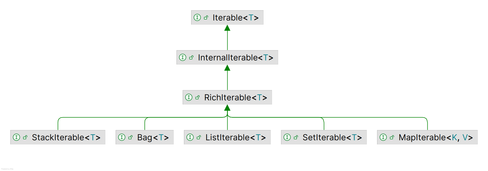

# 迭代范式

2026-08-04⭐
@author Jiawei Mao
***

## 简介

Eclipse Collections (EC) 对 Java 集合框架进行扩展，实现了 Smalltalk 语言中集合的各类迭代范式，如 *select*, *reject*, *collect*, *detect*, *injectInto* 等。

在传统命令式 Java 代码中，迭代依靠 `for`、`while` 循环实现，在循环内编写针对集合元素的业务逻辑。这种写法往往造成大量代码重复。

在 EC 中，业务逻辑被抽象为**代码块**（code block），并作为参数传入迭代方法。各类迭代方法内部遍历集合，并依次将每个元素交给**代码块**处理。在 Java 8+ 中，可以通过 Lambda 表达式与方法引用进行定义定义这类代码块。

> [!IMPORTANT]
>
> 内部迭代范式的核心优势：为标准化迭代模式命名、减少重复代码，从而提升代码可读性。此外，由于迭代实现被封装在对应的集合类型（list, set, map）内部，EC 能够针对不同集合类型的迭代过程做针对性优化。

## 常用迭代范式

以下是 EC 中最常用的迭代范式：

**筛选范式**

- Select：选择
- Reject：删除
- Partition：分区

**转换范式**

- Collect：转换
- FlatCollect：扁平化转换
- GroupBy：分组

**融合范式**

- CollectIf：条件转换
- CountBy：分组统计
- ContainsBy：条件匹配存在判断

**短路范式**

- Detect：查找首个匹配元素
- DetectIfNone：查找首个匹配元素，无匹配返回默认值
- AnySatisfy：存在任一元素满足条件
- AllSatisfy：全部元素满足条件
- NoneSatisfy：全部不满足条件

**通用操作范式**

- ForEach：遍历执行
- InjectInt：整数归约聚合

### Select 与 Reject 范式

>  筛选集合并生成新集合：包括 select、reject 和 partition。

- Select 范式：返回一个新集合，其中包含源集合中满足指定逻辑条件的元素。
- Reject 范式与之相反：返回由不满足条件的元素构成的新集合。

判断条件为单参数代码块形式的布尔表达式，通过 `Predicate` 接口的实现提供。

#### Select 范式示例

示例 1：Select 范式（伪代码）

```java
create <newCollection>
 for each <element> of <collection>
     if condition(<element>)
         add <element> to <newCollection>
```

示例 2：使用 Lambda 表达式实现 Select 范式

```java
MutableList<Integer> greaterThanFifty = list.select(each -> each > 50);
```

示例 3：使用匿名内部类实现 Select 范式

```java
MutableList<Integer> greaterThanFifty =
    list.select(new Predicate<Integer>()
    {
        public boolean accept(Integer each)
        {
            return each > 50;
        }
    });
```

示例 4：使用 `Predicates` 工厂构建 select `Predicate`

```java
MutableList<Integer> greaterThanFifty = list.select(Predicates.greaterThan(50));
```

示例 5：在 Java 8+ Stream 中借助 `Collectors2` 实现 Select 逻辑

```java
MutableList<Integer> greaterThanFifty = list.stream()
    .collect(Collectors2.select(each -> each.intValue() > 50, Lists.mutable::empty));
```

示例 6：命令式 Java 写法实现 Select 范式

```java
List<Integer> greaterThanFifty = Lists.mutable.empty();
for (Integer each : list)
{
    if (each.intValue() > 50)
    {
        greaterThanFifty.add(each);
    }
}
```

#### Reject 范式示例

示例 7：Reject 范式（伪代码）

```java
create <newCollection>
 for each <element> of <collection>
     if not condition(<element>)
         add <element> to <newCollection>
```

示例 8：使用 Lambda 表达式实现 Reject 范式

```java
MutableList<Integer> notGreaterThanFifty =
    list.reject(each -> each > 50);
```

示例 9：通过 `Predicates` 工厂构建 Reject `Predicate`

```java
MutableList<Integer> notGreaterThanFifty =
    list.reject(Predicates.greaterThan(50));
```

示例 10：在 Java 8+ Stream 中借助 `Collectors2` 实现 Reject 范式

```java
MutableList<Integer> notGreaterThanFifty = list.stream()
    .collect(Collectors2.reject(each -> each.intValue() > 50, Lists.mutable::empty));
```

示例 11：命令式 Java 写法实现 Reject 范式

```java
List<Integer> notGreaterThanFifty = Lists.mutable.empty();
for (Integer each : list)
{
    if (each <= 50)
    {
        notGreaterThanFifty.add(each);
    }
}
```

#### Select 与 Reject 方法

以下 EC 方法实现了 Select 范式与 Reject 范式。

```java
select(Predicate): RichIterable
reject(Predicate): RichIterable
```

功能：对集合的每个元素执行断言

- `select` 选取断言返回 `true` 的元素
- `reject` 选取断言返回 `false` 的元素

筛选 / 剔除后的结果将封装为**与原集合类型一致的新集合**进行返回。

```java
select(Predicate, targetCollection): targetCollection
reject(Predicate, targetCollection): targetCollection
```

功能：与单参数的 select /reject 方法功能相同，单结果会添加到指定的目标集合 `targetCollection` 中。

```java
selectWith(Predicate2, argument): RichIterable
rejectWith(Predicate2, argument): RichIterable
```

功能：遍历集合的每个元素时，使用**二元断言（Predicate2）**进行判定，集合元素作为第一个参数，调用者传入另一个参数；筛选后保留的元素，将以**同类型新集合**返回。

```java
selectWith(Predicate2, argument, targetCollection): targetCollection
rejectWith(Predicate2, argument, targetCollection): targetCollection
```

功能：与 `selectWith`/`rejectWith` 方法功能一致，但结果会添加至指定的目标集合 `targetCollection`。

### Partition 范式

> 通过**选择（Select）**与**删除（Reject）**创建两个集合。

分区范式根据元素是否满足断言（Predicate）定义的条件，将集合内的元素分配至两个新集合中的一个。

该范式融合 select 与 reject 范式，两组结果集合会封装在适配源集合类型的 `PartitionIterable` 对象中返回。你可以从 `PartitionIterable` 获取被选中和被剔除的元素。

下面示例将人员列表拆分为成年人列表与未成年人列表。

示例 12：使用 Lambda 表达式实现分区

```java
PartitionMutableList<Person> partitionedFolks =
    people.partition(person -> person.getAge() >= 18);
MutableList<Person> adults = partitionedFolks.getSelected();
MutableList<Person> children = partitionedFolks.getRejected();
```

示例 13：使用匿名内部类实现分区

```java
MutableList<Person> people =...
PartitionMutableList<Person> partitionedFolks = people.partition(
    new Predicate<Person>()
    {
        public boolean accept(Person each)
        {
            return each.getAge() >= 18;
        }
    });
MutableList<Person> adults = partitionedFolks.getSelected();
MutableList<Person> children = partitionedFolks.getRejected();
```

示例 14：借助 `Collectors2.partition` 实现分区的 Java 8 Streams

```java
List<Person> people =...
PartitionMutableList<Person>> partitionedFolks = people.stream()
    .collect(Collectors2.partition(person -> person.getAge() >= 18, PartitionFastList::new)
MutableList<Person> adults = partitionedFolks.getSelected();
MutableList<Person> children = partitionedFolks.getRejected());
```

#### 分区方法

以下 EC 方法实现了分区范式。

```java
partition(Predicate): PartitionIterable
```

功能：返回 `PartitionIterable`，它包含一对逻辑容器。

- 第一个容器包含所有满足断言条件的元素
- 第二个容器包含所有不满足断言条件的元素

`PartitionIterable` 的各个子类型与 `RichIterable` 的子类型一一对应。

```java
partitionWith(Predicate2, argument): PartitionIterable
```

功能：遍历集合中的每个元素，执行**二元断言（Predicate2）**判定，将当前元素作为第一个参数，并传入额外参数；分区后的元素封装为全新的 `PartitionIterable` 对象返回。

### Collect 范式

>  转换集合元素并生成新集合，相关方法包括 `collect`、`flatCollect` 和 `groupBy`。

实现转换范式的方法返回一个新集合，集合内元素由代码块运算得出。也就是说，源集合的每个元素都会映射为新对象，新对象的类型通常与原元素不同。传入 `collect` 系列方法作为参数的代码块需要实现 `Function` 接口。

EC 为转换范式提供两种专用变体：

- 扁平化转换（FlatCollect，亦称 Flatten）
- 分组（GroupBy）模式

和基础转换操作一样，这两类模式对应的方法接收单个 `Function` 作为入参。

示例 15：转换范式（伪代码）

```java
create <newCollection>
 for each <element> of <collection>
     <result> = transform(<element>)
     add <result> to <newCollection>
```

示例 16：使用 Lambda 表达式与方法引用执行转换操作

```java
MutableList<Address> addresses =
    people.collect(person -> person.getAddress());

//or

MutableList<Address> addresses =
    people.collect(Person::getAddress);
```

示例 17：使用匿名内部类执行转换操作

```java
MutableList<Person> people =...;
Function<Person, Address> addressFunction =
    new Function<Person, Address>()
    {
        public Address valueOf(Person person)
        {
            return person.getAddress();
        }
    };
MutableList<Address> addresses = people.collect(addressFunction);
```

**注意**：这里假定集合中每个人仅有一个地址。

如果每个人有多处地址，则 `Function` 对每个人返回一个地址列表（若某人仅有一处地址，该列表只包含一个元素），最终得到的结果是**嵌套列表**。下面是嵌套列表示例。

示例 18：使用 Lambda 表达式与方法引用执行转换操作

```java
MutableList<MutableList<Address>> addresses =
    people.collect(person -> person.getAddresses());

//or

MutableList<MutableList<Address>> addresses =
    people.collect(Person::getAddresses);
```

示例 19：使用匿名内部类执行转换操作

```java
MutableList<Person> people =...;
Function<Person, MutableList<Address>> addressFunction =
    new Function<Person, MutableList<Address>>()
    {
        public MutableList<Address> valueOf(Person person)
        {
            return person.getAddresses();
        }
    };
MutableList<MutableList<Address>> addresses =
    people.collect(addressFunction);
```

示例 20：在 Java 8+ Streams 中借助 `Collectors2` 执行转换操作

```java
MutableList<MutableList<Address>> addresses = people.stream()
    .map(person -> person.getAddresses())
    .collect(Collectors2.toList());

//or

MutableList<MutableList<Address>> addresses = people.stream()
    .collect(Collectors2.collect(Person::getAdddresses, Lists.mutable::empty));
```

示例 21：命令式 Java 写法实现转换模式

```java
List<Address> addresses = Lists.mutable.empty();
for (Person person : people)
{
    addresses.add(person.getAddress());
}

//or for multiple addresses

List<List<Address>> addresses = Lists.mutable.empty();
for (Person person : people)
{
    addresses.add(person.getAddresses());
}
```

#### Collect 方法

以下是 EC 中实现转换范式的方法。

```java
collect(Function): RichIterable
```

功能：遍历集合的每个元素，以当前元素作为参数执行转换函数 `Function`；返回一个元素类型经过转换的新集合。

```java
collectInt(IntFunction): IntIterable
```

功能：与 `collect` 方法类似，但接收 `IntFunction`，返回继承自 `IntIterable` 的基本类型集合。EC 对全部 8 种基本数据类型均提供对应变体方法：`collectBoolean`、`collectFloat` 等等。

```java
collect(Function, targetCollection): targetCollection
```

功能：功能与 `collect` 一致，区别在于转换结果会添加到指定目标集合 `targetCollection`，该集合需实现 `java.util.Collection`。

```java
collectInt(IntFunction, targetCollection): targetCollection
```

功能：功能与 `collectInt` 一致，区别在于转换结果会添加至指定的目标集合 `targetCollection`，目标集合需实现 `MutableIntCollection`。EC 为全部八种基本类型均提供对应的变体方法。

```java
collectIf(Predicate, Function): RichIterable
```

功能：功能与 `collect` 一致，区别在于先以元素为参数执行断言完成筛选，再执行元素转换。

```java
collectWith(Predicate, Function, argument2): RichIterable
```

功能：功能与 `collect` 一致，使用 `Function2` 执行转换，传入元素与额外参数作为两个入参；返回元素类型讲过转换后的新集合。

```java
collectWith(Function2, argument2, targetCollection): targetCollection
```

功能：功能与 `collectWith` 一致，区别在于转换结果会被添加至指定的目标集合。

### FlatCollect 范式

> 从集合元素选取属性构建一个扁平化的线性集合。

扁平化转换（FlatCollect，亦称 Flatten）范式是转换模式（Collect pattern）的一种变体。它从源集合的各个元素中提取属性值，返回单层（即 “扁平化”）集合（非嵌套）。

```java
flatCollect(Function): RichIterable
```

对每个元素执行转换函数 `Function`。该函数必须返回可迭代类型 `Iterable`，并将得到的可迭代对象合并为单一的扁平化集合。

沿用 `collect` 示例中的人员列表，下面演示如何使用 `flatCollect`，配合同一个函数 `addressFunction`，根据列表中人员对象的地址字段生成扁平化列表。

示例 22：伪代码

```java
create <newCollection>
 for each <element> of <collection>
     <results> = transform(<element>)
     Add all <results> to <newCollection>
```

示例23：使用 Lambda 表达式与方法引用实现 FlatCollect

```java
MutableList<Address> flatAddress =
    people.flatCollect(person -> person.getAddresses());

// or

MutableList<Address> flatAddress =
    people.flatCollect(Person::getAddresses);
```

注意：`flatCollect` 与签名相同的 `collect` 方法十分相似：两个方法 入参函数 `Function` 都映射返回`Iterable` 类型。对 `collect` 这是可选形式，但对 `flatCollect` 属于强制要求。两个方法都返回新集合。

二者区别在于：该形式下的 `collect` 生成嵌套集合（元素为 List, Set 或 Bag）；而 `flatCollect` 执行另一套逻辑（在该场景下实用性更强），最终返回扁平化的地址列表。

示例 24：使用匿名内部类实现 FlatCollect

```java
MutableList<Address> addresses =
    people.flatCollect(
       new Function<Person, MutableList<Address>>()
       {
           public MutableList<Address> valueOf(Person person)
           {
               return person.getAddresses();
           }
       });
```

示例 25. 在 Java 8+ 中使用 `Collectors2` 实现 FlatCollect

```java
MutableList<Address> flatAddress = people.stream()
    .collect(Collectors2.flatCollect(Person::getAddresses, Lists.mutable::empty));
```

示例 26. 命令式 Java 实现 FlatCollect

```java
List<Address> addresses = Lists.mutable.empty();
for (Person person : people)
{
    addresses.addAll(person.getAddresses());
}
```

### GroupBy 范式

> 分组范式使用选择或生成的 key 对集合元素分组，创建一个 Multimap。

分组范式将集合中的元素收集到一种类似的 map 的容器 `Multimap` 中，该容器支持一个 key 关联多个值。`Function` 对每个元素执行转换，将返回的结果作为 key，使用 key 将元素存入 Multimap。

```java
groupBy(Function): Multimap
```

将元素分组存入一个新的 `Multimap`，使用 `Function` 获取每个元素的 key。

```java
groupBy(Function, targetMultimap) : targetMultimap
```

功能与 `groupBy` 类似，区别在于分组结果会添加到指定的 targetMultimap。

```java
groupByEach(Function): Multimap
```

逻辑与 `groupBy` 类似，区别在于 `Function` 可为一个元素生成多个 keys，返回的 `Multimap` 包含所有的键值对。

### 短路范式

> 校验集合是否满足逻辑条件的方法：`detect`, `anySatisfy`, `allSatisfy`。

短路范式包括查找（`detect`）、任一满足（`anySatisfy`）和全部满足（`allSatisfy`）。之所以命名为短路范式，是因为这类方法在达成特定条件后立刻终止遍历。每次迭代都会执行断言，当判断结果达到目标，立即停止遍历并返回对应结果。

#### Detect 范式

> 查找并返回第一个满足指定逻辑表达式的元素。

`detect` 方法返回第一个满足断言条件的元素。如果遍历完集合所有元素，没有元素满足条件，则返回 `null`。

示例 27. 查找范式（伪代码）

```java
for each <element> of <collection>
  if condition(<element>)
    return <element> // and end process
```

示例 28. 使用 Lambda 表达式实现查找范式

```java
Integer result =
    list.detect(each -> each > 50);
```

示例 29. 借助 Predicates 工厂实现查找范式

```java
Integer result =
    list.detect(Predicates.greaterThan(50));
```

示例 30. Java 8+ 流实现查找范式

```java
Integer result =
    list.stream().findAny(each -> each > 50).get();
```

示例 31. 命令式 Java 实现查找范式

```java
for (int i = 0; i < list.size(); i++)
{
    Integer v = list.get(i);
    if (v.intValue() > 50)
    {
        return v;
    }
}
return null;
```

##### Detect 方法

```
detect(Predicate): element
```

返回首个满足 `Predicate` 的元素；若无任何元素满足条件，则返回 `null`。

```
detectIfNone(Predicate, Function0): element (or Function0 result)
```

同 `detect`，区别在于：当没有元素满足 `Predicate` 时，执行 `Function0` 并返回其结果。

```
detectWith(Predicate2, parameter): element
```

返回首个结合元素与传入参数执行 `Predicate2` 判定为 `true` 的 元素；全部元素判定不满足则返回 `null`。

```
detectWithIfNone(Predicate2, parameter, Function0): element (or Function0 result)
```

功能与 `detectWith` 一致，区别在于：若没有元素使 `Predicate2` 返回 `true`，则执行 `Function0` 并返回其结果。

#### AnySatisfy 范式

> 判断集合中是否存在任意元素满足指定逻辑表达式。

AnySatisfy 范式用于判定集合中是否存在元素符合 `Predicate` 条件。该方法依次对每个元素执行断言判断；如果断言返回 `true`，立刻终止遍历并返回 `true`。若遍历全部元素后不满足条件，则返回 `false`。

示例 32. 用伪代码实现 AnySatisfy

```java
for each <element> of <collection>
     if condition(<element>)
         return true  // and end process
 otherwise return false
```

示例 33. 使用 Lambda 表达式实现 AnySatisfy

```java
boolean result =
    list.anySatisfy(num -> num > 50);
```

示例 34. 使用 `Predicates` 工厂实现 AnySatisfy

```java
boolean result =
    list.anySatisfy(Predicates.greaterThan(50));
```

示例 35. Java 8+ Streams 实现 AnySatisfy

```java
boolean result =
    list.stream().anyMatch(num -> num > 50);
```

示例 36. 命令式 Java 实现 AnySatisfy

```java
for (int i = 0; i < list.size(); i++)
{
    Integer v = list.get(i);
    if (v.intValue() > 50)
    {
        return true;
    }
}
return false;
```

##### AnySatisfy 方法

```
anySatisfy(Predicate): boolean
```

若集合中存在任意元素使 `Predicate` 返回 true，则返回 true；否则（集合为空时同样）返回 false。

```
anySatisfyWith(Predicate2, parameter): boolean
```

若集合中存在任意元素，结合传入参数执行 `Predicate2` 得到 true，则返回 true；否则（集合为空时同样）返回 false。

#### AllSatisfy 范式

> 判断集合中的所有元素是否均满足指定逻辑表达式。

AllSatisfy 范式是 AnySatisfy 的反向逻辑，用于校验是否所有元素都符合断言条件。方法对每个元素执行`Predicate`；一旦断言返回 `false`，立即终止遍历并返回 `false`。若完成全部元素校验且均满足条件，则返回 `true`。

示例 37. AllSatisfy 的伪代码实现

```
for each <element> of <collection>
     if not condition(<element>)
         return false  // and end process
 otherwise return true
```

示例 38. AllSatisfy 的 Lambda 表达式实现

```java
boolean result =
    list.allSatisfy(each -> each > 50);
```

示例 39. AllSatisfy 的 `Predicates` 工厂实现

```java
boolean result =
    list.allSatisfy(Predicates.greaterThan(50));
```

示例 40. AllSatisfy 的 Java 8+ Streams 实现

```java
boolean result =
    list.stream().allMatch(each -> each > 50);
```

示例 41. AllSatisfy 的 命令式 Java 实现

```java
for (int i = 0; i < list.size(); i++)
{
    Integer v = list.get(i);
    if (v.intValue() <= 50)
    {
        return false;
    }
}
return true;
```

> [!TIP]
>
> NoneSatisfy 与 AllSatisfy 类似，但会对断言结果取反。即没有任何元素满足断言条件时返回 true。若集合为空，同样返回 true。

##### AllSatisfy 方法

```java
allSatisfy(Predicate): boolean
```

若集合所有元素都使 `Predicate` 返回 `true`，则返回 true；其余情况（包含集合为空）返回 `false`。

```java
allSatisfyWith(Predicate2, parameter): boolean
```

若集合所有元素结合传入参数执行 `Predicate2` 均返回 `true`，则返回 `true`；其余情况（包含集合为空）返回 `false`。

```java
noneSatisfy(Predicate): boolean
```

若所有元素都使断言返回 `false`，或集合为空，则返回 `true`；否则返回 `false`。

```java
noneSatisfyWith(Predicate2, parameter): boolean
```

若所有元素结合传入参数执行 `Predicate2` 均返回 `false`，或集合为空，则返回 `true`；否则返回 `false`。

### ForEach 方式

> 对集合中的每个元素执行指定操作。

ForEach 范式是适用于所有集合类型的最基础迭代操作。与其他范式不同，ForEach 范式对应的方法会遍历集合的每一个元素，**方法本身没有返回值**。

在 EC 中，`each` 和 `forEach` 方法可以直接替代 Java 的 for 循环。它会对每个元素执行 Procedure 中的逻辑。

示例 42. ForEach 范式的伪代码实现

```
for each <element> of <collection>
     evaluate(<element>)
```

示例 43. 使用 Lambda 表达式实现 ForEach 范式

```java
list.each(each -> doSomething(each));

// or

list.forEach(each -> doSomething(each));
```

示例 44. 使用匿名内部类实现 ForEach 范式

```java
list.each(new Procedure()
{
    public void value(Object each)
    {
        doSomething(each);
    }
});
```

示例 45. 命令式 Java 实现 ForEach 范式

```java
for (int i = 0; i < list.size(); i++)
{
    this.doSomething(list.get(i));
}
```

#### each 与 forEach 方法

```java
each(Procedure): void
```

依次处理每个元素，将元素作为实参传入 `Procedure` 执行。

```java
forEach(Procedure): void
```

依次处理每个元素，将元素作为实参传入 `Procedure` 执行。

```java
forEachIf(Predicate, Procedure): void
```

仅对满足 `Predicate` 断言条件的元素执行 `Procedure`。

```java
forEach(fromIndex, toIndex, Procedure): void
```

遍历 `ListIterable` 指定索引区间内的元素（首尾索引均包含）。

```java
forEachWith(Procedure2, parameter): void
```

遍历集合每个元素，将元素作为第一个参数、传入的额外参数作为第二个参数执行 `Procedure2`。

```java
forEachWithIndex(ObjectIntProcedure): void
```

遍历集合，将元素以及对应的整型索引传入 `ObjectIntProcedure`。

```java
forEachWithIndex(fromIndex, toIndex, ObjectIntProcedure): void
```

遍历列表指定索引区间内的元素（首尾索引均包含）。

### InjectInto 范式

> 迭代过程中持续计算并保存中间累积值，将每一轮的计算结果作为下一轮迭代的入参。
>
> 等同于 java Stream 中的 reduce 操作。

InjectInto 范式用于把单次迭代的计算结果传递给下一轮迭代作为输入。该范式对应的 `injectInto` 方法接收一个初始值作为入参。该初始值作为双参数代码块的第一个参数；集合迭代过程中的当前元素作为第二个参数。

每一轮迭代完成后，代码块的执行结果会传递至下一轮迭代，充当代码块的第一个参数（累积值），新一轮的当前元素作为第二个参数。全部迭代结束后，`injectInto()` 方法返回代码块运算得到的最终累积结果。

示例 46. InjectInto 范式的伪代码实现

```
set <result> to <initialvalue>
 for each <element> of <collection>
     <result> = apply(<result>, <element>)
 return <result>
```

示例 47. 使用 Lambda 表达式与方法引用实现 InjectInto 范式

```java
Integer result =
    Lists.mutable.of(1, 2).injectInto(3, (result, each) -> result + each);

// or

Integer result =
    Lists.mutable.of(1, 2).injectInto(3, Integer::sum);
```

示例 48. 使用静态类实现 InjectInto 范式

```java
Integer result =
    Lists.mutable.of(1, 2).injectInto(3, AddFunction.INTEGER);
```

示例 49. Java 8 流中使用 Lambda 表达式与方法引用实现 InjectInto 范式

```java
Integer result =
    Lists.mutable.of(1, 2).stream().reduce(3, (result, each) -> result + each);

// or

Integer result =
    Lists.mutable.of(1, 2).stream().reduce(3, Integer::sum);
```

示例 50. 命令式 Java 实现 InjectInto 范式

```java
List<Integer> list = Lists.mutable.of(1, 2);
int result = 3;
for (int i = 0; i < list.size(); i++)
{
    Integer v = list.get(i);
    result = result + v.intValue();
}
```

#### InjectInto 方法

```java
injectInto(injectedValue, Function2): (final result)
```

遍历集合每个元素进行运算，将上一轮迭代的运算结果与当前元素作为参数传入函数进行计算，最终返回汇总结果。

```java
injectInto(floatValue, FloatObjectToFloatFunction): float
```

遍历集合每个元素进行运算，将上一轮迭代结果与当前元素作为参数参与计算。初始传入值与运算结果均为基础类型 `float`。

```java
injectInto(intValue, IntObjectToIntFunction): int
```

遍历集合每个元素进行运算，将上一轮迭代结果与当前元素作为参数参与计算。初始传入值与运算结果均为基础类型 `int`。

```java
injectInto(longValue, LongObjectToLongFunction): long
```

遍历集合每个元素进行运算，将上一轮迭代结果与当前元素作为参数参与计算。初始传入值与运算结果均为基础类型 `long`。

```java
injectInto(doubleValue, DoubleObjectToDoubleFunction): double
```

遍历集合每个元素进行运算，将上一轮迭代结果与当前元素作为参数参与计算。初始传入值与运算结果均为基础类型 `double`。

## RichIterable

>  该接口定义了 Eclipse Collections 容器类型支持的各类迭代范式。

`RichIterable` 是 EC 中最重要的接口，它为所有**非变更型迭代范式**提供基础规范。它代表由若干元素组成、能够逐个依次访问或运算的对象（即 iterable），同时规定每次元素运算可执行的操作（迭代范式）。最常用的实现类包括 `FastList` 和 `UnifiedSet`。

`RichIterable` 的子接口如下图所示。存储键值对的 `MapIterable`，其值集合同样是一个 `RichIterable`。（注意：`Multimap` 及其子接口拥有独立的 API。）



`RichIterable` 同时被 `MutableCollection` 继承，并经由 `MutableList`、`MutableSet` 间接扩展（这两个接口同时继承 Java 原生可变集合接口 `List`、`Set`）。另有子接口用于定义非 JDK 标准容器 `MutableBag`（多重集合）；还有 `ImmutableCollection`，用来划分 EC 各类容器的不可变实现。

子接口 `LazyIterable` 在很大程度上复刻了 `RichIterable` 的接口定义，但重写了部分会返回集合的方法：`collect`、`collectIf`、`select`、`reject`、`flatCollect`。这些方法会**延迟执行**，直到使用返回集合时才触发计算，该机制称为 “惰性迭代”。

### Lazy iteration

> 延迟运算：在真正需要结果时才执行。

惰性迭代（lazy iteration）是一种优化范式：调用迭代方法时并不会立刻执行逻辑，直到后续方法需要使用该操作的执行动作或返回结果时，才真正开始运算。实际应用中，该机制的目的是避免不必要的运算、内存占用以及临时对象创建，只在确有需求时才执行。

惰性迭代通过 `asLazy` 方法为当前 `RichIterable` 集合创建适配器实现：

```java
richIterable.asLazy()
```

该返回返回具备延迟求值特性的 `LazyIterable` 对象。

惰性迭代与短路迭代范式相辅相成。短路迭代指一旦达成方法目标就立刻终止遍历。如下例最后一行，`anySatisfy` 在 `collect` 生成的地址列表中找到 "address2" 元素后便停止执行；列表中存在的第三个元素（address3）永远不会被 `anySatisfy` 检查。

示例 51. 使用匿名内部类实现 anySatisfy 与 collect

```java
Person person1 = new Person(address1);
Person person2 = new Person(address2);
Person person3 = new Person(address3);
MutableList<Person> people =
    Lists.mutable.with(person1, person2, person3);
MutableList<MutableList<Address>> addresses =
    people.collect(addressFunction);
Assert.assertTrue(addresses.anySatisfy(Predicates.equal(address2)));
```

三个元素多检查一个或许无关紧要，但如果 people 是一个超长列表（或是 stream 对象），在不启用惰性迭代时，`anySatisfy` 需要等待 `collect` 方法完成运算，生成一个规模同样庞大的临时集合，而最终只会检查该临时集合的前两个元素。

若为 people 应用惰性迭代适配器，`collect` 的遍历逻辑将会服从 `anySatisfy` 的遍历节奏：只会对 `anySatisfy` 所需的元素执行转换收集操作。

示例 52. 使用 `Predicates` 工厂实现 anySatisfy 与 collect

```java
MutableList<Person> people = Lists.mutable.with(person1, person2, person3);
LazyIterable<Person> lazyPeople = people.asLazy();
LazyIterable<Address> addresses = lazyPeople.collect(addressFunction);
Assert.assertTrue(addresses.anySatisfy(Predicates.equal(address2)));
```

示例 53. 使用 Lambda 表达式与方法引用实现惰性迭代

```java
LazyIterable<Person> lazyPeople = people.asLazy();
LazyIterable<Address> addresses =
    lazyPeople.flatCollect(person -> person.getAddresses());

//or

LazyIterable<Address> addresses =
    lazyPeople.flatCollect(Person::getAddresses);
```

**注意**：以下 EC 方法会**隐式返回惰性可迭代类型**。

#### MutableMap 实现类中的惰性可迭代对象

```java
valuesView() : RichIterable
```

集合值的**不可修改视图**。

```java
keysView() : RichIterable
```

集合键集的**不可修改视图**。

```java
keyValuesView() : RichIterable
```

集合条目集（键值对）的**不可修改视图**。

#### Multimap 实现类中的惰性可迭代对象

```java
keyMultiValuePairsView() : RichIterable
```

由键与多值组合构成条目的不可修改视图。

```java
keysView() : RichIterable
```

不重复键组成的不可修改视图。

```java
keyValuePairsView() : RichIterable
```

键值配对条目的不可修改视图。

```java
multiValuesView() : RichIterable
```

仅包含每个键对应的值集合（不含键）的不可修改视图。

### Parallel-lazy iteration

>  一套融合并行迭代与延迟求值特性的 API。

`ParallelIterate` 工具类执行**并行立即求值**；串行延迟求值由 `LazyIterable` 提供，也就是调用 `RichIterable.asLazy()` 返回的视图。

`ParallelIterable` 接口定义了一种同时具备并行、惰性两大特性的迭代视图。调用各类集合实现的 `asParallel(ExecutorService executorService, int batchSize)` 方法，将会返回 `ParallelIterable` 的子接口实例。`ParallelIterable` API 自 5.0 版本新增，带有 `@Beta` 注解，属于实验性功能。标记为 `@Beta` 的 API 可能在小版本更新时发生不兼容变更，无法保证向后兼容。在 5.0 版本中，`asParallel` 方法并未定义在 `RichIterable` 这类顶层接口上，仅部分受支持的集合提供该方法，如 `FastList`、`UnifiedSet`。

```java
FastList integers = Lists.mutable.with(1, 2, 3, 4, 5, 6, 7, 8, 9);
ExecutorService threadPool =
  Executors.newFixedThreadPool(Runtime.getRuntime().availableProcessors());
int batchSize = 2;
ParallelListIterable parallelListIterable =
  integers.asParallel(threadPool, batchSize);
// deferred evaluation
ParallelListIterable evenNumbers =
  parallelListIterable.select(each -> each % 2 == 0);
// deferred evaluation
ParallelListIterable evenStrings =
  evenNumbers.collect(Object::toString);
// forced evaluation
MutableList strings = evenStrings.toList();
threadPool.shutdown();
Assert.assertEquals(Lists.mutable.with("2", "4", "6", "8"), strings);
```

在本段代码示例中，`select` 和 `collect` 的调用均为惰性执行 —— 判断依据是二者返回 `ParallelIterable` 的子类。调用 `toList()` 会触发实际运算。

`asParallel(ExecutorService executorService, int batchSize)` 接收两个参数，用于对并行执行进行配置。

- **executorService（线程池）**

该代码示例创建了一个线程池，每个 CPU 核心分配一条线程，这种配置适合**CPU 密集型任务**。面向 IO 密集型任务的线程池可设置为无上限，或者为每一份 IO 资源分配一条线程（例如，每个数据库连接对应一条线程）。多次调用 `asParallel` 时，通常建议**复用同一个线程池**。

- **batchSize（批次大小）**

批次大小决定底层集合（`FastList` 或 `UnifiedSet`）中，分配给线程池内单个任务处理的元素数量。

对于 CPU 密集型任务，合适的批次规模通常更大，推荐区间：10000 ~ 100000。

#### 性能

与延迟求值机制类似，无法保证并行惰性求值一定优于普通的串行立即求值。需要搭配合适的线程池、尝试不同批次大小开展性能测试验证。

#### 可取消特性

正在运行的并行惰性计算支持取消操作。该特性要求使用**可关闭的线程池**，因此这类线程池一般不建议在多项计算任务之间共享。取消操作还需要一条能够访问该线程池的执行线程。基于前面的示例，只需将 `evenStrings.toList()` 放到后台线程执行。之后主线程可以调用`threadPool.shutdownNow()`，该操作会令 `toList()` 快速终止并抛出异常。

关闭线程池**不会中断正在执行的批次任务**，但不会再启动任何新的批次。

### RichIterable 方法

所有 `RichIterable` 的实现类都提供下列方法。

#### 构建字符串

> 用于将集合元素转换为字符串，并可输出至流或缓冲区。

`makeString` 方法将调用方 `RichIterable` 集合输出为 `String` 对象。元素转换规则等同于 `String.valueOf(Object)`。可以指定首尾分隔字符串（默认均为空字符串），以及元素之间的分隔符（默认为逗号加空格）。

```java
makeString(startString, separatorString, endString): String
```

生成集合的字符串表示，元素迭代顺序与迭代器一致；整体以 `startString`、`endString` 包裹，元素之间使用 `separatorString` 分隔。

```java
makeString(separatorString): String
```

效果同上，不添加首尾包裹字符串。

```java
makeString(): String
```

使用默认分隔符 `, `（逗号 + 空格），无首尾包裹字符串。

示例 54. makeString

```java
MutableList<Integer> list = Lists.mutable.with(1, 2, 3);
String myDelim = list.makeString("[", "/", "]"); // "[1/2/3]"
String mySeper = list.makeString("/"); // "1/2/3"
String defaultString = list.makeString(); //"1, 2, 3"
```

示例 55. 在 Java 8+ Stream 中构建字符串

```java
MutableList<Integer> list = Lists.mutable.with(1, 2, 3);
String myDelim =
    list.stream().map(Object::toString).collect(Collectors.joining("/", "[", "]")); // "[1/2/3]"
String mySeper =
    list.stream().map(Object::toString).collect(Collectors.joining("/")); // "1/2/3"
String defaultString =
    list.stream().map(Object::toString).collect(Collectors.joining()); // "1/2/3"
```

示例 56. 使用 `Collectors2` 在 Java 8+ Stream 构建字符串

```java
MutableList<Integer> list = Lists.mutable.with(1, 2, 3);
String myDelim =
    list.stream().collect(Collectors2.makeString("[", "/", "]")); // "[1/2/3]"
String mySeper =
    list.stream().collect(Collectors2.makeString("/")); // "1/2/3"
String defaultString =
    list.stream().collect(Collectors2.makeString()); // "1/2/3"
```

`appendString` 参数形式与 `makeString` 类似，但不返回字符串，而是将集合的字符串形式直接写入 Java `Appendable` 对象（例如 `PrintStream`、`StringBuilder`、`StringBuffer`），方法返回值为 `void`。

```java
appendString(Appendable, startString, separatorString, endString): void
```

使用指定首尾字符串与分隔符，将集合字符串追加到目标 `Appendable`。

```java
appendString(Appendable, separatorString): void
```

使用指定分隔符，无首尾包裹字符串。

```java
appendString(Appendable): void
```

使用默认分隔符 `, `，无首尾包裹字符串。

示例 57. appendString

```java
MutableList<Integer> list = Lists.mutable.with(1, 2, 3);
Appendable myStringBuilder = new StringBuilder();
list.appendString(myStringBuilder, "[", "/", "]"); //"[1/2/3]");
```

#### 元素计数

> 统计满足条件的元素总数。

`count` 与 `countWith` 用于计算集合中满足断言的元素数量。`countWith` 额外接收一个参数，在判断元素时作为第二个入参传入断言。

```java
count(Predicate): int
```

返回满足 `Predicate` 的元素数量。

示例 58. Lambda 写法的 count

```java
int count =
    people.count(person -> person.getAddress().getState().getName().equals("New York"));
```

示例 59. 匿名内部类写法的 count

```java
int count =
    people.count(new Predicate<Person>()
    {
      public boolean value(Person person)
      {
        return person.getAddress().getState().getName().equals("New York");
      }
    });
```

```java
countWith(Predicate2, parameter): int
```

返回满足 `Predicate2` 的元素数量；第二个入参会直接传给 `Predicate2` 作为第二个参数。

示例 60. 使用 `Predicates2` 工厂实现 count

```java
int count =
    lastNames.countWith(Predicates2.equal(), "Smith");
```

以下方法获取集合总大小或判断集合是否为空：

```java
size() : int
```

返回集合内元素总数。

```java
isEmpty() : boolean
```

集合无元素返回 true。

```java
notEmpty() : boolean
```

集合至少存在一个元素返回 true。

#### 查找元素

`getFirst`、`getLast` 分别返回集合第一个、最后一个元素。对于 `List`，对应下标首位、末尾元素；其他集合则返回迭代器遍历得到的首尾元素。集合为空时两个方法均返回 `null`；若集合允许存储 null，建议先用 `isEmpty()` 判断空集合。

> [!NOTE]
>
> 基于哈希的 `Set` 不存在固定顺序，`getFirst/getLast` 结果不确定。

```java
getFirst(): element
```

返回可迭代集合的首个元素。

```java
getLast(): element
```

返回可迭代集合的末尾元素。

不带参数的 `min`、`max` 通过元素**自然排序**（调用 `compareTo()`）获取最大或最小元素。

```java
max(): element
```

基于自然排序返回最大值元素。

```java
min(): element
```

基于自然排序返回最小值元素。

示例 61. max 和 min

```java
RichIterable<Integer> iterable = Lists.mutable.with(5, 4, 8, 9, 1);
Assert.assertEquals(Integer.valueOf(9), iterable.max());
Assert.assertEquals(Integer.valueOf(1), iterable.min());
```

如果集合内任意元素未实现 `Comparable`，调用会抛出 `ClassCastException`。

```java
RichIterable<Object> iterable = Lists.mutable.with(5, 4, 8, 9, 1, new Foo());
iterable.max(); // throws ClassCastException
```

`min`、`max` 支持重载版本，接收 `Comparator` 自定义比较规则：

```java
max(Comparator): element
```

根据比较器返回最大元素。

```java
min(Comparator): element
```

根据比较器返回最小元素。

示例 62. 传入比较器的 max/min

```java
public class SillyWalk
{
  public final int wiggles;

  public SillyWalk(int wiggles)
  {
    this.wiggles = wiggles;
  }
}
```

```java
private static final Comparator<SillyWalk> SILLY_WALK_COMPARATOR =
    new Comparator<SillyWalk>()
    {
      public int compare(SillyWalk o1, SillyWalk o2)
      {
        return o1.wiggles - o2.wiggles;
      }
    };
SillyWalk sillyWalk2 = new SillyWalk(2);
SillyWalk sillyWalk3 = new SillyWalk(3);
RichIterable<SillyWalk> walks = Lists.mutable.with(sillyWalk2, sillyWalk3);
Assert.assertEquals(sillyWalk3,walks.max(SILLY_WALK_COMPARATOR));
Assert.assertEquals(sillyWalk2,walks.min(SILLY_WALK_COMPARATOR));
```

配套方法 `minBy` / `maxBy` 接收 `Function`，根据函数提取**属性的自然顺序**求取最值元素：

```java
maxBy(Function): element
```

对每个元素执行 `Function`，依据返回结果选出原始集合最大元素。

```java
minBy(Function): element
```

对每个元素执行函数，依据返回结果选出原始集合最小元素。

示例 63. 使用方法引用实现 `minBy`（获取年龄最小的人）

```java
Person alice = new Person("Alice", 40);
Person bob = new Person("Bob", 30);
Person charlie = new Person("Charlie", 50);
MutableList<Person> people = Lists.mutable.with(alice, bob, charlie);
Assert.assertEquals(bob, people.minBy(Person::getAge));
```

下面两种写法等价，`minBy` 写法更加简洁：

```java
people.minBy(Person::getAge);
people.min(Comparators.byFunction(Person::getAge));
```

#### 元素聚合

> 根据计算得到的键分组，生成聚合结果 map。

`aggregateBy`：使用 `Function` 对 `RichIterable` 元素分组；同一键的所有元素通过 `Function2` 完成聚合。第三个参数 `Function0` 提供每组聚合初始值。

概念等价逻辑：先用 `groupBy` 生成 `Multimap`，再对每个分组调用 `injectInto`，最终得到 `MapIterable`。

`aggregateInPlaceBy` 与 `aggregateBy` 类似，但**直接修改 map 内的值对象而非替换**，因此聚合对象必须支持可变操作。

```java
aggregateBy(Function, Function0, Function2): MapIterable
```

通过分组函数生成键，执行聚合运算，返回 `MapIterable`。

示例 64. Lambda 与方法引用写法 `aggregateBy`

```java
FastList<Integer> integers = FastList.newListWith(1, 1, 1, 2, 2, 3);
MutableMap<Integer, Integer> aggregation =
integers.aggregateBy(
        integer -> integer % 2,
        () -> 0,
        Integer::sum);
Assert.assertEquals(4, aggregation.get(0).intValue());
Assert.assertEquals(6, aggregation.get(1).intValue());
```

示例 65. 匿名内部类写法 `aggregateBy`

```java
Function0<Integer> factory = new Function0<Integer>()
{
    public Integer value()
    {
        return Integer.valueOf(0);
    }
};
Function2<Integer, Integer, Integer> sumAggregator =
new Function2<Integer,
        Integer, Integer>()
{
    public Integer value(Integer aggregate, Integer value)
    {
        return aggregate + value;
    }
};
Function<Integer, Integer> groupBy =
new Function<Integer, Integer>()
{
    public Integer valueOf(Integer integer)
    {
        return integer % 2;
    }
};
FastList<Integer> integers = FastList.newListWith(1, 1, 1, 2, 2, 3);
MutableMap<Integer, Integer> aggregation = integers.aggregateBy(groupBy, factory, sumAggregator);
Assert.assertEquals(4, aggregation.get(0).intValue());
Assert.assertEquals(6, aggregation.get(1).intValue());
```

```java
aggregateInPlaceBy(Function, Function0, Function2): MapIterable
```

分组就地聚合，返回映射结果。

示例 66. Lambda 与方法引用写法 `aggregateInPlaceBy`

```java
FastList<Integer> integers = FastList.newListWith(1, 1, 1, 2, 2, 3);
MutableMap<Integer, AtomicInteger> aggregation =
integers.aggregateInPlaceBy(
        integer -> integer % 2,
        () -> new AtomicInteger(0),
        AtomicInteger::addAndGet)
Assert.assertEquals(4, aggregation.get(0).intValue());
Assert.assertEquals(6, aggregation.get(1).intValue());
```

示例 67. 匿名内部类写法 aggregateInPlaceBy

```java
Function0<AtomicInteger> factory = new Function0<AtomicInteger>()
{
    public AtomicInteger value()
    {
        return new AtomicInteger(0);
    }
};
Procedure2<AtomicInteger, Integer> sumAggregator = new Procedure2<AtomicInteger, Integer>()
{
    public void value(AtomicInteger aggregate, Integer value)
    {
        aggregate.addAndGet(value);
    }
};
Function<Integer, Integer> groupBy =
new Function<Integer, Integer>()
{
    public Integer valueOf(Integer integer)
    {
        return integer % 2;
    }
};
FastList<Integer> integers = FastList.newListWith(1, 1, 1, 2, 2, 3);
MutableMap<Integer, AtomicInteger> aggregation = integers.aggregateInPlaceBy(groupBy, factory, sumAggregator);
Assert.assertEquals(4, aggregation.get(0).intValue());
Assert.assertEquals(6, aggregation.get(1).intValue());
```

#### 使用 chunk、zip 创建集合

> 对单个 / 多个集合元素进行分组、配对。

`chunk`：将集合元素拆分为多个固定大小的子集合；如果总元素不能均分，最后一个分组尺寸更小。

```java
chunk(size): RichIterable
```

把源集合元素分批，每批最多 `size` 个元素；剩余不足一批的元素组成最后一个分组。

示例 68. chunk

```java
MutableList<Integer> list =
    Lists.mutable.with(1, 2, 3, 4, 5, 6, 7, 8, 9, 10);
RichIterable<RichIterable<Integer>> chunks = list.chunk(4);
System.out.println(chunks);
```

输出：

```
[[1, 2, 3, 4], [5, 6, 7, 8], [9, 10]]
```

`zip` 将两个 `RichIterable` 对应位置元素两两配对。两个集合长度不一致时，较长集合多出的元素直接丢弃。`zipWithIndex` 是特殊的 zip，将元素与其下标索引配对（索引从 0 开始）。

```java
zip(RichIterable): RichIterable
```

将当前集合与传入集合对应元素组合成 `Pair`；较长集合尾部多余元素忽略。

示例 69. zip

```java
MutableList<String> list1 = Lists.mutable.with("One", "Two", "Three", "Truncated");
MutableList<String> list2 = Lists.mutable.with("Four", "Five", "Six");
MutableList<Pair<String, String>> pairs = list1.zip(list2);
System.out.println(pairs);
```

输出：

```
[One:Four, Two:Five, Three:Six]
```

```java
zipWithIndex(): RichIterable
```

元素与下标索引配对组成新集合。

示例 70. zipWithIndex

```java
MutableList<String> list = Lists.mutable.with("One", "Two", "Three");
MutableList<Pair<String, Integer>> pairs = list.zipWithIndex();
System.out.println(pairs);
```

输出：

```
[One:0, Two:1, Three:2]
```

#### 复用代码块

> 在循环或其他迭代范式中使用 `selectWith`、`rejectWith`、`collectWith`；代码块可以在循环外创建，甚至可以定义为静态对象实现复用。

`collect`、`select`、`reject` 这类返回集合的迭代方法，接收单参数代码块。这些方法的变体方法：`collectWith`、`selectWith`、`rejectWith`。

同样，返回布尔值的短路方法 `detect`、`anySatisfy`、`allSatisfy`、`noneSatisfy` 都存在以 `With` 结尾的重载版本，全部定义在 `RichIterable` 及其子接口。

所有 `xxxWith` 方法接收两个参数：

1. 第一个入参为当前遍历元素
2. 第二个入参为外部传入对象

```java
selectWith(Predicate2, argument): RichIterable;
rejectWith(Predicate2, argument): RichIterable;
```

遍历集合，`Predicate2` 使用【当前元素 + 外部传入参数】进行判断；筛选 / 排除后的元素存入同类型新集合返回。

```java
collectWith(Predicate2, argument): RichIterable
```

与 `collect` 功能类似，但函数接收两个参数；返回相同尺寸、元素经过转换的新集合。

> [!NOTE]
>
> `xxxWith` 系列方法与普通方法逻辑完全一致。虽然写法略冗长，但带来性能优化：**同一个代码块实例可以搭配不同外部参数重复使用，减少对象创建开销**。

示例：筛选成年人，分别展示传统 Java 命令式写法、普通 select、selectWith。

示例 71. 命令式 Java 实现 Select 模式

```java
List<Person> people =...;
List<Person> adults = Lists.mutable.empty();
for (Person person : people)
{
  if (person.getAge() >= 18)
  {
    adults.add(person);
  }
}
```

示例 72. Lambda 实现 select

```java
MutableList<Person> people =...;
MutableList<Person> adults =
    people.select(each -> each.getAge() >= 18);
```

示例 73. 匿名内部类实现 select

```java
MutableList<Person> people =...;
MutableList<Person> adults = people.select(
    new Predicate<Person>()
    {
      public boolean accept(Person each)
      {
        return each.getAge() >= 18;
      }
    });
```

改用 `selectWith` 实现相同逻辑：

示例 74. Lambda / 方法引用写法 selectWith

```java
MutableList<Person> people =...;
MutableList<Person> adults =
    people.selectWith((eachPerson, age) -> eachPerson.getAge() > age, 18);

// or

MutableList<Person> adults =
    people.selectWith(Person::isOlderThan, 18);
```

示例 75. 匿名内部类写法 selectWith

```java
MutableList<Person> people =...;
MutableList<Person> adults = people.selectWith(
    new Predicate2<Person, Integer>()
    {
      @Override
      public boolean accept(Person eachPerson, Integer age)
      {
        return eachPerson.getAge() > age;
      }
    }, 18);
```

单次筛选场景下，使用 `selectWith` 没有优势；将年龄抽成第二个参数的通用性显得多余。

但如果需要使用多个年龄阈值筛选，优势就体现出来：**复用同一个 Predicate2 对象，减少临时对象产生**。

示例 76. 复用 Predicate2

```java
MutableList<Person> people =...;
Predicate2<Person, Integer> agePredicate =
    new Predicate2<Person, Integer>()
    {
      @Override
      public boolean accept(Person eachPerson, Integer age)
      {
        return eachPerson.getAge() > age;
      }
    };
MutableList<Person> drivers = people.selectWith(agePredicate, 17);
MutableList<Person> voters = people.selectWith(agePredicate, 18);
MutableList<Person> drinkers = people.selectWith(agePredicate, 21);
```

`collectWith`、`selectWith`、`rejectWith` 非常适合搭配**方法引用**：

示例 77. 方法引用配合 selectWith

```java
MutableList<Person> drivers = people.selectWith(Person::isOlderThan, 17);
MutableList<Person> voters = people.selectWith(Person::isOlderThan, 18);
MutableList<Person> drinkers = people.selectWith(Person::isOlderThan, 21);
```

这种编码风格鼓励把业务行为封装到容器存储的实体类中；Java 8+ 所有 `xxxWith` 系列方法均支持该写法。

## Map 迭代方法

> `Map` 与 `Multimap` 的迭代相关方法

`MapIterable` 和 `Multimap` 接口属于关联数组，内部存储键‑值对。`MapIterable` 中所有键都是唯一的；而 `Multimap` 的同一个键可以关联多个值。

`Multimap` 接口**并未继承** `MapIterable`。`Multimap` 拥有若干子接口，例如 `ListMultimap`、`SetMultimap`、`BagMultimap`，不同子接口针对每个键所关联的值集合，具备各自专属的处理行为。

### 创建 map 的可迭代视图

>  返回 map 可迭代视图的包装类；以及用于 `Map` 容器的 ForEach 迭代范式。

以下三个方法均返回映射的不可修改 `RichIterable` 视图。本质上它们是一层包装，对应当前 Java 集合框架返回的可修改、非惰性对象。

**`valuesView(): RichIterable`**

（适用于 Map、Multimap）对 Map 的值做包装，返回不可修改的 `RichIterable`。

**`keysView(): RichIterable`**

（适用于 Map、Multimap）对 `Map` 的 `KetSet` 集合做包装，返回不可修改的 `RichIterable`。

**`keyValuesView(): RichIterable`**

（仅适用于 Map）返回由键‑值对组成的不可修改惰性可迭代对象。

#### ForEach 迭代

下面三个方法遍历 `Map` 的每一项并执行代码块，全部返回 `void`。

**`forEachKey(Procedure): void`**

对映射中的每一个键执行 `Procedure`。

**`forEachValue(Procedure): void`**

对映射中的每一个值执行 `Procedure`。

**`forEachKeyValue(Procedure2): void`**

对映射中每一组键值对执行 `Procedure2`。

### 收集条目

> 将其他集合的元素整理为条目存入 `Map`。

使用 `collectKeysAndValues` 方法，可以把源自另一个集合的全部条目添加到当前 `Map`。

**`collectKeysAndValues(collection, keyFunction, valueFunction): MutableMap`**

（仅可变 Map 可用）对传入集合的每一个元素，分别执行 `keyFunction`、`valueFunction`（二者均为 `Function`），以此确定条目的键与值。每一个元素都会转换为一条键‑值条目并插入 `Map`。

如果新条目的键与调用方 `Map` 中已存在的键重复，**新条目的值会覆盖原有条目的值**。

### 查找、条件判断与写入值

>  通过 key 查找值，还可按需插入新值或返回备选值。

`updateValue`、`getIfAbsent`、`ifPresentApply` 会定位指定键，并返回该键对应的映射值。根据键是否存在，各个方法执行对应的分支逻辑。

**`add(Pair<K, V>): value`**

向 `Map` 中添加给定的键‑值对。这是为方便操作 `Pair` 提供的便捷方法，作用类似 `put(K, V)`。

**`updateValue(key, Function0, Function): value`**

若 `Map` 中已存在指定键，使用传入的 `Function` 对该键对应的值做转换，并用结果替换原值；

若该键不存在，则执行 `Function0` 获取初始值，再交给 `Function` 处理，将最终结果存入该键并返回。

**`updateValueWith(key, Function0, Function2, parameter): value`**

若映射中已存在指定键，将该键对应的值与外部入参传给 `Function2`，计算结果替换原有值；

若该键不存在，先通过 `Function0` 获取初始值，再把初始值和外部入参传给 `Function2`，将计算结果存入该键并返回。

**`getIfAbsent(key, Function0): element（Function0 的返回结果）`**

返回映射中指定键对应的值；若键不存在，则执行无参的 `Function0`，返回其执行结果（仅做计算，**不会写入映射**）。

**`getIfAbsentPut(key, value): element`**

返回映射中指定键对应的值；若键不存在，把传入的 `value` 存入映射，同时返回该值。

**`getIfAbsentPut(key, Function0): element（Function0 的返回结果）`**

返回映射中指定键对应的值；若键不存在，执行 `Function0`，将得到的结果存入映射并返回该结果。

**`getIfAbsentPutWith(key, Function,parameter): element（Function 的返回结果）`**

返回映射中指定键对应的值；若键不存在，使用外部参数执行单参数 `Function`，将结果存入映射并返回。

**`getIfAbsentWith(key, Function, parameter) : element（Function 的返回结果）`**

返回映射中指定键对应的值；若键不存在，使用外部参数执行 `Function`，直接返回计算结果（**不会写入映射**）。

**`ifPresentApply(key, Function) : Function 的返回结果`**

如果映射存在指定键，则把该键对应的值传入 `Function` 执行，返回函数结果；键不存在则返回 `null`。

### Map 反转

> 返回一个新的关联数组，将原 Map 的键与值互换位置。

**`flip(): Multimap`**

由于 `MapIterable` 中的值不一定唯一，因此 `flip()` 返回 `Multimap`，而非 `MapIterable`。

**`flipUniqueValues(): MapIterable`**

功能类似 `MapIterable.flip()`，但要求原映射内所有值必须唯一，因此返回 `MapIterable`。

如果原映射存在重复的值，会抛出 `IllegalArgumentException`。
