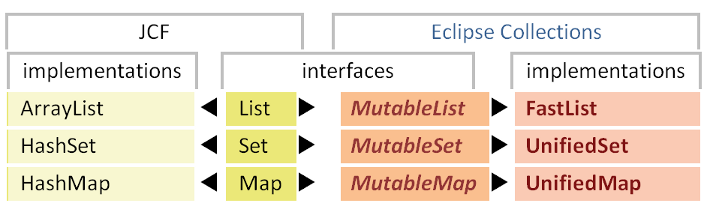

# 集合与容器

## 简介

Eclipse Collections 集合类最具特色之处，是被良好封装隐藏起来的迭代模式的内部实现。借助这种封装机制，Eclipse Collections 能够为每一种容器，都提供经过针对性优化的方法实现。

例如，下面首先介绍的 `FastList` 基于数组实现，迭代时直接通过下标访问其内部数组完成遍历。

本文将先介绍 Eclipse Collections 中与 Java 集合框架（JCF）功能对应的各类实现；之后再讲解全新的数据类型 `Bag`、`Multimap`，不可变集合，以及防护包装类。

## 基础集合类型

Eclipse Collections 最常用的类是 `FastList`、`UnifiedSet` 和 `UnifiedMap`。这些集合可以直接替换 Java 集合框架（JCF）中对应的原生类型。

注意：Eclipse Collections 的这些类**并没有继承 JCF 的实现类**，它们是全新实现，同时实现了 JCF 接口与 Eclipse Collections 自身接口，高度简化的类图可概括这一点。



JCF 集合类型的方法主要聚焦于元素增删以及其他非迭代类操作。Eclipse Collections 接口提供大量迭代模式相关方法，绝大多数方法**不会修改（可变变更）源集合**，而是返回新集合，或是返回源集合的统计信息。

### ListIterable

> 有序集合，允许存放重复元素。

`ListIterable` 继承自 `RichIterable`，保持元素的插入顺序，支持元素重复。`ListIterable` 包

- 含两个可变子接口：`MutableList` 和 `FixedSizeList`
- 一个不可变子接口：`ImmutableList`

`ListIterable` 接口提供 `binarySearch`（二分查找）方法，功能与 `java.util.Collections` 的静态 `binarySearch` 类似，但该方法是面向对象实例 API，可直接通过对象调用。

#### MutableList

> 可变的 `ListIterable`，同时实现 `java.util.List`；最常用实现类为 `FastList`。

`MutableList` 继承 JCF 的 `List` 接口，遵守其全部契约；同时继承 `RichIterable`，拥有所有集合通用的迭代方法。

`MutableList` 最主要实现是 `FastList`，可以直接替换大家熟悉的 `java.util.ArrayList`。下面对比两种容器的创建方式。

示例 1. Java 集合框架的 `ArrayList`

```java
List<String> comparison = new ArrayList<String>();
comparison.add("Comcast");
comparison.add("IBM");
comparison.add("Microsoft");
comparison.add("Microsoft");
```

示例 2. Eclipse Collections 的 `FastList`

```java
MutableList<String> comparison =
    FastList.newListWith("Comcast", "IBM", "Microsoft", "Microsoft");
```

`MutableList` 提供 `sortThis` 与 `reverseThis` 方法，对应 `java.util.Collections` 的静态 `sort`、`reverse`；**两个方法都会直接修改原集合**。下面对比 JDK API 与 Eclipse Collections 的排序写法。

示例 3. JCF‑ArrayList，使用匿名内部类 `Comparator`

```java
Collections.sort(people, new Comparator<Person>()
{
    public int compare(Person o1, Person o2)
    {
        int lastName = o1.getLastName().compareTo(o2.getLastName());
        if (lastName != 0)
        {
            return lastName;
        }
        return o1.getFirstName().compareTo(o2.getFirstName());
    }
});
```

示例 4. EC‑FastList，使用匿名内部类 `Comparator`

```java
people.sortThis(new Comparator<Person>()
{
    public int compare(Person o1, Person o2)
    {
        int lastName = o1.getLastName().compareTo(o2.getLastName());
        if (lastName != 0)
        {
            return lastName;
        }
        return o1.getFirstName().compareTo(o2.getFirstName());
    }
 });
```

示例 5. EC‑FastList，使用 Lambda

```java
people.sortThis((o1, o2) ->
        {
            int lastName = o1.getLastName().compareTo(o2.getLastName());
            if (lastName != 0)
            {
                return lastName;
            }
            return o1.getFirstName().compareTo(o2.getFirstName());
        });
```

`MutableList` 新增 `sortThisBy` 方法：传入一个 `Function` 提取元素属性，依据该属性的自然顺序对列表排序。

示例 6. JCF‑ArrayList，使用静态函数完成排序

```java
Collections.sort(people, Functions.toComparator(Person.TO_AGE));
```

示例 7. EC‑FastList，使用静态函数完成排序

```java
people.sortThisBy(Person.TO_AGE);
```

示例 8. FastList，方法引用与 Lambda 两种写法

```java
// Using a method reference
people.sortThisBy(Person::getAge);

// Using a lambda expression
people.sortThisBy(person -> person.getAge());
```

下面对比 JCF 与 Eclipse Collections 的反转操作；`reverseThis()` 会直接修改原列表。

示例 9. JCF‑ArrayList 原地反转

```java
Collections.reverse(people);
```

示例 10. EC‑FastList 原地反转

```java
people.reverseThis();
```

`MutableList.toReversed()`：**不修改原集合**，返回全新的 `MutableList`，内容为原列表反转后的结果。对比 JCF 和 EC 的实现。

示例 11. JCF‑ArrayList 返回反转后的新列表

```java
List<Person> reversed = new ArrayList<Person>(people)
Collections.reverse(reversed);
```

示例 12 EC‑FastList 返回反转后的新列表

```java
MutableList<Person> reversed = people.toReversed();
```

`asReversed()`：返回列表的**反转视图**，属于惰性可迭代对象（和 `asLazy` 返回对象类似）；元素求值会延迟，直到后续方法触发计算。

示例 13 FastList 使用惰性求值

```java
ListIterable<Integer> integers = FastList.newListWith(1, 2, 3);
// deferred evaluation
LazyIterable<Integer> reversed = integers.asReversed();
// deferred evaluation
LazyIterable<String> strings = reversed.collect(String::valueOf);
// forces evaluation
MutableList<String> stringsList = strings.toList();
 Assert.assertEquals(FastList.newListWith("3", "2", "1"), stringsList);
```

#### 将 ArrayList 迁移至 FastList

下面展示更多从 JCF 重构到 Eclipse Collections 的示例。

**示例 14 JCF 的 ArrayList**

```java
List<Integer> integers = new ArrayList<Integer>();
integers.add(1);
integers.add(2);
integers.add(3);
```

下面是 Eclipse Collections 中等效的构造写法：

**示例 15 EC 的 FastList**

```java
List<Integer> integers = new FastList<Integer>();
integers.add(1);
integers.add(2);
integers.add(3);
```

Eclipse Collections 的静态工厂方法 `newList` 可以自动推导泛型类型。

**示例 16 使用 newList 工厂方法创建 FastList**

```java
List<Integer> integers = FastList.newList();
integers.add(1);
integers.add(2);
integers.add(3);
```

Eclipse Collections 的 `newListWith()` 支持可变参数，可以直接传入任意数量元素。

**示例 17 使用 newListWith 方法创建 FastList**

```java
List<Integer> integers = FastList.newListWith(1, 2, 3);
```

Eclipse Collections 还提供与各集合类型同名的工厂类：`Lists`、`Sets`、`Maps`、`Bags`、`Stacks`、`BiMaps`、`Multimaps` 等。

**示例 18 Lists 工厂类**

```java
List<Integer> integers =
    Lists.mutable.with(1, 2, 3);
```

也可以直接使用 richer 接口类型接收返回值：

```java
MutableList<Integer> integers =
    FastList.newListWith(1, 2, 3);

// 或者

MutableList<Integer> integers =
    Lists.mutable.with(1, 2, 3);
```

如果不希望列表被修改，可以包装为不可修改视图：

**示例 19 不可修改的 FastList**

```java
MutableList<Integer> integers =
    FastList.newListWith(1, 2, 3).asUnmodifiable();
```

`newList` 还有重载版本，可以传入另一个可迭代对象作为数据源。

**示例 20 传入 Iterable 构造 FastList**

```java
MutableList<Integer> integers =
    FastList.newList(listOfIntegers);
```

上述这套重构方式，同样适用于 `UnifiedSet` 和 `UnifiedMap`。

### SetIterable

>  不允许存放重复元素的集合。

`SetIterable` 继承自 `RichIterable`，集合内不允许存在重复元素，分为有序与无序两种实现。

- `SortedSetIterable`，会保持元素按排序顺序存储。
- `UnsortedSetIterable`，底层基于哈希表存储，元素顺序不可预测。

`UnsortedSetIterable` 包含两个可变子接口（`MutableSet`、`FixedSizeSet`）和一个不可变子接口（`ImmutableSet`）。

#### MutableSet

> 可变的 `SetIterable`，实现了 `java.util.Set`；最常用实现类为 `UnifiedSet`。

`MutableSet` 继承 JCF 的 `Set` 接口，遵守其全部契约；同时继承 `RichIterable`，拥有所有集合通用的迭代方法。向 `MutableSet` 添加重复元素时会直接忽略，**不会抛出异常**。迭代遍历元素时，元素顺序无规定（不保证顺序）。

最常用实现为 `UnifiedSet`，可直接替换大家熟悉的 `java.util.HashSet`。

**示例 21 Java 集合框架的 HashSet**

```java
Set<String> comparison = new HashSet<String>();
comparison.add("IBM");
comparison.add("Microsoft");
comparison.add("Oracle");
comparison.add("Comcast");
```

**示例 22 Eclipse Collections 的 UnifiedSet**

```java
Set<String> comparison = UnifiedSet.newSetWith("IBM", "Microsoft", "Verizon", "Comcast");
```

#### MutableSortedSet

> 存储不重复元素，元素依据比较器或元素自然顺序完成排序。

`MutableSortedSet` 遵守与 `MutableSet` 相同的契约，但元素会按照自然顺序，或是用户传入的比较器参数进行排序。`MutableSortedSet` 的实现类是 `TreeSortedSet`。

下面示例展示逆序排列数字的 `MutableSortedSet`：

**示例 23 TreeSortedSet**

```java
MutableSortedSet<Integer> sortedSetA =
    TreeSortedSet.newSet(Collections.<Integer>reverseOrder());
MutableSortedSet<Integer> sortedSetB =
    TreeSortedSet.newSet(sortedSetA.with(1).with(2, 3).with(4, 5, 6));
```

### MapIterable

>  存储键‑值对的集合。

`MapIterable` 接口继承自 `RichIterable`，是所有键‑值对集合的顶层接口。

`MapIterable` 包含两个可变子接口：`MutableMap`、`FixedSizeMap`；一个不可变子接口：`ImmutableMap`。

另外还有两类接口继承自 `MapIterable`：支持元素排序的可变 / 不可变映射（`SortedMapIterable`），以及支持通过（唯一）值反向查找键的双向映射（`BiMap`）。

#### MutableMap

> 可变的 `MapIterable`，实现 `java.util.Map`；最常用实现类为 `UnifiedMap`。

`MutableMap` 接口定义键‑值对的关联关系。它继承 `MapIterable`，后者提供一套专门适配 Map 键值结构的迭代方法。包括通过 `keysView`、`valuesView`、`entriesView` 分别获取键、值、键值条目的不可修改视图。

`MapIterable` 的可变子接口同时实现 JCF 的 `Map` 接口。

**示例 24 JDK 的 HashMap**

```java
Map<Integer, String> map = new HashMap<Integer, String>();
map.put(1, "1");
map.put(2, "2");
map.put(3, "3");
```

**示例 25 Eclipse Collections 的 UnifiedMap**

```java
MutableMap<Integer, String> map = UnifiedMap.newWithKeysValues(1, "1", 2, "2", 3, "3");
```

#### MutableSortedMap

>  有序的可变 Map。

`MutableSortedMap` 遵守与 `MutableMap` 相同的契约，但会按照键的自然顺序，或者用户传入的比较器参数对键进行排序。`MutableSortedMap` 的实现类为 `TreeSortedMap`。

下面代码创建一个**降序排序**的 `TreeSortedMap`：

**示例 26 逆序有序 Map**

```java
MutableSortedMap<String, Integer> sortedMap = TreeSortedMap.newMapWith(Comparators.<String>reverseNaturalOrder(),
                "1", 1, "2", 3, "3", 2, "4", 1);
```

#### BiMap

> 双向映射，既可以按键查找值，也可以通过值反向查找键。

`BiMap` 接口定义双向映射，支持两个方向的查询。**BiMap 中键与值都必须唯一**。

`BiMap` 继承 `MapIterable`；`MutableBiMap` 继承 `MutableMap`。标准实现类为 `HashBiMap`。

**示例 27 双向映射**

```java
MutableBiMap<Integer, String> biMap =
    HashBiMap.newWithKeysValues(1, "1", 2, "2", 3, "3");
```

`MutableBiMap` 的核心特有方法：`put`、`forcePut`、`inverse`。

**MutableBiMap.put()**

行为和普通 Map 的 `put` 类似，但当放入重复的值时会抛出异常。

```java
MutableBiMap<Integer, String> biMap = HashBiMap.newMap();
biMap.put(1, "1");   // 和普通put行为一致
biMap.put(1, "1");   // 无任何效果
biMap.put(2, "1");   // 抛出 IllegalArgumentException，值"1"已经存在
```

**MutableBiMap.forcePut()**

与 `put` 行为相似，遇到值冲突时，**会静默删除原有冲突值对应的条目**，再存入新的键值对。

```java
MutableBiMap<Integer, String> biMap = HashBiMap.newMap();
biMap.forcePut(1, "1");     // 和普通put行为一致
biMap.forcePut(1, "1");     // 无任何效果
biMap.put(1, "2");          // 将 [1, "1"] 替换为 [1, "2"]
biMap.forcePut(2, "2");     // 先移除 [1, "2"]，再存入新条目
Assert.assertFalse(biMap.containsKey(1));
Assert.assertEquals(HashBiMap.newWithKeysValues(2, "2"), biMap);
```

**MutableBiMap.inverse()**

返回 BiMap 的反转视图。该操作开销很低，反转视图会在 BiMap 内部缓存。

推荐用法：`biMap.inverse().get(value)`，通过值反向查询对应的键。

```java
MutableBiMap<Integer, String> biMap =
HashBiMap.newWithKeysValues(1, "1", 2, "2", 3, "3");
MutableBiMap<String, Integer> inverse = biMap.inverse();
Assert.assertEquals("1", biMap.get(1));
Assert.assertEquals(Integer.valueOf(1), inverse.get("1"));
Assert.assertTrue(inverse.containsKey("3"));
Assert.assertEquals(Integer.valueOf(2), inverse.put("2", 4));
```

### Bag

> 允许元素重复的无序集合。

`Bag` 继承自 `RichIterable`，支持存放重复元素，并且可以高效查询每个元素的出现次数，分为有序与无序两种。

- `SortedBag`：有序 Bag，元素维持排序顺序
- `UnsortedBag`：无序 Bag，底层基于哈希表存储，迭代顺序不可预测

`UnsortedBag` 包含两个子接口：`MutableBag`、`ImmutableBag`。

`SortedBag` 包含两个子接口：`MutableSortedBag`、`ImmutableSortedBag`。

从概念上理解，**Bag 等价于「元素 → 该元素出现次数」的映射 Map**。

例如下面这份列表：

```
Apple
Pear
Orange
Orange
Apple
Orange
```

对应生成的 Bag 内部计数：

```
Pear      1
Orange    3
Apple     2
```

**示例 28 Bag**

```java
MutableBag<String> bag =
    HashBag.newBagWith("Apple", "Pear", "Orange", "Apple", "Apple", "Orange");

// 或者使用工厂类
MutableBag<String> bag =
    Bags.mutable.with("Apple", "Pear", "Orange", "Apple", "Apple", "Orange");
```

下面是 Bag 接口特有的方法：

**Bag.occurrencesOf(Object item)**

返回指定元素在 Bag 中的出现次数。

**Bag.forEachWithOccurrences(ObjIntProcedure)**

遍历每一个不重复元素，同时传入该元素与它的计数值，执行 procedure。

**Bag.toMapOfItemToCount()**

返回一个 Map，键为集合元素，值为该元素的出现次数（Integer 类型）。

#### MutableBag

>  允许元素重复的可变无序集合。

`MutableBag` 接口提供用于操作元素出现次数的方法。例如，想要获取 `MutableBag` 中不重复元素的数量，可以使用 `sizeDistinct` 方法。`MutableBag` 最常用的实现类是 `HashBag`。

**示例 29 MutableBag**

```java
MutableBag<String> bag = HashBag.newBagWith("Apple", "Pear", "Orange", "Apple", "Apple", "Orange");

// 或者使用工厂类
MutableBag<String> bag = Bags.mutable.with("Apple", "Pear", "Orange", "Apple", "Apple", "Orange");
```

以下是 `MutableBag` 的特有方法：

**MutableBag.addOccurrences(T item, int occurrences)**

将 Bag 中该元素的计数增加 `occurrences` 指定的数值。

**MutableBag.removeOccurrences(Object item, int occurrences)**

将 Bag 中该元素的计数减少 `occurrences` 指定的数值。

**MutableBag.setOccurrences(T item, int occurrences)**

修改 Bag，将指定元素的出现次数直接设置为目标数值。

#### MutableSortedBag

> 支持重复元素的有序集合。

`MutableSortedBag` 是维持元素顺序的 `Bag`。默认按照元素自然顺序排序，也可以传入自定义比较器实现排序。`MutableSortedBag` 最常用实现为 `TreeBag`，底层使用有序映射（`SortedMap`）存储数据。

下面示例创建按**逆序排列**整数的 `MutableSortedBag`：

**示例 30 Eclipse‑Collections**

```java
MutableSortedBag<Integer> revIntegers =
    TreeBag.newBagWith(Collections.reverseOrder(), 4, 3, 3, 2, 2, 2, 1, 1);

// 或者使用工厂类
MutableSortedBag<Integer> revIntegers =
    SortedBags.mutable.with(Collections.reverseOrder(), 4, 3, 3, 2, 2, 2, 1, 1);
```

### StackIterable

> 遵循**后进先出（LIFO）**规则的集合，迭代时按与插入相反的顺序遍历元素。

`StackIterable` 继承自 `RichIterable`，强制使用后进先出的顺序；所有迭代相关方法都按照**插入逆序**遍历，从最近添加的元素开始。

例如 `getFirst` 方法返回最后加入的元素，也就是栈的栈顶。

`StackIterable` 包含两个子接口：可变子接口 `MutableStack`、不可变子接口 `ImmutableStack`。

#### MutableStack

> 遵循**后进先出（LIFO）**规则的可变集合，迭代按照插入逆序遍历元素。

`MutableStack` 最常用实现类是 `ArrayStack`。与 `ArrayStack` 功能最接近的 JCF 类是 `java.util.Stack`，但后者继承自 `Vector`，**并不严格保证后进先出的迭代行为**。

`MutableStack` 的特有方法：`push`、`pop`、`peek`。

| 方法                | 说明                                                         |
| ------------------- | ------------------------------------------------------------ |
| `push`              | 向栈顶添加新元素                                             |
| `pop`               | 返回栈顶（最近加入）元素，并将该元素从集合中移除             |
| `pop(int count)`    | 从栈顶开始，弹出指定数量的元素，返回 `ListIterable`          |
| `peek`              | 返回栈顶元素，但**不会移除**该元素。注意：`getFirst` 同样返回栈顶元素；调用 `getLast` 会抛出异常。 |
| `peek(int count)`   | 从栈顶开始，获取指定数量的元素并返回 `ListIterable`；**不会从栈中移除元素**。 |
| `peekAt(int index)` | 获取指定下标位置的栈内元素。                                 |

`ArrayStack` 可以用来替换 `java.util.Stack`。

**示例 31 Java 集合框架的 Stack**

```java
Stack stack = new Stack();
stack.push(1);
stack.push(2);
stack.push(3);
```

**示例 32 Eclipse‑Collections 的 ArrayStack**

```java
MutableStack mutableStack =
    ArrayStack.newStackWith(1, 2, 3);

// 或者使用工厂类
MutableStack mutableStack =
    Stacks.mutable.with(1, 2, 3);
```

### Multimap

在 `Multimap` 容器中，每个键可以关联多个值。从这个角度看它和 `Map` 相似，但 `Multimap` 的值本身是指定类型的集合，称为**底层存储集合（backing collection）**。当业务原本需要使用 `Map<K, Collection<V>>` 时，就适合使用 `Multimap`。

和 Eclipse Collections 的其他容器不同，`Multimap` **不继承 `RichIterable`**，它及其子接口属于一套独立 API；`RichIterable` 的相关方法由它内部的底层集合来提供。

依据实现不同，`Multimap` 中的值可以存放在 `List`、`Set` 或者 `Bag` 中。例如 `FastListMultimap`，底层基于 `UnifiedMap`，每个键对应一个 `FastList`；该列表保留值的插入顺序，允许存放重复元素。

`groupBy` 方法的返回值类型就是 `Multimap`。下面示例将单词列表按单词长度分组，得到一个 `Multimap`：键是整型（单词长度），值为对应长度的单词集合。

原始单词列表：

```
here
are
a
few
words
that
are
not
too
long
```

得到底层为 `List` 的 `Multimap`：

| 键   | 值（List）              |
| :--- | :---------------------- |
| 1    | a                       |
| 3    | are, few, are, not, too |
| 4    | here, that, long        |
| 5    | words                   |

分组逻辑由 `groupBy` 实现。

**示例 33 使用 StringFunctions 进行分组，得到 MutableListMultimap**

```java
MutableList<String> words = Lists.mutable.with("here", "are", "a", "few",
     "words", "that", "are", "not", "too", "long");
MutableListMultimap<Integer, String> multimap =
    words.groupBy(StringFunctions.length());
```

**示例 34 使用方法引用，得到 MutableListMultimap**

```java
MutableList<String> words = Lists.mutable.with("here", "are", "a", "few",
     "words", "that", "are", "not", "too", "long");
MutableListMultimap<Integer, String> multimap =
    words.groupBy(String::length);
```

接口 `MutableListMultimap` 继承 `Multimap`，名字指明内部底层集合为 `List`。因为源集合是 `MutableList`，输出结果就是 `MutableListMultimap`；键 3 对应的列表中允许 "are" 重复出现两次。

如果源集合改为 `MutableSet`，返回结果就是 `MutableSetMultimap`，会自动去除重复元素。

**示例 35 使用 StringFunctions，得到 MutableSetMultimap**

```java
MutableSet<String> words = Sets.mutable.with("here", "are", "a", "few",
     "words", "that", "are", "not", "too", "long");
MutableSetMultimap<Integer, String> multimap =
    words.groupBy(StringFunctions.length());
```

**示例 36 使用方法引用，得到 MutableSetMultimap**

```java
MutableSet<String> words = Sets.mutable.with("here", "are", "a", "few",
     "words", "that", "are", "not", "too", "long");
MutableSetMultimap<Integer, String> multimap =
    words.groupBy(String::length);
```

去重之后，长度为 3 的单词只剩 4 个：

| 键   | 值（Set）       |
| :--- | :-------------- |
| 1    | a               |
| 3    | too,are,few,not |
| 4    | long,here,that  |
| 5    | words           |

## Primitive collections

>  用来遍历 Java 基础数据类型元素的容器。

Eclipse‑Collections 针对全部八种基础类型（int、long、float、char、byte、boolean、short、double），提供经过内存优化的 list, set, stack, map, bag。

基础类型的接口层级结构和普通对象集合的接口结构高度对应。以 int 相关集合接口举例对照：

| 接口                   | 对标对象集合接口    |
| :--------------------- | :------------------ |
| `IntIterable`          | `RichIterable`      |
| `MutableIntCollection` | `MutableCollection` |
| `IntList`              | `ListIterable`      |
| `MutableIntList`       | `MutableList`       |

除布尔类型集合以外，所有基础类型集合都自带常用算术运算方法。

**示例 37 在基础类型集合上执行数学运算**

```java
MutableIntList intList = IntLists.mutable.with(1, 2, 3);
Assert.assertEquals(6, intList.sum());        // 求和
Assert.assertEquals(1, intList.min());        // 最小值
Assert.assertEquals(3, intList.max());        // 最大值
Assert.assertEquals(2.0d, intList.average(), 0.0); // 平均值
Assert.assertEquals(2, intList.median());     // 中位数

// IntList.summaryStatistics() 返回 IntSummaryStatistics 统计对象
Assert.assertEquals(6, intList.summaryStatistics().getSum());
Assert.assertEquals(1, intList.summaryStatistics().getMin());
Assert.assertEquals(3, intList.summaryStatistics().getMax());
Assert.assertEquals(2.0d, intList.summaryStatistics().getAverage(), 0.0);
```

### 基础类型 list

基础类型列表底层存储方式与 `FastList` 相似，依托数组实现；区别在于它使用基础类型数组，而非对象数组 `Object[]`。实现类命名规则为 `IntArrayList`、`FloatArrayList` 等。

`BooleanArrayList` 属于特殊实现。当下 JVM 的 `boolean[]` 数组中每个布尔值占用一字节（并非按比特存储）。出于内存优化，`BooleanArrayList` 底层采用 `java.util.BitSet` 作为存储容器。

**示例 38 创建 IntArrayList 的四种方式**

```java
// 新建空列表
IntArrayList emptyList = new IntArrayList();
// 通过可变参数初始化
IntArrayList intList = IntArrayList.newListWith(1, 2, 3);
// 使用工具工厂类创建
IntArrayList alternate = IntLists.mutable.with(1, 2, 3);
// 从其他原生类型可迭代对象构造列表
IntArrayList listFromIntIterable = IntArrayList.newListWith(IntHashSet.newSetWith(1, 2, 3));
```

### IntInterval

`IntInterval` 代表一段整型区间，可以按照指定步长进行迭代遍历。（它类似普通包装类区间 `Interval`，但底层使用原生 `int`，而非 `Integer` 包装对象）。`IntInterval` 的所有区间方法均为**闭区间**，起始值与终止值都会被包含在内。

因为 `IntInterval` 实现了 `ImmutableIntList`，所以凡是入参支持 `ImmutableIntList` 的构造器和方法，都可以传入它。

```java
Assertions.assertInstanceOf(ImmutableIntList.class, IntInterval.oneTo(5));
```

借助 `IntInterval` 生成数值区间的方法有多种：

- 使用接收起始值、终止值、步长的构造函数初始化
- 调用各类静态工厂方法

```java
// 生成 [1‑5]、默认步长等于1的区间
ImmutableIntList expected = IntLists.immutable.with(1, 2, 3, 4, 5);
Assertions.assertEquals(expected, IntInterval.fromTo(1, 5));

// 起始1、终止10、步长3
ImmutableIntList expected = IntLists.immutable.with(1, 4, 7, 10);
Assertions.assertEquals(expected, IntInterval.fromToBy(1, 10, 3));

// from() 创建只包含单个数值的区间
ImmutableIntList expected = IntLists.immutable.with(10);
Assertions.assertEquals(expected, IntInterval.from(10));

// 生成偶数区间；步长自动判断：终止大于起始取2，反之取‑2
ImmutableIntList expected = IntLists.immutable.with(2, 4, 6);
Assertions.assertEquals(expected, IntInterval.evensFromTo(2, 6));

ImmutableIntList expected = IntLists.immutable.with(6, 4, 2);
Assertions.assertEquals(expected, IntInterval.evensFromTo(6, 2));

// 生成奇数区间，步长自适应正负方向
ImmutableIntList expected = IntLists.immutable.with(1, 3, 5);
Assertions.assertEquals(expected, IntInterval.oddsFromTo(1, 5));

ImmutableIntList expected = IntLists.immutable.with(5, 3, 1);
Assertions.assertEquals(expected, IntInterval.oddsFromTo(5, 1));

// oneTo()：从1开始到目标数值，步长默认为1
ImmutableIntList expected = IntLists.immutable.with(1, 2, 3, 4, 5);
Assertions.assertEquals(expected, IntInterval.oneTo(5));

// oneToBy(start=1, end=10, step=2)，原文参数书写笔误
ImmutableIntList expected = IntLists.immutable.with(1, 3, 5, 7, 9);
Assertions.assertEquals(expected, IntInterval.oneToBy(10, 2));

// zero()：仅包含数字0
ImmutableIntList expected = IntLists.immutable.with(0);
Assertions.assertEquals(expected, IntInterval.zero());

// zeroTo()：由0至目标数值，默认步长1
ImmutableIntList expected = IntLists.immutable.with(0, 1, 2, 3, 4);
Assertions.assertEquals(expected, IntInterval.zeroTo(4));

// zeroToBy()：0至终点，自定义步长
ImmutableIntList expected = IntLists.immutable.with(0, 2, 4);
Assertions.assertEquals(expected, IntInterval.zeroToBy(4, 2));
```

### Primitive sets

基础类型集合底层基于哈希表实现，命名格式为 `IntHashSet`、`FloatHashSet` 等。

其中 `BooleanHashSet` 较为特殊：依靠单个 integer 存储四种状态：空集合、仅存 false、仅存 true、同时包含 true‑false。

其余所有原生哈希集合采用**开放寻址 + 二次探测**作为哈希冲突解决策略。

下面介绍创建原生类型集合的各类方式：可以调用 `newSetWith`、构造器重载、原生类型工厂类进行实例化；下面示例以 `IntHashSet` 演示，`FloatHashSet`、`BooleanHashSet` 的用法完全一致。

```java
// 1. 通过支持可变参数的 newSetWith 创建
MutableIntSet intHashSet1 = IntHashSet.newSetWith(1, 2, 3, 4, 5);
MutableFloatSet floatHashSet1 = FloatHashSet.newSetWith(12.5f, 13.5f, 14.88f, 15.6f);
MutableBooleanSet booleanHashSet = BooleanHashSet.newSetWith(true, false);

// 无参构造，默认初始化容量16
MutableIntSet intHashSet2 = new IntHashSet();

// 指定初始容量
MutableIntSet intHashSet3 = new IntHashSet(32);

// 构造器传入可变参数初始化元素
MutableIntSet intHashSet4 = new IntHashSet(1, 2, 3, 4, 5, 6);

// 根据任意 IntIterable 可迭代原生集合进行构造
IntIterable intIterable = intHashSet4;
MutableIntSet intHashSet = new IntHashSet(intIterable);

// 使用已有 IntHashSet 拷贝构造
MutableIntSet intHashSet5 = new IntHashSet(intHashSet2);
```

还能够借助原生集合工厂类创建对象：`IntSets`、`FloatSets`、`BooleanSets`，工厂类分别提供可变、不可变集合的创建入口，包含 `with`、`withAll`、`empty`、`ofAll` 等重载方法。

> 注：`withInitialCapacity` 仅适用于可变集合工厂。

```java
// 指定初始容量创建可变整型集合
MutableIntSet mutableIntSetCapacity = IntSets.mutable.withInitialCapacity(12);
mutableIntSetCapacity.addAll(1, 3, 5, 6);

// with() 可变参数创建可变集合
MutableIntSet mutableIntSet = IntSets.mutable.with(1, 2, 3, 4, 5);
MutableFloatSet mutableFloatSet = FloatSets.mutable.with(1.5f, 2.5f);
MutableBooleanSet mutableBooleanSet = BooleanSets.mutable.with(true, false, false, true);

// 创建不可变原生集合
ImmutableIntSet immutableIntSet = IntSets.immutable.with(1, 2, 3, 4, 5);
ImmutableFloatSet immutableFloatSet = FloatSets.immutable.with(1.5f, 2.5f);
ImmutableBooleanSet immutableBooleanSet = BooleanSets.immutable.with(true, false, false, true);

// 通过 IntIterable 数据源构造不可变集合
IntIterable intIterable = immutableIntSet;
ImmutableIntSet immutableIntSet = IntSets.immutable.withAll(intIterable);
```

primitive hashset 常用操作：

```java
MutableIntSet intHashSet = IntHashSet.newSetWith(1, 2, 3, 4, 5);
intHashSet.add(6);
intHashSet.addAll(7, 8, 9);    // addAll 支持可变参数

// allSatisfy、anySatisfy 使用断言判断集合元素
boolean allSatisfy = intHashSet.allSatisfy(x -> 2 < x);
boolean anySatisfy = intHashSet.anySatisfy(x -> 5 > x);

// 判断是否全部包含指定元素
boolean containsAll = intHashSet.containsAll(5, 4);

// 获取最大值、最小值
int min = intHashSet.min();
int max = intHashSet.max();

// select 筛选、reject 排除元素
MutableIntSet evens = intHashSet.select(x -> 0 == x % 2);
MutableIntSet odds = intHashSet.reject(x -> 0 == x % 2);

// 多种类型转换方法
ImmutableIntSet immutableIntSet = intHashSet.toImmutable();
int[] toArray = intHashSet.toArray();
int[] toSortedArray = intHashSet.toSortedArray();
MutableIntList mutableIntList = intHashSet.toSortedList();
MutableIntBag mutableIntBag = intHashSet.toBag();
```

### Primitive stacks

primitive stack 实现与集合框架的 `ArrayStack` 大体相似，但专为 Java 基础数据类型做了性能优化。

### Primitive bags

primitive Bag 的实现逻辑类似 `HashBag`，但存储的元素与元素计数全部采用原生基础类型。

### Primitive Maps

基础类型 Map 分为下面三类：

1. **对象‑原生类型映射**：`ObjectIntHashMap`、`ObjectFloatHashMap` 等，键为普通对象、值为基础类型
2. **原生类型‑对象映射**：`IntObjectHashMap`、`FloatObjectHashMap` 等，键为基础类型、值为普通对象
3. **原生类型‑原生类型映射**：`IntIntHashMap`、`IntLongHashMap` 等，键和值均为基础类型

全部原生映射底层均采用**开放寻址 + 二次探测**处理哈希冲突。

数值类型值（排除布尔类型、对象类型）的原生映射提供 `addToValue` 方法：给指定键对应的值叠加增量，最后返回更新之后的值。

**示例 39 addToValue 用法**

```java
MutableByteIntMap map = new ByteIntHashMap();
Assert.assertEquals(1, map.addToValue((byte) 0, 1));
Assert.assertEquals(ByteIntHashMap.newWithKeysValues((byte) 0, 1), map);
Assert.assertEquals(11, map.addToValue((byte) 0, 10));
Assert.assertEquals(ByteIntHashMap.newWithKeysValues((byte) 0, 11), map);
```

所有原生类型集合都具备对应的不可变版本，同时支持获取不可修改包装类、线程同步包装类。

## Immutable collections

>  集合的只读快照；一经创建之后便永远无法修改。

Eclipse‑Collections 的所有基础容器都提供了可变接口与不可变接口。这一点和 Java 集合框架有所区别，JCF 绝大多数容器都是可变的。

不可变集合顾名思义：实例初始化完毕之后就不能改动，在整个生命周期当中内部引用与存储的数据始终保持不变。如果可变集合和不可变集合存放一模一样的元素，二者可以相等；`MutableList` 和 `ImmutableList` 在内容一致时判定相等。

由于内部状态不会发生改动，不可变集合天然线程安全。条件允许时优先使用不可变集合，可以提升代码可读性与可维护性。

前文介绍的容器类型均为可变版本，每一类容器都拥有对应的不可变接口，对照关系如下：

| 可变类型        | 不可变类型        |
| :-------------- | :---------------- |
| MutableList     | ImmutableList     |
| MutableSet      | ImmutableSet      |
| MutableBag      | ImmutableBag      |
| MutableMap      | ImmutableMap      |
| MutableMultimap | ImmutableMultimap |
| MutableStack    | ImmutableStack    |

所有容器都可以调用 `toImmutable()` 方法，得到对应的不可变集合实例：

```java
MutableCollection.toImmutable(): ImmutableCollection
```

返回源可变集合对应的不可变副本。

1. `StackIterable.toImmutable(): ImmutableStack`

   

   从可变栈生成不可变栈；本身已经是不可变栈时直接返回自身。

2. `ListIterable.toImmutable(): ImmutableList`

   

   从可变列表生成不可变列表；本身已经是不可变列表时直接返回自身。

3. `SortedMapIterable.toImmutable(): ImmutableSortedMap`

   

   生成有序映射的不可变副本；源对象不可变则直接返回。

4. `UnsortedMapIterable.toImmutable(): ImmutableMap`

   

   生成普通哈希映射的不可变副本；源对象不可变则直接返回。

不可变集合接口并不提供 `add`、`remove` 这类修改元素的方法。

取而代之，它依靠方法返回全新的不可变副本，以此实现新增、移除元素：

- `ImmutableCollection.newWith(element): ImmutableCollection`

  

  生成一份全新不可变副本，往副本内加入指定元素。

- `ImmutableCollection.newWithAll(Iterable): ImmutableCollection`

  

  生成新副本，批量添加传入迭代器中的全部元素。

- `ImmutableCollection.newWithout(element): ImmutableCollection`

  

  生成新副本，移除指定元素。

- `ImmutableCollection.newWithoutAll(Iterable): ImmutableCollection`

  

  生成新副本，批量移除传入迭代器内的所有元素。

需要留意：`select`、`reject`、`collect` 这类迭代筛选转换方法，处理不可变容器之后，同样会产出全新的不可变集合。