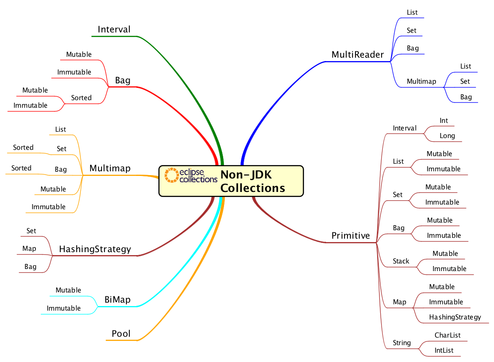

# EC 速查手册

2026-08-03⭐
@author Jiawei Mao
***

## RichIterable API

| `RichIterable` API | 说明                                                         |
| ------------------------------------------------------------ | ------------------------------------------------------------ |
| `allSatisfy` | 若全部元素满足断言 `Predicate`，返回 `true`；短路求值        |
| `anySatisfy` | 若任意元素满足断言 `Predicate`，返回 true；短路求值          |
| `appendString` | 将集合的字符串形式输出至指定 `Appendable`；输出内容与 `makeString` 一致 |
| **[asSynchronized](https://www.eclipse.org/collections/javadoc/11.1.0/org/eclipse/collections/api/collection/MutableCollection.html#asSynchronized())*** | 返回同步集合                                                 |
| **[asUnmodifiable](https://www.eclipse.org/collections/javadoc/11.1.0/org/eclipse/collections/api/collection/MutableCollection.html#asUnmodifiable())*** | 返回不可修改集合                                             |
| **[chunk](https://www.eclipse.org/collections/javadoc/11.1.0/org/eclipse/collections/api/RichIterable.html#chunk(int))** | 将集合划分为固定大小的多个子集合；若元素无法均分，最后一块会小一点 |
| `collect`                                                    | 通过 `Function` 转换元素，返回存放转换结果的新集合（一对一映射） |
| `count`                                                      | 统计满足断言 `Predicate` 的元素数量                          |
| `detect`                                                     | 查找第一个满足断言 `Predicate` 的元素数量；短路求值          |
| `flatCollect`                                                | 使用 `Function` 转换元素，并对结果执行扁平化处理             |
| **[forEach](https://www.eclipse.org/collections/javadoc/11.1.0/org/eclipse/collections/api/RichIterable.html#forEach(org.eclipse.collections.api.block.procedure.Procedure))** | 对每个元素执行 `Procedure`，无返回值                         |
| **[groupBy](https://www.eclipse.org/collections/javadoc/11.1.0/org/eclipse/collections/api/RichIterable.html#groupBy(org.eclipse.collections.api.block.function.Function))** | 通过 `Function` 获取每个元素的 key，将 key 与元素存入 `Multimap` |
| **[groupByEach](https://www.eclipse.org/collections/javadoc/11.1.0/org/eclipse/collections/api/RichIterable.html#groupByEach(org.eclipse.collections.api.block.function.Function))** | `groupBy` 的特殊形式，但是返回一个集合。类似 `collect` 与 `flatCollect` 的差异 |
| **[injectInto](https://www.eclipse.org/collections/javadoc/11.1.0/org/eclipse/collections/api/RichIterable.html#injectInto(double,org.eclipse.collections.api.block.function.primitive.DoubleObjectToDoubleFunction))** | 归约计算：以初始值、集合元素依次迭代运算，持续传入上一轮运算结果，返回最终值 |
| **[makeString()](https://www.eclipse.org/collections/javadoc/11.1.0/org/eclipse/collections/api/RichIterable.html#makeString())** | 将集合转换为字符串，可指定可选的起始符、结束符、分隔符       |
| `max`                                                        | 根据自然顺序或指定 `Comparator`，返回最大元素                |
| `maxBy`                                                      | 通过函数提取元素属性，返回属性值最大的元素                   |
| `min`                                                        | 根据自然顺序或指定 `Comparator`，返回最小元素                |
| `minBy`                                                      | 通过函数提取元素属性，返回属性值最小的元素                   |
| **[reject](https://www.eclipse.org/collections/javadoc/11.1.0/org/eclipse/collections/api/RichIterable.html#reject(org.eclipse.collections.api.block.predicate.Predicate))** | 返回不满足 `Predicate` 的所有元素（反向筛选）                |
| **[select](https://www.eclipse.org/collections/javadoc/11.1.0/org/eclipse/collections/api/RichIterable.html#select(org.eclipse.collections.api.block.predicate.Predicate))** | 返回满足 `Predicate` 的所有元素（正向筛选）                  |
| `sortThis`**                                                 | 对 `MutableList` 内部数据排序，使用自然顺序或指定 `Comparator` |
| `sortThisBy`**                                               | 通过 `Function` 提取元素属性，依据属性自然顺序对列表原地排序 |
| **[toBag()](https://www.eclipse.org/collections/javadoc/11.1.0/org/eclipse/collections/api/RichIterable.html#toBag())** | 将集合转换为默认 `MutableBag` 实现                           |
| **[toImmutable](https://www.eclipse.org/collections/javadoc/11.1.0/org/eclipse/collections/api/collection/MutableCollection.html#toImmutable())*** | 返回不可变集合                                               |
| **[toList()](https://www.eclipse.org/collections/javadoc/11.1.0/org/eclipse/collections/api/RichIterable.html#toList())** | 将集合转换为 `MutableList` 实现                              |
| **[toMap](https://www.eclipse.org/collections/javadoc/11.1.0/org/eclipse/collections/api/RichIterable.html#toMap(org.eclipse.collections.api.block.function.Function,org.eclipse.collections.api.block.function.Function))** | 使用指定 key 函数与 value 函数，将集合转换为 `MutableMap`    |
| **[toSet()](https://www.eclipse.org/collections/javadoc/11.1.0/org/eclipse/collections/api/RichIterable.html#toSet())** | 将集合转换为 `MutableSet`                                    |
| **[toSortedList](https://www.eclipse.org/collections/javadoc/11.1.0/org/eclipse/collections/api/RichIterable.html#toSortedList(java.util.Comparator))** | 将集合转换为 `MutableList`， 并按元素自然顺序排序（返回新集合） |
| **[toSortedListBy](https://www.eclipse.org/collections/javadoc/11.1.0/org/eclipse/collections/api/RichIterable.html#toSortedListBy(org.eclipse.collections.api.block.function.Function))** | 通过 `Function` 提取元素属性，返回依据属性自然排序的新 list  |
| **[toSortedSet](https://www.eclipse.org/collections/javadoc/11.1.0/org/eclipse/collections/api/RichIterable.html#toSortedSet(java.util.Comparator))** | 将集合转换为有序 `MutableSortedSet`，按自然顺序排序          |
| **[toSortedSetBy](https://www.eclipse.org/collections/javadoc/11.1.0/org/eclipse/collections/api/RichIterable.html#toSortedSetBy(org.eclipse.collections.api.block.function.Function))** | 将集合转换为 `MutableSortedSet`，依据 `Function` 返回属性的自然顺序排序 |
| **[zip](https://www.eclipse.org/collections/javadoc/11.1.0/org/eclipse/collections/api/RichIterable.html#zip(java.lang.Iterable))** | 接收另一个 `RichIterable`，将两方元素两两配对，长度较短一方遍历结束后，舍弃较长结合剩余元素 |
| `zipWithIndex`                                               | 将集合元素与索引 0 到 n-1 配对                               |

\* on **MutableCollection**
** on **MutableList**

| 接口                                               | 说明          |
| ------------------------------------------------------------ | ------------------------------------------- |
| **[Bag](https://www.eclipse.org/collections/javadoc/11.1.0/org/eclipse/collections/api/bag/Bag.html)** | 类比 JCF *Map* <K, Integer>（统计元素频次） |
| **[Multimap](https://www.eclipse.org/collections/javadoc/11.1.0/org/eclipse/collections/api/multimap/Multimap.html)** | 类比 JCF *Map* <K, Iterable<V>>             |
| **[MutableList](https://www.eclipse.org/collections/javadoc/11.1.0/org/eclipse/collections/api/list/MutableList.html)** | 类比 JCF *List*                             |
| **[MutableMap](https://www.eclipse.org/collections/javadoc/11.1.0/org/eclipse/collections/api/map/MutableMap.html)** | 类比 JCF *Map*                              |
| **[MutableSet](https://www.eclipse.org/collections/javadoc/11.1.0/org/eclipse/collections/api/set/MutableSet.html)** | 类比 JCF *Set*                              |
| **[Pair](https://www.eclipse.org/collections/javadoc/11.1.0/org/eclipse/collections/api/tuple/Pair.html)** | 存放两个关联对象的容器                      |


| **Blocks**                                                   | 说明                                                         |
| ------------------------------------------------------------ | ------------------------------------------------------------ |
| **[Function](https://www.eclipse.org/collections/javadoc/11.1.0/org/eclipse/collections/api/block/function/Function.html)** | 将一种类型 `T` 转换为另一种类型 `V`                          |
| **[Function0](https://www.eclipse.org/collections/javadoc/11.1.0/org/eclipse/collections/api/block/function/Function0.html)** | 返回指定类型的 Java 8 无参 lambda，工厂函数                  |
| **[Function2](https://www.eclipse.org/collections/javadoc/11.1.0/org/eclipse/collections/api/block/function/Function2.html)** | 供 `injectInto` 方法使用，第一个参数为 accumulator，集合中的当前元素为第一个参数 |
| **[ObjectIntProcedure](https://www.eclipse.org/collections/javadoc/11.1.0/org/eclipse/collections/api/block/procedure/ObjectIntProcedure.html)** | 接收对象与 int 两个参数；int 通常为元素在集合中的 index，无返回值 |
| **[Predicate](https://www.eclipse.org/collections/javadoc/11.1.0/org/eclipse/collections/api/block/predicate/Predicate.html)** | 接受类型为 `T` 的对象，返回 boolean                          |
| **[Predicate2](https://www.eclipse.org/collections/javadoc/11.1.0/org/eclipse/collections/api/block/predicate/Predicate2.html)** | 用于 `selectWith`, `detectWith`, `rejectWith` 等方法。第一个参数为集合迭代的当前元素，第二个参数是调入方传入的外部参数 |
| **[Procedure](https://www.eclipse.org/collections/javadoc/11.1.0/org/eclipse/collections/api/block/procedure/Procedure.html)** | 接收类型为 `T` 的对象，无返回值（执行动作，不产生结果）      |
| **[Procedure2](https://www.eclipse.org/collections/javadoc/11.1.0/org/eclipse/collections/api/block/procedure/Procedure2.html)** | 接收 T1，T2 两个类型对象，无返回值                           |

## 1. 筛选

| 方法             | 说明                 |
| ---------------- | -------------------- |
| `anySatisfy()`   | 任意元素满足条件     |
| `noneSatisfy()`  | 没有元素满足条件     |
| `allSatisfy()`   | 所有元素满足条件     |
| `contains()`     | 是否包含元素         |
| `containsAll()`  | 是否包含全部集合元素 |
| `containsAny()`  | 是否包含任意元素     |
| `containsNone()` | 是否不包含指定元素   |
| `containsBy()`   | 根据转换结果判断包含 |
| `isEmpty()`      | 是否为空             |
| `notEmpty()`     | 是否非空             |

| 方法                       | 说明             |
| -------------------------- | ---------------- |
| `select()`                 | 保留满足条件元素 |
| `reject()`                 | 删除满足条件元素 |
| `selectInstancesOf(Class)` | 类型过滤         |
| `selectWith()`             | 带额外参数过滤   |
| `rejectWith()`             | 带额外参数排除   |
| `partition()`              | 分成两组         |

### select

选择满足条件的元素。

```java
MutableList<Integer> source = Lists.mutable.of(1, 2, 3, 4, 5, 6);
MutableList<Integer> evenNums = source.select(num -> num % 2 == 0);

// Eclipse‑Collections 自带断言工具 Verify
Verify.assertContainsAll(evenNums, 2,4,6);
Verify.assertSize(3, evenNums);
```

### reject

选择不满足条件的元素。

```java
MutableList<Integer> nums = Lists.mutable.of(1, 2, 3, 4, 5, 6);
MutableList<Integer> odds = nums.reject(num -> num % 2 == 0);

Verify.assertContainsAll(odds, 1, 3, 5);
Verify.assertSize(3, odds);
```


### selectWith

```java
<P> ReversibleIterable<T> selectWith(Predicate2<? super T, ? super P> predicate, 
                                     P parameter);
```

`selectWith` 接收 `Predicate2` 为参数，第一个入参为遍历的元素，第二个入参为外部自定义参数，属于 `select` 的带参重载。

```java
@Test
void testSelectWithLambda() {
    MutableList<Integer> nums = Lists.mutable.of(10, 14, 18, 22, 26);
    int threshold = 20;
    // (集合元素,外部参数)‑>布尔值
    MutableList<Integer> result = nums.selectWith((num, param) -> num > param, threshold);
    Verify.assertContainsAll(result,22,26);
}
```

### rejectWith

```java
// lambda写法
@Test
void rejectWithLambdaDemo() {
    MutableList<Integer> numList = Lists.mutable.of(8, 15, 23, 36);
    int threshold = 20;
    // 删除大于阈值的元素，留下 ≤20
    MutableList<Integer> result = numList.rejectWith((val, param) -> val > param, threshold);
    Verify.assertContainsAll(result,8,15);
}

 // 实体类案例
static class Fruit{
    private final String name;
    private final int price;
    public Fruit(String name,int price){
        this.name=name;
        this.price=price;
    }
    public int getPrice(){
        return price;
    }
}

@Test
void rejectWithEntityFilter(){
    MutableList<Fruit> fruitList = Lists.mutable.of(
            new Fruit("苹果",12),
            new Fruit("香蕉",5),
            new Fruit("橙子",15)
    );
    int priceLimit = 10;
    // 剔除售价高于10的水果
    MutableList<Fruit> cheapFruit = fruitList.rejectWith((fruit,limit)-> fruit.getPrice()>limit,priceLimit);
    Verify.assertSize(1,cheapFruit);
    Verify.assertContains(cheapFruit,fruitList.get(1));
}
```

### partition

`partition(Predicate)` 返回 `PartitionIterable`，会把集合拆分成两份：

- selected：满足断言条件的元素
- rejected：不满足断言条件的元素

还有重载 `partitionWith(Predicate2, 附加参数)`，用来传入额外判断参数。

```java
@Test
void partitionLambdaSimple() {
    MutableList<Integer> nums = Lists.mutable.of(1, 2, 3, 4, 5, 6);
    // 拆分偶数、奇数
    PartitionMutableList<Integer> partition = nums.partition(i -> i % 2 == 0);

    Verify.assertContainsAll(partition.getSelected(),2,4,6);
    Verify.assertContainsAll(partition.getRejected(),1,3,5);
}
```

## 2. 转换

| 方法                | 说明         |
| ------------------- | ------------ |
| `collect(Function)` | 元素转换     |
| `collectIf()`       | 条件转换     |
| `collectWith()`     | 带参数转换   |
| `flatCollect()`     | 展开集合     |
| `zip()`             | 两个集合合并 |
| `zipWithIndex()`    | 添加索引     |

原生类型转换：

| 方法               | 输出类型          |
| ------------------ | ----------------- |
| `collectInt()`     | IntCollection     |
| `collectLong()`    | LongCollection    |
| `collectDouble()`  | DoubleCollection  |
| `collectFloat()`   | FloatCollection   |
| `collectBoolean()` | BooleanCollection |

### collect

`collect()` 用于将集合中的每个元素通过指定函数转换为新的元素，并返回包含转换结果的新集合（等价于 Java Stream 的 `map()`）。

- 示例 1

```java
MutableList<String> strList = Lists.mutable.of("java", "eclipse", "collections");
MutableList<Integer> lengthList = strList.collect(s -> s.length());

Verify.assertContainsAll(lengthList, 4, 7, 11);
```

- 示例 2

```java
@Test
void testCollect() {
    MutableList<Peptide> peptides = Lists.mutable.of(
            new Peptide("PEPTIDEK", 1000.5),
            new Peptide("MPEPTIDER", 1200.8),
            new Peptide("ACDEFGHIK", 950.2)
    );

    MutableList<String> sequences =
            peptides.collect(Peptide::getSequence);

    assertEquals(
            Lists.mutable.of(
                    "PEPTIDEK",
                    "MPEPTIDER",
                    "ACDEFGHIK"
            ),
            sequences
    );
}


private static class Peptide {

    private final String sequence;
    private final double mass;

    Peptide(String sequence, double mass) {
        this.sequence = sequence;
        this.mass = mass;
    }

    String getSequence() {
        return sequence;
    }

    double getMass() {
        return mass;
    }
}
```


### collectDouble

`collectDouble()` 用于将集合中的元素通过指定函数转换为 `double` 原始值集合（`DoubleList`），避免 `Double` 装箱，提高数值计算效率。

- 示例 1⭐

```java
@Test
void testCollectDouble() {
    MutableList<Peptide> peptides = Lists.mutable.of(
            new Peptide("PEPTIDEK", 1000.5),
            new Peptide("MPEPTIDER", 1500.2),
            new Peptide("ACDEFGHIK", 800.0)
    );

    DoubleList masses =
            peptides.collectDouble(
                    Peptide::getMass
            );

    assertEquals(3, masses.size());

    assertEquals(1000.5, masses.get(0));
    assertEquals(1500.2, masses.get(1));
    assertEquals(800.0, masses.get(2));
}

private static class Peptide {

    private final String sequence;
    private final double mass;

    Peptide(String sequence, double mass) {
        this.sequence = sequence;
        this.mass = mass;
    }

    String getSequence() {
        return sequence;
    }

    double getMass() {
        return mass;
    }
}
```


### flatCollect

转换后扁平化处理。

```java
/**
 * 基础 lambda 示例：拆分嵌套集合
 */
@Test
void testFlatCollectLambda() {
    MutableList<MutableList<Integer>> nestedList = Lists.mutable.of(
            Lists.mutable.of(1, 2),
            Lists.mutable.of(3, 4),
            Lists.mutable.of(5, 6)
    );

    MutableList<Integer> flat = nestedList.flatCollect(list -> list);
    Verify.assertContainsAll(flat,1,2,3,4,5,6);
    Verify.assertSize(6, flat);
}

/**
 * 模拟实体场景：Person‑多个地址
 */
static class Person{
    private final MutableList<String> addresses;
    public Person(MutableList<String> addresses){
        this.addresses = addresses;
    }
    public MutableList<String> getAddresses(){
        return addresses;
    }
}

@Test
void testFlatCollectEntityAddress() {
    MutableList<Person> personList = Lists.mutable.of(
            new Person(Lists.mutable.of("北京","天津")),
            new Person(Lists.mutable.of("上海"))
    );
    // 取出全部地址，扁平化
    MutableList<String> allAddresses = personList.flatCollect(Person::getAddresses);
    Verify.assertContainsAll(allAddresses,"北京","天津","上海");
}
```

```java
<V, R extends Collection<V>> R flatCollect(Function<? super T, ? extends Iterable<V>> function, R target);
```

传入 `target` 参数，可以将扁平化的结果存入目标集合。

```java
// 测试实体：一个人拥有多个爱好
static class Person {
    private final MutableList<String> hobbies;

    public Person(MutableList<String> hobbies) {
        this.hobbies = hobbies;
    }

    public MutableList<String> getHobbies() {
        return hobbies;
    }
}

@Test
void flatCollectAppendIntoMutableSet() {
    MutableList<Person> personList = Lists.mutable.of(
            new Person(Lists.mutable.of("篮球", "阅读")),
            new Person(Lists.mutable.of("跑步", "阅读")),
            new Person(Lists.mutable.of("篮球", "骑行"))
    );

    // 创建目标 Set，用来接收扁平化结果，自动去重
    MutableSet<String> hobbySet = Sets.mutable.empty();

    // flatCollect 的重载：flatCollect(Function, 目标容器)
    personList.flatCollect(Person::getHobbies, hobbySet);

    Verify.assertContainsAll(hobbySet, "篮球", "阅读", "跑步", "骑行");
    Verify.assertSize(4, hobbySet);
}
```

### flatCollectInt

## 3. 查找

| 方法                | 说明                   |
| ------------------- | ---------------------- |
| `detect(Predicate)` | 查找第一个满足条件元素 |
| `detectIfNone()`    | 找不到返回默认值       |
| `detectWith()`      | 带额外参数查找         |
| `detectOptional()`  | Optional 返回          |
| `getAny()`          | 获取任意元素           |
| `getFirst()`        | 获取第一个元素         |
| `getLast()`         | 获取最后元素           |
| `getOnly()`         | 获取唯一元素           |
| `min()`             | 最小值                 |
| `max()`             | 最大值                 |
| `minBy(Function)`   | 根据属性找最小         |
| `maxBy(Function)`   | 根据属性找最大         |
| `minOptional()`     | Optional 最小值        |
| `maxOptional()`     | Optional 最大值        |


### detect

查找第一个满足条件的元素，具备短路特性；找不到则返回 `null`。

```java
// 1.查询第一个偶数
@Test
void testDetectLambda() {
    MutableList<Integer> numList = Lists.mutable.of(3, 5, 8, 10);
    Integer firstEven = numList.detect(i -> i % 2 == 0);
    Assertions.assertEquals(8, firstEven);
}

// 2.没有匹配元素，返回 null
@Test
void testDetectReturnNullWhenNotFound() {
    MutableList<Integer> odds = Lists.mutable.of(1, 3, 5);
    Integer result = odds.detect(i -> i % 2 == 0);
    Assertions.assertNull(result);
}
```

### anySatisfy

任意元素满足条件返回 true。

```java
MutableList<Integer> numList = Lists.mutable.of(1, 3, 5, 6);
boolean hasEven = numList.anySatisfy(integer -> integer % 2 == 0);
Assertions.assertTrue(hasEven);
```

### anySatisfyWith

```java
<P> boolean anySatisfyWith(Predicate2<? super T, ? super P> predicate, P parameter);
```

`Predicate2`，第一个参数为遍历元素、第二个为外部传入参数，该方法具备短路求值特性。

```java
// Lambda 写法
@Test
void anySatisfyWithLambda() {
    MutableList<Integer> numList = Lists.mutable.of(12, 25, 31, 44);
    int compareVal = 30;
    // (集合元素,外部参数) -> 判断条件
    boolean hasElementGreater = numList.anySatisfyWith((item, param) -> item > param, compareVal);
    Assertions.assertTrue(hasElementGreater);
}

// 无匹配元素返回 false
@Test
void anySatisfyWithReturnFalse() {
    MutableList<Integer> list = Lists.mutable.of(1,3,5,7);
    int threshold = 10;
    boolean result = list.anySatisfyWith((i,param)->i>param,threshold);
    Assertions.assertFalse(result);
}
```

### allSatisfy

所有元素条件返回 true。

```java
 // 1. lambda 判断全部都是偶数
@Test
void testAllSatisfyLambda() {
    MutableList<Integer> nums = Lists.mutable.of(2, 4, 6, 8);
    boolean allEven = nums.allSatisfy(i -> i % 2 == 0);
    Assertions.assertTrue(allEven);
}

// 2. 存在不符合元素，返回 false
@Test
void testAllSatisfyReturnFalse() {
    MutableList<Integer> nums = Lists.mutable.of(2, 4, 5, 8);
    boolean allEven = nums.allSatisfy(i -> i % 2 == 0);
    Assertions.assertFalse(allEven);
}
```

### allSatisfyWith

```java
// Lambda 表达式示例
@Test
void testAllSatisfyWithLambda() {
    MutableList<Integer> nums = Lists.mutable.of(22, 25, 28, 30);
    int minValue = 20;
    boolean allAboveMin = nums.allSatisfyWith((num, param) -> num > param, minValue);
    Assertions.assertTrue(allAboveMin);
}

// 存在不符合条件的元素，返回 false
@Test
void testAllSatisfyWithReturnFalse() {
    MutableList<Integer> nums = Lists.mutable.of(21, 23, 18, 29);
    int minValue = 20;
    boolean allAboveMin = nums.allSatisfyWith((num, param) -> num > param, minValue);
    Assertions.assertFalse(allAboveMin);
}
```

### max

`max()` 用于返回集合中按照自然顺序比较得到的最大元素。

```java
@Test
void testMax() {
    MutableList<Double> masses =
            Lists.mutable.of(
                    1000.5,
                    1500.2,
                    800.0
            );

    double maxMass = masses.max();

    assertEquals(
            1500.2,
            maxMass
    );
}


@Test
void testMaxWithComparableObject() {
    MutableList<Peptide> peptides =
            Lists.mutable.of(
                    new Peptide("PEPTIDEK", 1000.5),
                    new Peptide("MPEPTIDER", 1500.2),
                    new Peptide("ACDEFGHIK", 800.0)
            );

    Peptide maxPeptide = peptides.max();

    assertEquals(
            "MPEPTIDER",
            maxPeptide.getSequence()
    );
}


private static class Peptide implements Comparable<Peptide> {

    private final String sequence;
    private final double mass;

    Peptide(String sequence, double mass) {
        this.sequence = sequence;
        this.mass = mass;
    }

    String getSequence() {
        return sequence;
    }

    double getMass() {
        return mass;
    }

    @Override
    public int compareTo(Peptide other) {
        return Double.compare(
                this.mass,
                other.mass
        );
    }
}
```

### maxBy

`maxBy()` 用于根据指定函数计算元素的比较值，并返回具有最大比较值的元素。

```java
@Test
void testMaxBy() {
    MutableList<PeptideFeature> features =
            Lists.mutable.of(
                    new PeptideFeature("PEPTIDEK", 1200.5),
                    new PeptideFeature("MPEPTIDER", 3500.8),
                    new PeptideFeature("ACDEFGHIK", 800.2)
            );

    PeptideFeature maxFeature =
            features.maxBy(
                    PeptideFeature::getIntensity
            );

    assertEquals(
            "MPEPTIDER",
            maxFeature.getSequence()
    );

    assertEquals(
            3500.8,
            maxFeature.getIntensity()
    );
}

private static class PeptideFeature {

    private final String sequence;
    private final double intensity;

    PeptideFeature(String sequence, double intensity) {
        this.sequence = sequence;
        this.intensity = intensity;
    }

    String getSequence() {
        return sequence;
    }

    double getIntensity() {
        return intensity;
    }
}
```


## 4. 聚合

聚合：从集合产生单个结果。

| 方法                   | 说明            |
| ---------------------- | --------------- |
| `injectInto()`         | reduce          |
| `reduce()`             | 二元归约        |
| `aggregateBy()`        | 分组聚合        |
| `aggregateInPlaceBy()` | 原地聚合        |
| `sumOfInt()`           | int 求和        |
| `sumOfLong()`          | long 求和       |
| `sumOfDouble()`        | double 求和     |
| `sumOfFloat()`         | float 求和      |
| `summarizeInt()`       | int 统计摘要    |
| `summarizeDouble()`    | double 统计摘要 |

### aggregateBy

`aggregateBy()` 用于根据指定函数生成分组键，并在每个分组内使用累加逻辑聚合元素，最终返回一个 `MutableMap<K,V>`。

功能：分组+汇总。签名如下，三个参数的含义

1. 分组 `Function`
2. 初始值
3. 累计策略

```java
<K, V> MapIterable<K, V> aggregateBy(
        Function<? super T, ? extends K> groupBy,
        Function0<? extends V> zeroValueFactory,
        Function2<? super V, ? super T, ? extends V> nonMutatingAggregator);
```

- 示例 1⭐

```java
@Test
void testAggregateBy()
{
    MutableList<PeptideFeature> features =
            Lists.mutable.of(
                    new PeptideFeature("PEPTIDEK", "ProteinA", 1000.0),
                    new PeptideFeature("MPEPTIDER", "ProteinB", 2000.0),
                    new PeptideFeature("ACDEFGHIK", "ProteinA", 1500.0),
                    new PeptideFeature("TIDESEQ", "ProteinB", 500.0)
            );

    MutableMap<String, Double> intensityByProtein = features.aggregateBy(
            PeptideFeature::getProtein,
            () -> 0.0,
            (sum, feature) ->
                    sum + feature.getIntensity()
    );

    assertEquals(2500.0, intensityByProtein.get("ProteinA"));
    assertEquals(2500.0, intensityByProtein.get("ProteinB"));
}

private static class PeptideFeature
{
    private final String sequence;
    private final String protein;
    private final double intensity;

    PeptideFeature(
            String sequence,
            String protein,
            double intensity
    )
    {
        this.sequence = sequence;
        this.protein = protein;
        this.intensity = intensity;
    }

    String getSequence()
    {
        return sequence;
    }

    String getProtein()
    {
        return protein;
    }

    double getIntensity()
    {
        return intensity;
    }
}
```

### sumByDouble

`sumByDouble()` 用于根据第一个函数生成分组 key，并根据第二个函数提取 `double` 值后对每个分组进行求和，返回 `ObjectDoubleMap<K>`。签名如下：

```java
/**
 * Groups and sums the values using the two specified functions.
 *
 */
<V> ObjectDoubleMap<V> sumByDouble(Function<? super T, ? extends V> groupBy, 
                                   DoubleFunction<? super T> function);
```

- 示例 1

```java
@Test
void testSumByDouble() {
    MutableList<PeptideFeature> features =
            Lists.mutable.of(
                    new PeptideFeature("PEPTIDEK", "ProteinA", 1000.5),
                    new PeptideFeature("MPEPTIDER", "ProteinB", 2000.0),
                    new PeptideFeature("ACDEFGHIK", "ProteinA", 800.5),
                    new PeptideFeature("TIDESEQ", "ProteinB", 500.0)
            );

    ObjectDoubleMap<String> intensityByProtein =
            features.sumByDouble(
                    PeptideFeature::getProtein,
                    PeptideFeature::getIntensity
            );

    assertEquals(
            1801.0,
            intensityByProtein.get("ProteinA"),
            1e-10
    );

    assertEquals(
            2500.0,
            intensityByProtein.get("ProteinB"),
            1e-10
    );
}


private static class PeptideFeature {

    private final String sequence;
    private final String protein;
    private final double intensity;

    PeptideFeature(
            String sequence,
            String protein,
            double intensity
    ) {
        this.sequence = sequence;
        this.protein = protein;
        this.intensity = intensity;
    }

    String getSequence() {
        return sequence;
    }

    String getProtein() {
        return protein;
    }

    double getIntensity() {
        return intensity;
    }
}
```


### countByEach

`countByEach` 返回 `MutableBag<K>`；

入参 `Function` 需要返回 `Iterable<K>`，集合里单个元素能够产出多个统计键，该元素会为每一个键贡献一次计数。

适用场景：一对多频次统计（例如一个人拥有多个爱好，所有爱好次数 +1）

- countBy：一个元素对应 1 个 key，进行频次统计
- countByEach：一个元素对应多个 key，全部累加计数

```java
// 实体：人拥有多项爱好
static class Person {
    private final String name;
    private final MutableList<String> hobbies;

    public Person(String name, MutableList<String> hobbies) {
        this.name = name;
        this.hobbies = hobbies;
    }

    public MutableList<String> getHobbies() {
        return hobbies;
    }
}

@Test
void countByEachLambdaDemo() {
    MutableList<Person> personList = Lists.mutable.of(
            new Person("小明", Lists.mutable.of("篮球", "阅读")),
            new Person("小红", Lists.mutable.of("跑步", "阅读")),
            new Person("小刚", Lists.mutable.of("篮球", "骑行"))
    );

    // 提取多个爱好键，爱好计数 +1
    MutableBag<String> hobbyBag = personList.countByEach(Person::getHobbies);

    Verify.assertEquals(2, hobbyBag.occurrencesOf("篮球"));
    Verify.assertEquals(2, hobbyBag.occurrencesOf("阅读"));
    Verify.assertEquals(1, hobbyBag.occurrencesOf("跑步"));
    Verify.assertEquals(1, hobbyBag.occurrencesOf("骑行"));
}
```
### reduce

`reduce(BinaryOperator<T>)` 用于使用指定的累积函数将集合中的元素逐步合并为一个结果，并以 `Optional<T>` 返回（集合为空时返回 `Optional.empty()`）。方法签名：

```java
default Optional<T> reduce(BinaryOperator<T> accumulator);
```


### min, max

## 5. 分组

| 方法                  | 说明             | Stream         |
| --------------------- | ---------------- | -------------- |
| `groupBy()`           | 根据 key 分组    | `groupingBy()` |
| `groupByEach()`       | 一个元素多个 key | 无             |
| `groupByUniqueKey()`  | 唯一 key 映射    | `toMap()`      |
| `groupByAndCollect()` | 分组后立即转换   |                |
| `chunk()`             | 分块             |                |


### groupBy

`groupBy()` 用于根据指定函数计算分组键（key），将集合中的元素按照 key 聚合成一个 `MutableMultimap`。

- 示例 1⭐

```java
@Test
void testGroupBy() {
    MutableList<Peptide> peptides =
            Lists.mutable.of(
                    new Peptide("PEPTIDEK", "ProteinA"),
                    new Peptide("MPEPTIDER", "ProteinB"),
                    new Peptide("ACDEFGHIK", "ProteinA"),
                    new Peptide("TIDESEQ", "ProteinB")
            );

    MutableMultimap<String, Peptide> grouped =
            peptides.groupBy(
                    Peptide::getProtein
            );

    assertEquals(2, grouped.size());

    assertEquals(2, grouped.get("ProteinA").size());
    assertEquals(2, grouped.get("ProteinB").size());

    assertEquals(
            "PEPTIDEK",
            grouped.get("ProteinA")
                    .get(0)
                    .getSequence()
    );
}


private static class Peptide {

    private final String sequence;
    private final String protein;

    Peptide(String sequence, String protein) {
        this.sequence = sequence;
        this.protein = protein;
    }

    String getSequence() {
        return sequence;
    }

    String getProtein() {
        return protein;
    }
}
```

- 示例 2

```java
// 测试实体
static class Person {
    private final String name;
    private final int age;

    public Person(String name, int age) {
        this.name = name;
        this.age = age;
    }

    public String getName() {
        return name;
    }

    public int getAge() {
        return age;
    }
}

// lambda，根据年龄分组
@Test
void testGroupByLambda() {
    MutableList<Person> personList = Lists.mutable.of(
            new Person("张三", 18),
            new Person("李四", 20),
            new Person("王五", 18)
    );

    MutableListMultimap<Integer, Person> ageGroup = personList.groupBy(Person::getAge);

    Verify.assertSize(2, ageGroup.get(18));
    Verify.assertSize(1, ageGroup.get(20));
}
```

### groupByEach

`groupByEach` 接收 Function，函数返回一个 Iterable。

一个元素可对应多个分组键，元素会被放进每一个对应的分组当中；适合一对多分组场景，等同于先 `flatCollect` 再 `groupBy`。

```java
// 实体：人拥有多个爱好
static class Person {
    private final String name;
    private final MutableList<String> hobbies;

    public Person(String name, MutableList<String> hobbies) {
        this.name = name;
        this.hobbies = hobbies;
    }

    public MutableList<String> getHobbies() {
        return hobbies;
    }

    @Override
    public String toString() {
        return name;
    }
}

@Test
void testGroupByEachLambda() {
    MutableList<Person> personList = Lists.mutable.of(
            new Person("小明", Lists.mutable.of("篮球", "阅读")),
            new Person("小红", Lists.mutable.of("跑步", "阅读")),
            new Person("小刚", Lists.mutable.of("篮球", "骑行"))
    );

    // 根据多个爱好进行分组，一个人归入多个爱好分组
    MutableListMultimap<String, Person> hobbyMultimap = personList.groupByEach(Person::getHobbies);

    Verify.assertContainsAll(hobbyMultimap.get("篮球"), "小明", "小刚");
    Verify.assertContainsAll(hobbyMultimap.get("阅读"), "小明", "小红");
    Verify.assertContainsAll(hobbyMultimap.get("跑步"), "小红");
    Verify.assertContainsAll(hobbyMultimap.get("骑行"), "小刚");
}
```

```java
<V, R extends MutableMultimap<V, T>> R groupByEach(
        Function<? super T, ? extends Iterable<V>> function,
        R target);
```

`groupByEach(Function, MutableMultimap)` 重载方法：不会新建 `Multimap`，而是将分组结果追加至你传入的 `targetCollection`（目标 `Multimap`），适合多次循环、分批归集数据。

```java
static class Person {
    private final String name;
    private final MutableList<String> hobbies;
    public Person(String name, MutableList<String> hobbies) {
        this.name = name;
        this.hobbies = hobbies;
    }
    public MutableList<String> getHobbies() { return hobbies; }
    @Override
    public String toString() { return name; }
}

@Test
void testGroupByEachIntoSetMultimap(){
    MutableList<Person> personList = Lists.mutable.of(
            new Person("小明", Lists.mutable.of("篮球", "阅读")),
            new Person("小红", Lists.mutable.of("跑步", "阅读"))
    );

    // 创建目标 SetMultimap，集合值自动去重
    MutableSetMultimap<String,Person> hobbyMultimap = Multimaps.mutable.set.empty();

    // 将分组结果直接追加进目标容器
    personList.groupByEach(Person::getHobbies, hobbyMultimap);

    Verify.assertContainsAll(hobbyMultimap.get("阅读"),"小明","小红");
}
```

## 6. 去重

| 方法         | 说明     |
| ------------ | -------- |
| `distinct()` | 去重     |
| `toSet()`    | 转换 Set |

## 7. 排序

| 方法             | 作用          |
| ---------------- | ------------- |
| `toSortedList()` | 生成排序 List |
| `toSortedSet()`  | 排序 Set      |
| `sortThis()`     | 原地排序      |

### sortThis

`sortThis()` 用于对 Eclipse Collections 的可变集合进行**原地排序（in-place sort）**，直接修改当前集合顺序，不创建新的排序集合。

```java
@Test
void testSortThis() {
    MutableList<Double> intensities =
            Lists.mutable.of(
                    300.5,
                    100.2,
                    200.8
            );

    MutableList<Double> result =
            intensities.sortThis(
                    Comparator.naturalOrder()
            );

    assertEquals(
            Lists.mutable.of(
                    100.2,
                    200.8,
                    300.5
            ),
            result
    );

    // sortThis 返回自身，验证原集合已被修改
    assertEquals(
            result,
            intensities
    );
}


@Test
void testSortThisDescending() {
    MutableList<Double> intensities =
            Lists.mutable.of(
                    300.5,
                    100.2,
                    200.8
            );

    intensities.sortThis(
            Comparator.reverseOrder()
    );

    assertEquals(
            Lists.mutable.of(
                    300.5,
                    200.8,
                    100.2
            ),
            intensities
    );
}
```


## 8. 遍历

| 方法                                   | 作用                         |
| -------------------------------------- | ---------------------------- |
| `each(Procedure)`                      | 遍历每个元素                 |
| `forEach(Procedure)`                   | 遍历元素                     |
| `forEachWith(Procedure2, Object)`      | 遍历，并提供额外参数         |
| `forEachWithIndex(ObjectIntProcedure)` | 遍历，并提供索引             |
| `tap(Procedure)`                       | 遍历并返回自身，用于链式调试 |
| `asLazy`                               | 转换为 `LazyIterable`        |
| `iterator()`                           | 获取 `Iterator`              |
| `spliterator()`                        | 获取 `Spliterator`           |
| `forEachKeyValue()`                    | Map                          |

## 9. 集合转换

> [!NOTE]
>
> 在 EC 中所有以 `to` 作为前缀的方法，都生成全新的数据副本。

| 方法             | 返回类型          |
| ---------------- | ----------------- |
| `toList()`       | MutableList       |
| `toSet()`        | MutableSet        |
| `toBag()`        | MutableBag        |
| `toMap()`        | MutableMap        |
| `toSortedList()` | MutableSortedList |
| `toSortedSet()`  | MutableSortedSet  |
| `toSortedMap()`  | MutableSortedMap  |

| 方法                      | 返回类型            |
| ------------------------- | ------------------- |
| `toImmutableList()`       | ImmutableList       |
| `toImmutableSet()`        | ImmutableSet        |
| `toImmutableMap()`        | ImmutableMap        |
| `toImmutableBag()`        | ImmutableBag        |
| `toImmutableSortedList()` | ImmutableSortedList |
| `toImmutableSortedSet()`  | ImmutableSortedSet  |

### 转换示例 (int 为例)

- 示例 1：toList

```java
IntInterval interval = IntInterval.oneTo(5);
// Convert interval to a MutableIntList
MutableIntList list = interval.toList();
// Convert list to an ImmutableIntList
ImmutableIntList immutableIntList = list.toImmutable();
assertEquals(IntLists.mutable.with(1, 2, 3, 4, 5), list);
assertEquals(list, immutableIntList);
```

- 示例 2：toSet

```java
MutableIntList list = IntLists.mutable.with(1, 2, 2, 3, 3);
// Convert list to a MutableIntSet
MutableIntSet set = list.toSet();
// Convert set to an ImmutableIntSet
ImmutableIntSet immutableIntSet = set.toImmutable();
assertEquals(IntSets.mutable.with(1, 2, 3), set);
assertEquals(set, immutableIntSet);
```

- 示例 3：toBag

```java
MutableIntList list = IntLists.mutable.with(1, 2, 2, 3, 3);
// Convert list to a MutableIntBag
MutableIntBag bag = list.toBag();
// Convert bag to an ImmutableIntBag
ImmutableIntBag immutableIntBag = bag.toImmutable();
assertEquals(IntBags.mutable.with(1, 2, 2, 3, 3), bag);
assertEquals(bag, immutableIntBag);
```

- 示例 4：toSortedList

```java
MutableIntList list = IntLists.mutable.with(5, 3, 1, 4, 2);
// Convert list to a sorted MutableIntList
MutableIntList sorted = list.toSortedList();
assertEquals(IntLists.mutable.with(1, 2, 3, 4, 5), sorted);
// Sort the sorted list in reverse order
MutableIntList reversed = list.sortThisBy(i -> -i);
assertEquals(IntLists.mutable.with(5, 4, 3, 2, 1), reversed);
```

- 示例 5：toArray

```java
MutableIntList list = IntLists.mutable.with(1, 2, 3);
int[] array = list.toArray();
Assertions.assertArrayEquals(new int[]{1, 2, 3}, array);
```

- 示例 6：makeString

```java
MutableIntList list = IntLists.mutable.with(1, 2, 3);
String toString = list.toString();
String makeString = list.makeString("[", ", ", "]");
assertEquals("[1, 2, 3]", toString);
assertEquals("[1, 2, 3]", makeString);
```

- 示例 7：toSortedMapBy

```java
// Convert this.people to MutableSortedMap<String, Person>
// the keys are the last name of the person
// the values are the person
// and the keys are sorted on their uppercase String value
MutableSortedMap<String, Person> map = this.people.toSortedMapBy(
        String::toUpperCase, Person::getLastName, person -> person);
```


### makeString

`makeString()` 用于将集合中的所有元素连接成一个字符串，可指定分隔符、前缀和后缀，常用于集合内容格式化输出。⭐

```java
@Test
void testMakeString() {
    MutableList<String> sequences =
            Lists.mutable.of(
                    "PEPTIDEK",
                    "MPEPTIDER",
                    "ACDEFGHIK"
            );

    String result =
            sequences.makeString(
                    ", "
            );

    assertEquals(
            "PEPTIDEK, MPEPTIDER, ACDEFGHIK",
            result
    );
}

@Test
void testMakeStringWithPrefixAndSuffix() {
    MutableList<Integer> values =
            Lists.mutable.of(
                    10,
                    20,
                    30
            );

    String result =
            values.makeString(
                    "[",
                    ", ",
                    "]"
            );

    assertEquals(
            "[10, 20, 30]",
            result
    );
}
```

### Collectors2

适配 Eclipse‑Collections 各类集合与运算算法的一组收集器。

#### 转换为 Mutable 类型

- 示例 1：java Stream 转换为 MutableList

```java
Stream<Integer> interval = IntStream.rangeClosed(1, 5).boxed();
MutableList<Integer> list = interval.collect(Collectors2.toList());
assertEquals(Lists.mutable.with(1, 2, 3, 4, 5), list);
```

- 示例 2：java list 转换为 MutableSet

```java
List<Integer> list = List.of(1, 2, 2, 3, 3);
MutableSet<Integer> set = list.stream().collect(Collectors2.toSet());
assertEquals(Sets.mutable.with(1, 2, 3), set);
```

- 示例 3：java list 转换为 Bag

```java
List<Integer> list = List.of(1, 2, 2, 3, 3);
MutableBag<Integer> bag = list.stream().collect(Collectors2.toBag());
assertEquals(Bags.mutable.with(1, 2, 2, 3, 3), bag);
```

- 示例 4：java list 转换为 MutableStack

```java
List<Integer> list = List.of(1, 2, 3);
MutableStack<Integer> stack = list.stream().collect(Collectors2.toStack());
assertEquals(Stacks.mutable.with(1, 2, 3), stack);
```

- 示例 5：java list 转换为 MutableMap

```java
List<Integer> list = List.of(1, 2, 3);
// map 的 key 为 Integer 的 toString
MutableMap<String, Integer> map = list.stream()
        .collect(Collectors2.toMap(Object::toString, each -> each));
assertEquals(Maps.mutable.with("1", 1, "2", 2, "3", 3), map);
```

- 示例 6：java list 转换为有序 MutableList

```java
List<Integer> list = List.of(5, 3, 1, 4, 2);
// Convert list to a sorted MutableList<Integer>
MutableList<Integer> forward = list.stream().collect(Collectors2.toSortedList(Comparator.naturalOrder()));
// Convert list to a MutableList<Integer> sorted in reverse order
MutableList<Integer> reverse = list.stream().collect(Collectors2.toSortedList(Comparator.reverseOrder()));
assertEquals(Lists.mutable.with(1, 2, 3, 4, 5), forward);
assertEquals(Lists.mutable.with(5, 4, 3, 2, 1), reverse);
```

- 示例 7：java list 转换为有序 MutableList，按指定字段排序

```java
MutableList<Person> sorted = this.people.stream()
        .collect(Collectors2.toSortedListBy(Person::getLastName));
assertEquals(Lists.mutable.with(TED_FIELDS, SALLY_GOLD, MARY_SMITH), sorted);
```

- 示例 8：java list 转换为有序 Set

```java
List<Integer> list = List.of(5, 3, 1, 4, 2);
// Convert list to a sorted MutableSortedSet<Integer>
MutableSortedSet<Integer> forward = list.stream()
        .collect(Collectors2.toSortedSet(Comparator.naturalOrder()));
// Convert list to a MutableSortedSet<Integer> sorted in reverse order
MutableSortedSet<Integer> reverse = list.stream()
        .collect(Collectors2.toSortedSet(Comparator.reverseOrder()));
assertEquals(SortedSets.mutable.with(1, 2, 3, 4, 5), forward);
assertEquals(SortedSets.mutable.with(5, 4, 3, 2, 1), reverse);
```

- 示例 9：java list 转换为有序 Set，按指定字段排序

```java
MutableSortedSet<Person> sorted = this.people.stream()
        .collect(Collectors2.toSortedSetBy(Person::getFirstName));
assertEquals(SortedSets.mutable.with(
        Comparator.comparing(Person::getFirstName),
        MARY_SMITH, SALLY_GOLD, TED_FIELDS), sorted);
```

- 示例 10：java list 转换为有序 Bag

```java
List<Integer> list = List.of(5, 3, 1, 4, 2);
// Convert list to a sorted MutableSortedBag<Integer>
MutableSortedBag<Integer> forward = list.stream()
        .collect(Collectors2.toSortedBag(Comparator.naturalOrder()));
// Convert list to a MutableSortedBag<Integer> sorted in reverse order
MutableSortedBag<Integer> reverse = list.stream()
        .collect(Collectors2.toSortedBag(Comparator.reverseOrder()));
assertEquals(SortedBags.mutable.with(1, 2, 3, 4, 5), forward);
assertEquals(SortedBags.mutable.with(5, 4, 3, 2, 1), reverse);
```

- 示例 11：java list 转换为有序 Bag，按 age 排序

```java
MutableSortedBag<Person> sorted = this.people.stream()
        .collect(Collectors2.toSortedBagBy(Person::getAge));
```

- 示例 12：转换为字符串

```java
List<Integer> list = List.of(1, 2, 3);
// Convert the list to a String
String toString = list.toString();
// Convert the list to a String with "[", "," "]" as separators
String makeString = list.stream()
        .collect(Collectors2.makeString("[", ", ", "]"));
assertEquals("[1, 2, 3]", toString);
assertEquals("[1, 2, 3]", makeString);
```

#### 转换为 Immutable 类型

- 示例 1：转换为 immutableList

```java
Stream<Integer> interval = IntStream.rangeClosed(1, 5).boxed();
// Convert interval to a ImmutableList<Integer>
ImmutableList<Integer> list = interval
        .collect(Collectors2.toImmutableList());
assertEquals(Lists.mutable.with(1, 2, 3, 4, 5), list);
```

- 示例 2：转换为 immutableSet

```java
List<Integer> list = List.of(1, 2, 2, 3, 3);
// Convert list to a ImmutableSet<Integer>
ImmutableSet<Integer> set = list.stream()
        .collect(Collectors2.toImmutableSet());
assertEquals(Sets.mutable.with(1, 2, 3), set);
```

- 示例 3：转换为 immutableBag

```java
List<Integer> list = List.of(1, 2, 2, 3, 3);
// Convert list to a ImmutableBag<Integer>
ImmutableBag<Integer> bag = list.stream()
        .collect(Collectors2.toImmutableBag());
assertEquals(Bags.mutable.with(1, 2, 2, 3, 3), bag);
```

- 示例 4：转换为 immutableStack

```java
List<Integer> list = List.of(1, 2, 3);
// Convert list to a ImmutableStack<Integer>
ImmutableStack<Integer> stack = list.stream()
        .collect(Collectors2.toImmutableStack());
assertEquals(Stacks.mutable.with(1, 2, 3), stack);
```

- 示例 5：转换为 immutableMap

```java
List<Integer> list = List.of(1, 2, 3);
// Convert list to a ImmutableMap<String, Integer> where the keys are the String value of the element, and the
// values are the Integer value
ImmutableMap<String, Integer> map = list.stream()
        .collect(Collectors2.toImmutableMap(String::valueOf, val -> val));
assertEquals(Maps.mutable.with("1", 1, "2", 2, "3", 3), map);
```

- 示例 6：转换为 sortedList

```java
List<Integer> list = List.of(5, 3, 1, 4, 2);
// Convert list to a sorted ImmutableList<Integer>
ImmutableList<Integer> forward = list.stream()
        .collect(Collectors2.toImmutableSortedList());
// Convert list to a ImmutableList<Integer> sorted in reverse order
ImmutableList<Integer> reverse = list.stream()
        .collect(Collectors2.toImmutableSortedList(Comparator.reverseOrder()));
assertEquals(Lists.mutable.with(1, 2, 3, 4, 5), forward);
assertEquals(Lists.mutable.with(5, 4, 3, 2, 1), reverse);
```

- 示例 7：转换为 sortedSet

```java
List<Integer> list = List.of(5, 3, 1, 4, 2);
// Convert list to a sorted ImmutableSortedSet<Integer>
ImmutableSortedSet<Integer> forward = list.stream()
        .collect(Collectors2.toImmutableSortedSet());
// Convert list to a ImmutableSortedSet<Integer> sorted in reverse order
ImmutableSortedSet<Integer> reverse = list.stream()
        .collect(Collectors2.toImmutableSortedSet(Comparator.reverseOrder()));
assertEquals(SortedSets.mutable.with(1, 2, 3, 4, 5), forward);
assertEquals(SortedSets.mutable.with(5, 4, 3, 2, 1), reverse);
```

- 示例 8：转换为 sortedBag

```java
List<Integer> list = List.of(5, 3, 1, 4, 2);
// Convert list to a sorted ImmutableSortedBag<Integer>
ImmutableSortedBag<Integer> forward = list.stream()
        .collect(Collectors2.toImmutableSortedBag());
// Convert list to a ImmutableSortedBag<Integer> sorted in reverse order
ImmutableSortedBag<Integer> reverse = list.stream()
        .collect(Collectors2.toImmutableSortedBag(Comparator.reverseOrder()));
assertEquals(SortedBags.mutable.with(1, 2, 3, 4, 5), forward);
assertEquals(SortedBags.mutable.with(5, 4, 3, 2, 1), reverse);
```


## 10. 计数

| 方法                            | 说明                        |
| ------------------------------- | --------------------------- |
| `size()`                        | 集合大小                    |
| `count(Predicate)`              | 统计满足条件的元素数量      |
| `countBy(Function)`             | 根据 key 统计数量           |
| `countByEach(Function)`         | 一个元素对应多个 key 时统计 |
| `countByWith(Function2,Object)` | 带额外参数的统计            |
| `countWith(Predicate2,Object)`  | 带额外参数条件统计          |

### count

`count()` 用于统计集合中满足指定条件的元素数量（不提供条件时使用 `size()` 获取集合大小）。

- 示例 1

```java
@Test
void testCountWithPredicate() {
    MutableList<Peptide> peptides = Lists.mutable.of(
            new Peptide("PEPTIDEK", 1000.5),
            new Peptide("MPEPTIDER", 1500.2),
            new Peptide("ACDEFGHIK", 800.0)
    );

    long count = peptides.count(
            peptide -> peptide.getMass() > 1000
    );

    assertEquals(2, count);
}

private static class Peptide {

    private final String sequence;
    private final double mass;

    Peptide(String sequence, double mass) {
        this.sequence = sequence;
        this.mass = mass;
    }

    String getSequence() {
        return sequence;
    }

    double getMass() {
        return mass;
    }
}
```

- 示例 2

```java
// 统计偶数数量
@Test
void testCountLambda() {
    MutableList<Integer> nums = Lists.mutable.of(1, 2, 3, 4, 5, 6);
    long evenCount = nums.count(integer -> integer % 2 == 0);
    Assertions.assertEquals(3, evenCount);
}
```

## 11. 数值专用 API

| 方法         | 作用   |
| ------------ | ------ |
| `sum()`      | 求和   |
| `average()`  | 平均   |
| `max()`      | 最大   |
| `min()`      | 最小   |
| `median()`   | 中位数 |
| `sortThis()` | 排序   |


## 静态工具

| 静态工具类                                   | 适用对象             |
| ------------------------------------------------------------ | --------------------------------- |
| `ArrayIterate` | 数组（Arrays）                  |
| [Iterate](https://www.eclipse.org/collections/javadoc/11.1.0/org/eclipse/collections/impl/utility/Iterate.html) | 所有可迭代对象              |
| [LazyIterate](https://www.eclipse.org/collections/javadoc/11.1.0/org/eclipse/collections/impl/utility/LazyIterate.html) | 所有可迭代对象，用于惰性求值 |
| `ListIterate` | 列表（Lists）                    |
| [MapIterate](https://www.eclipse.org/collections/javadoc/11.1.0/org/eclipse/collections/impl/utility/MapIterate.html) | 映射（Maps）                      |
| **[ParallelArrayIterate](https://www.eclipse.org/collections/javadoc/11.1.0/org/eclipse/collections/impl/utility/ParallelArrayIterate.html)** | 数组，并行迭代 |
| **[ParallelIterate](https://www.eclipse.org/collections/javadoc/11.1.0/org/eclipse/collections/impl/utility/ParallelIterate.html)** | 可迭代对象，并行迭代 |
| **[ParallelMapIterate](https://www.eclipse.org/collections/javadoc/11.1.0/org/eclipse/collections/impl/utility/ParallelMapIterate.html)** | 映射，并行迭代 |
| **[StringIterate](https://www.eclipse.org/collections/javadoc/11.1.0/org/eclipse/collections/impl/utility/StringIterate.html)** | 字符串（strings）               |

### ListIterate

- `ListIterate.sumOfDouble()` 用于遍历列表并根据指定函数提取 `double` 数值后求和，返回所有元素对应数值的总和。

```java
@Test
void testSumOfDouble() {
    List<Peptide> peptides = FastList.newListWith(
            new Peptide("PEPTIDEK", 1000.5),
            new Peptide("MPEPTIDER", 1500.2),
            new Peptide("ACDEFGHIK", 800.0)
    );

    double totalMass = ListIterate.sumOfDouble(
            peptides,
            Peptide::getMass
    );

    assertEquals(
            3300.7,
            totalMass,
            1e-10
    );
}


private static class Peptide {

    private final String sequence;
    private final double mass;

    Peptide(String sequence, double mass) {
        this.sequence = sequence;
        this.mass = mass;
    }

    String getSequence() {
        return sequence;
    }

    double getMass() {
        return mass;
    }
}
```

## 集合类型

对比：

| JCF 接口/类 | EC            |
| ----------- | ------------- |
| ArrayList   | FastList      |
| HashSet     | `UnifiedSet`  |
| TreeSet     | TreeSortedSet |
| HashMap     | UnifiedMap    |

EC 提供的 JDK 中没有的数据结构：

- Interval
- Bag
- Multimap
- HashingStrategy: `Set`, `Map`, `Bag`, `Pool`
- BiMap



### Interval

区间（`Interval`）由起始值、终止值与步长组成：`from`, `to`, `step`。

- `Interval` 为 immutable 类型
- `Interval` 可以正向或反向遍历，具体取决于 `from` 与 `to` 的大小关系
- `Interval` 实现了 `List<Integer>`，同时支持随机访问 `RandomAccess`
- `Interval` 继承 `LazyIterable<Integer>`
- `Interval` 适合高校创建整型区间

示例 1：创建正向 `Interval`

```java
@Test
public void creatingForward()
{
    assertEquals(IntStream.rangeClosed(1, 10).boxed().collect(Collectors.toList()),
            Interval.oneTo(10));
    assertEquals(IntStream.rangeClosed(0, 9).boxed().collect(Collectors.toList()),
            Interval.zeroTo(9));
    assertEquals(IntStream.rangeClosed(1, 10).filter(i -> i % 2 == 0).boxed().collect(Collectors.toList()),
            Interval.evensFromTo(1, 10));
    assertEquals(IntStream.rangeClosed(0, 9).filter(i -> i % 2 != 0).boxed().collect(Collectors.toList()),
            Interval.oddsFromTo(0, 9));
    assertEquals(Lists.immutable.with(1, 4, 7, 10),
            Interval.oneToBy(10, 3));
    assertEquals(Lists.immutable.with(0, 3, 6, 9),
            Interval.zeroToBy(9, 3));
}
```

- 示例 2：创建反向 `Interval`

```java
@Test
public void creatingReverse()
{
    assertEquals(IntStream.rangeClosed(1, 10).boxed().sorted(Comparator.reverseOrder()).collect(Collectors.toList()),
            Interval.fromTo(10, 1));
    assertEquals(IntStream.rangeClosed(0, 9).boxed().sorted(Comparator.reverseOrder()).collect(Collectors.toList()),
            Interval.fromTo(9, 0));
    assertEquals(IntStream.rangeClosed(1, 10).filter(i -> i % 2 == 0).boxed().sorted(Comparator.reverseOrder()).collect(Collectors.toList()),
            Interval.evensFromTo(10, 1));
    assertEquals(IntStream.rangeClosed(0, 9).filter(i -> i % 2 != 0).boxed().sorted(Comparator.reverseOrder()).collect(Collectors.toList()),
            Interval.oddsFromTo(9, 0));
    assertEquals(Lists.immutable.with(1, 4, 7, 10).toReversed(),
            Interval.fromToBy(10, 1, -3));
    assertEquals(Lists.immutable.with(0, 3, 6, 9).toReversed(),
            Interval.fromToBy(9, 0, -3));
}
```

- 示例 3：转换为其他类型

```java
Interval integers = Interval.oneTo(10);

// JDK Collection Types
List<Integer> list = integers.toList();
Set<Integer> set = integers.toSet();
Map<Integer, Integer> map = integers.toMap(k -> k, v -> v);
Map<Integer, Integer> sortedMap = integers.toSortedMap(Comparator.reverseOrder(), k -> k, v -> v);
Integer[] array = integers.toArray();
String string = integers.toString();
int[] ints = integers.toIntArray();
Stream<Integer> stream = integers.stream();

// Mutable Collections
MutableList<Integer> mutableList = integers.toList();
MutableSet<Integer> mutableSet = integers.toSet();
MutableBag<Integer> mutableBag = integers.toBag();
MutableList<Integer> mutableSortedList = integers.toSortedList();
MutableSortedSet<Integer> mutableSortedSet = integers.toSortedSet();
MutableSortedBag<Integer> mutableSortedBag = integers.toSortedBag();
MutableMap<Integer, Integer> mutableMap = integers.toMap(k -> k, v -> v);
MutableSortedMap<Integer, Integer> mutableSortedMap = integers.toSortedMap(Comparator.reverseOrder(), k -> k, v -> v);
MutableBiMap<Integer, Integer> mutableBiMap = integers.toBiMap(k -> k, v -> v);

// Immutable Collections
ImmutableList<Integer> immutableList = integers.toImmutableList();
ImmutableSet<Integer> immutableSet = integers.toImmutableSet();
ImmutableBag<Integer> immutableBag = integers.toImmutableBag();
ImmutableList<Integer> immutableSortedList = integers.toImmutableSortedList();
ImmutableSortedSet<Integer> immutableSortedSet = integers.toImmutableSortedSet();
ImmutableSortedBag<Integer> immutableSortedBag = integers.toImmutableSortedBag();
ImmutableMap<Integer, Integer> immutableMap = integers.toImmutableMap(k -> k, v -> v);
ImmutableBiMap<Integer, Integer> immutableBiMap = integers.toImmutableBiMap(k -> k, v -> v);
```


### summaryStatistics

```java
@Test
void testIntListSummaryStatistics() {
    MutableIntList intList = IntLists.mutable.of(10,20,30,40,50);

    var stats = intList.summaryStatistics();

    Verify.assertEquals(5, stats.getCount());
    Verify.assertEquals(150, stats.getSum());
    Verify.assertEquals(30.0, stats.getAverage());
    Verify.assertEquals(10, stats.getMin());
    Verify.assertEquals(50, stats.getMax());
}
```

其它类型：

```
MutableIntList‑> IntSummaryStatistics
MutableLongList‑> LongSummaryStatistics
MutableDoubleList‑> DoubleSummaryStatistics
MutableFloatList‑> FloatSummaryStatistics
MutableShortList‑> ShortSummaryStatistics
MutableByteList‑> ByteSummaryStatistics
```

### Bag

`Bag` 是允许存放重复元素的无序容器。

- `Bag` 在原理上等同于 `Map<K, Integer>`
- `Bag` 适合计数
- `countBy` 方法返回的就是 `Bag` 类型
- 其他集合类型的 `toBag` 也是转换为 `Bag`

示例 1：单词计数
```java
String words = "one two Two three Three THREE four FOUR Four FoUr";
MutableBag<String> bag = Bags.mutable.with(words.split(" "));
Bag<String> bagOfWords = bag.asLazy()
        .collect(String::toLowerCase)
        .toBag();

assertEquals(1, bagOfWords.occurrencesOf("one"));
assertEquals(2, bagOfWords.occurrencesOf("two"));
assertEquals(3, bagOfWords.occurrencesOf("three"));
```

#### addOccurrences

`Bag.addOccurrences()` 用于向 Bag 中添加指定元素的指定数量出现次数（occurrences），用于维护多重集合（multiset）的频率统计。

- 示例 1

```java
MutableBag<String> bag = Bags.mutable.empty();
bag.addOccurrences("1", 1);
bag.addOccurrences("2", 2);
bag.addOccurrences("3", 3);
bag.addOccurrences("4", 4);
assertEquals(1, bag.occurrencesOf("1"));
assertEquals(2, bag.occurrencesOf("2"));
assertEquals(3, bag.occurrencesOf("3"));
assertEquals(4, bag.occurrencesOf("4"));
```

#### removeOccurrences

`Bag.removeOccurrences()` 用于从 Bag 中移除指定元素的指定数量出现次数（occurrences），当移除数量超过当前数量时，该元素的频次会被减少至 0 并从 `Bag` 中删除。

```java
MutableBag<String> bag = Bags.mutable.with("1", "1", "1", "2", "2", "2", "2", "3", "3", "3", "3");
bag.removeOccurrences("1", 2);
bag.removeOccurrences("2", 2);
bag.removeOccurrences("3", 1);
bag.removeOccurrences("4", 1);
assertEquals(1, bag.occurrencesOf("1"));
assertEquals(2, bag.occurrencesOf("2"));
assertEquals(3, bag.occurrencesOf("3"));
```

#### forEachWithOccurrences

`Bag.forEachWithOccurrences()` 用于遍历 Bag 中的每个唯一元素，并同时提供该元素对应的出现次数（occurrences）。

```java
MutableBag<String> bag = Bags.mutable.withOccurrences("1", 1, "2", 2, "3", 3, "4", 4);
MutableSet<ObjectIntPair<String>> set = Sets.mutable.empty();
// Add an ObjectIntPair<String> to set for each unique String in bag
bag.forEachWithOccurrences((each, parameter) -> set.add(PrimitiveTuples.pair(each, parameter)));
MutableSet<ObjectIntPair<String>> expected = Sets.mutable.with(
        PrimitiveTuples.pair("1", 1),
        PrimitiveTuples.pair("2", 2),
        PrimitiveTuples.pair("3", 3),
        PrimitiveTuples.pair("4", 4));
assertEquals(expected, set);
```

#### selectByOccurrences

`Bag.selectByOccurrences()` 用于根据元素的出现次数（occurrences）筛选 Bag 中的元素，并返回满足条件的新 Bag。

```java
MutableBag<String> bag = Bags.mutable.with("1", "2", "2", "3", "3", "3", "4", "4", "4", "4");
// include only elements with more than two occurrences
MutableBag<String> selected = bag.selectByOccurrences(IntPredicates.greaterThan(2));
MutableBag<String> expected = Bags.mutable.withOccurrences("3", 3, "4", 4);
assertEquals(expected, selected);
```

#### collectWithOccurrences

`Bag.collectWithOccurrences()` 用于遍历 Bag 中的每个唯一元素，并根据元素及其出现次数进行转换，返回包含转换结果的新集合。

```java
MutableBag<String> bag = Bags.mutable.with("1", "2", "2", "3", "3", "3", "4", "4", "4", "4");
// use collectWithOccurrences on bag to return a Bag of ObjectIntPair<String>
// Hint: Use PrimitiveTuples::pair
MutableBag<ObjectIntPair<String>> result = bag.collectWithOccurrences(PrimitiveTuples::pair);
MutableBag<ObjectIntPair<String>> expected = Bags.mutable.with(
        PrimitiveTuples.pair("1", 1),
        PrimitiveTuples.pair("2", 2),
        PrimitiveTuples.pair("3", 3),
        PrimitiveTuples.pair("4", 4));
assertEquals(expected, result);
```

#### anySatisfyWithOccurrences

`Bag.anySatisfyWithOccurrences()` 用于判断 Bag 中是否存在至少一个元素，其元素值和出现次数同时满足指定条件。

```java
MutableBag<String> bag = Bags.mutable.empty();
bag.addOccurrences("1", 1);
bag.addOccurrences("2", 2);
bag.addOccurrences("3", 3);
bag.addOccurrences("4", 4);
assertTrue(bag.anySatisfyWithOccurrences((each, occurrences) -> "1".equals(each) && 1 == occurrences));
assertTrue(bag.anySatisfyWithOccurrences((each, occurrences) -> "2".equals(each) && 2 == occurrences));
assertTrue(bag.anySatisfyWithOccurrences((each, occurrences) -> "3".equals(each) && 3 == occurrences));
assertTrue(bag.anySatisfyWithOccurrences((each, occurrences) -> "4".equals(each) && 4 == occurrences));
```

#### detectWithOccurrences

`Bag.detectWithOccurrences()` 用于查找 Bag 中第一个同时满足元素值和出现次数条件的元素，并返回该元素（不存在时返回 `null`）。

```java
MutableBag<String> bag = Bags.mutable.with("1", "2", "2", "3", "3", "3", "4", "4", "4", "4");
// Find the String with 4 occurrences
String string = bag.detectWithOccurrences((object, value) -> value == 4);
assertEquals("4", string);
```

#### toMapOfItemToCount

`Bag.toMapOfItemToCount()` 用于将 Bag 转换为 `Map<T, Integer>`，其中 key 为元素，value 为该元素在 Bag 中的出现次数。

```java
MutableBag<String> bag = Bags.mutable.with("1", "2", "2", "3", "3", "3", "4", "4", "4", "4");
// Convert the Bag to a Map<String, Integer> where the String 
// is the distinct item and the Integer is the number of occurrences
MutableMap<String, Integer> result = bag.toMapOfItemToCount();
MutableMap<String, Integer> expected = Maps.mutable.with("1", 1, "2", 2, "3", 3, "4", 4);
assertEquals(expected, result);
```

#### setOccurrences

`Bag.setOccurrences()` 用于直接设置指定元素在 Bag 中的出现次数（occurrences），如果元素不存在则添加，如果次数设置为 0 则移除该元素。

```java
MutableBag<String> bag = Bags.mutable.with("1", "1", "2", "3", "4");
bag.setOccurrences("1", 1);
bag.setOccurrences("2", 2);
bag.setOccurrences("3", 3);
bag.setOccurrences("4", 4);
MutableBag<String> expected = Bags.mutable.with("1", "2", "2", "3", "3", "3", "4", "4", "4", "4");
assertEquals(expected, bag);
```

#### sizeDistinct

`Bag.sizeDistinct()` 用于返回 Bag 中不同元素（distinct item）的数量，即忽略元素重复出现次数后的集合大小。

```java
Bag<String> bag = Bags.mutable.with("4", "4", "4", "4", "3", "3", "3", "1", "2", "2");
assertEquals(4, bag.sizeDistinct());
```


#### topOccurrences

`Bag.topOccurrences()` 用于返回集合中出现频率最高的元素及其出现次数，结果按照出现次数降序排列。

倘若符合条件的多个元素数值相等，会纳入所有出现次数等同于末尾元素出现次数的元素。

- 示例：模拟蛋白质组学中**统计 peptide 被鉴定次数（PSM 支持数量）并获取高频 peptide** 的场景

```java
@Test
void testTopOccurrences() {
    MutableBag<String> peptides =
            Bags.mutable.of(
                    "PEPTIDEK",
                    "PEPTIDEK",
                    "MPEPTIDER",
                    "PEPTIDEK",
                    "ACDEFGHIK",
                    "MPEPTIDER",
                    "ACDEFGHIK"
            );

    List<ObjectIntPair<String>> top =
            peptides.topOccurrences(2);

    assertEquals(2, top.size());

    // 第一名：PEPTIDEK 出现 3 次
    assertEquals(
            "PEPTIDEK",
            top.get(0).getOne()
    );

    assertEquals(
            3,
            top.get(0).getTwo()
    );

    // 第二名：MPEPTIDER 或 ACDEFGHIK 出现 2 次
    assertEquals(
            2,
            top.get(1).getTwo()
    );
}
```

### Multimap

`Multimap` 是一种类似 `Map` 的数据结构，但一个 key 可以关联多个值。

- `Multimap` 本质上等价于 `Map<K, Collection<V>>`
- `Multimap` 适合用于元素分组
- `groupBy` 返回 `Multimap`

### HashingStrategy+Pool

`HashingStrategy` 是一个接口，用于支持外部定义哈希策略。

- 实现该接口需要实现两个方法：`computeHashCode` 和 `equals`
- 通过 `HashingStrategy` 可以创建哈希类数据结构，无需依靠 key 对象重写 `hashCode` 和 `equals`
- `Pool` 接口提供 `put` 和 `get` 方法。它与 `Set` 相似，只存储唯一元素，同时又类似 `Map`，可以通过 `get` 方法查找元素。

EC 提供了多种支持自定义 `HashingStrategy` 的数据结构：

1. `UnifiedSetWithHashingStrategy`：同时属于可变集合（MutableSet）与对象池（Pool）
2. `UnifiedMapWithHashingStrategy`：可变映射容器（MutableMap）
3. `HashBagWithHashingStrategy`：可变多重集合（MutableBag）
4. Object‑to‑Primitive 系列 `HashMapWithHashingStrategy`：适配全部 Java 基础原生数据类型

示例 1：不区分大小写

```java
UnifiedSetWithHashingStrategy<String> caseInsensitiveSet =
        UnifiedSetWithHashingStrategy.newSet(HashingStrategies.fromFunction(String::toLowerCase));
Pool<String> caseInsensitivePool = caseInsensitiveSet;

assertEquals("fox", caseInsensitivePool.put("fox"));
assertEquals("dog", caseInsensitivePool.put("dog"));
assertEquals("cat", caseInsensitivePool.put("cat"));

assertEquals("fox", caseInsensitivePool.put("fOx"));
assertEquals("dog", caseInsensitivePool.put("DoG"));
assertEquals("cat", caseInsensitivePool.put("CAT"));

assertFalse(caseInsensitiveSet.add("fOx"));
assertFalse(caseInsensitiveSet.add("DoG"));
assertFalse(caseInsensitiveSet.add("CAT"));

assertEquals("fox", caseInsensitivePool.get("FOX"));
assertEquals("dog", caseInsensitivePool.get("DOG"));
assertEquals("cat", caseInsensitivePool.get("CAT"));

assertEquals("fox", caseInsensitivePool.get("FoX"));
assertEquals("dog", caseInsensitivePool.get("dOg"));
assertEquals("cat", caseInsensitivePool.get("cat"));
```

### BiMap

`BiMap` 支持通过 key 或 value 执行查询操作。

- key 与 value 都必须保持 unique
- 调用 `inverse` 即可开启按 value 反向查找

示例 1：正向和反向查找

```java
BiMap<String, Integer> biMap = BiMaps.mutable.with("1", 1, "2", 2, "3", 3);
BiMap<Integer, String> inverse = biMap.inverse();

assertEquals(1, biMap.get("1"));
assertEquals("1", inverse.get(1));

assertEquals(2, biMap.get("2"));
assertEquals("2", inverse.get(2));

assertEquals(3, biMap.get("3"));
assertEquals("3", inverse.get(3));
```

## MultiReader

JDK 提供了集合的同步包装类，可以让 `List`, `Set`,  `Map` 等具备线程安全的访问能力。创建这类包装容器的 static 方法全部位于 `Collections` 工具类。如下：

```java
List<?> list =
        Collections.synchronizedList(new ArrayList<>());
Set<?> set =
        Collections.synchronizedSet(new HashSet<>());
SortedSet<?> sortedSet =
        Collections.synchronizedSortedSet(new TreeSet<>());
Map<?, ?> map =
        Collections.synchronizedMap(new HashMap<>());
SortedMap<?, ?> sortedMap =
        Collections.synchronizedSortedMap(new TreeMap<>());
```

这些同步包装类属于**条件式线程安全**。开发者在使用外部迭代器遍历集合的时候，必须手动对该集合加锁同步。例如：

```java
List<String> list =
        Collections.synchronizedList(new ArrayList<>());

// Safe - lock taken inside of add
list.add("1");

// Safe - lock taken inside of addAll
list.addAll(List.of("2", "3", "4"));

// Safe - lock taken inside of forEach on SynchcronizedList
list.forEach(System.out::println);

// Unsafe - lock needs to be taken in client code
synchronized (list)
{
    for (String each : list)
    {
        System.out.println(each);
    }
}
```

想在同步集合使用的每个位置添加 `synchronize` 非常困难。

EC 为库内部所有 mutable 集合提供了同步包装实现。EC 中任何 mutable 集合，调用 `asSynchronized` 方法，就能返回对应类型的线程安全同步集合。

```java
MutableList<?> list =
        Lists.mutable.empty().asSynchronized();
MutableSet<?> set =
        Sets.mutable.empty().asSynchronized();
MutableSortedSet<?> sortedSet =
        SortedSets.mutable.empty().asSynchronized();
MutableMap<?, ?> map =
        Maps.mutable.empty().asSynchronized();
MutableSortedMap<?, ?> sortedMap =
        SortedMaps.mutable.empty().asSynchronized();
```

Eclipse‑Collections 的同步包装容器依旧存在 JDK 同步包装器固有的底层缺陷。倘若没有提前对容器对象执行显式上锁，直接使用迭代器、分割迭代器、串行流、并行流都是线程不安全的。但 Eclipse‑Collections 的同步包装实现拥有若干十分突出的区别特性。

**依靠丰富接口获得更加安全的遍历方式**

Eclipse‑Collections 的同步包装容器（例如 `SynchronizedMutableList`）内置大量方法，这些方法会在方法内部自动加锁之后执行对应的业务逻辑。此处便能体现出：功能完备、人性化的接口设计，对比精简型接口，能够更好地提升开发效率并且保障线程安全。

同步包装容器可以安全执行绝大多数自身所具备的方法。我原本猜想 `asLazy` 和 `asParallel` 或许会存在特例隐患。但令我意外的是，`SynchronizedMutableList` 的 `asParallel` 方法会返回 `SynchronizedParallelListIterable`（带同步保护的并行可迭代对象）。即便如此，我依旧建议你对所有多线程代码开展实战压力测试，不要想当然地认定代码天然线程安全。

