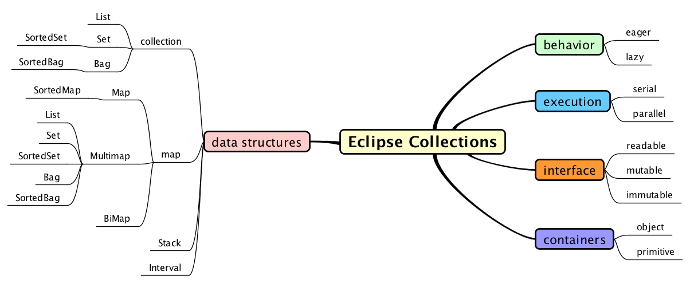
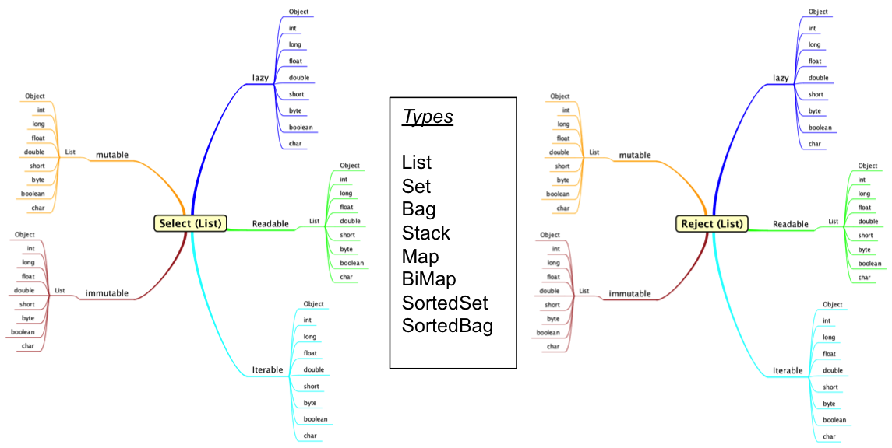
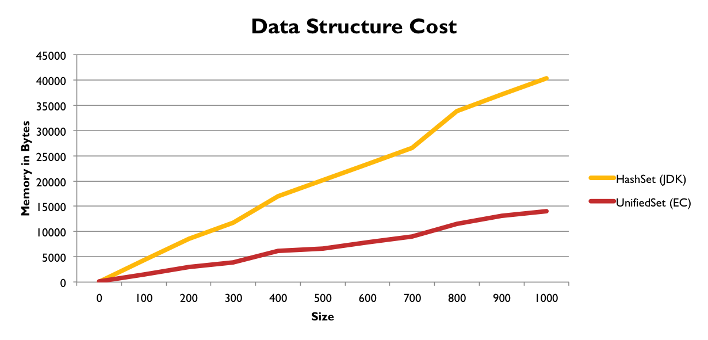
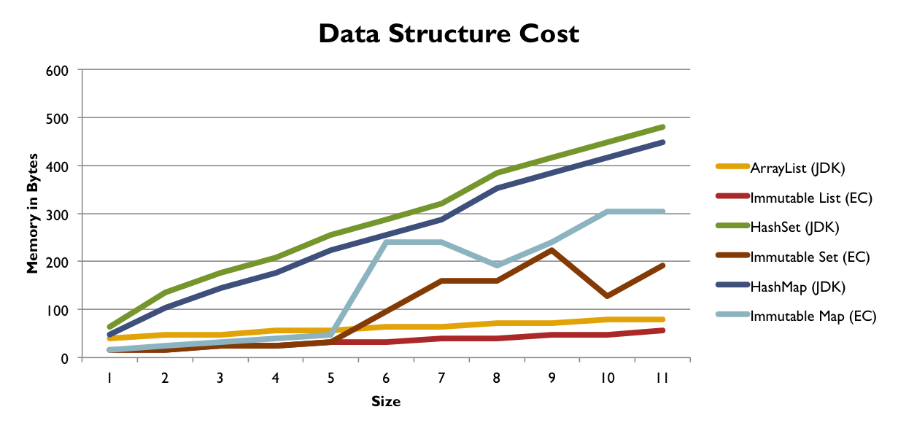
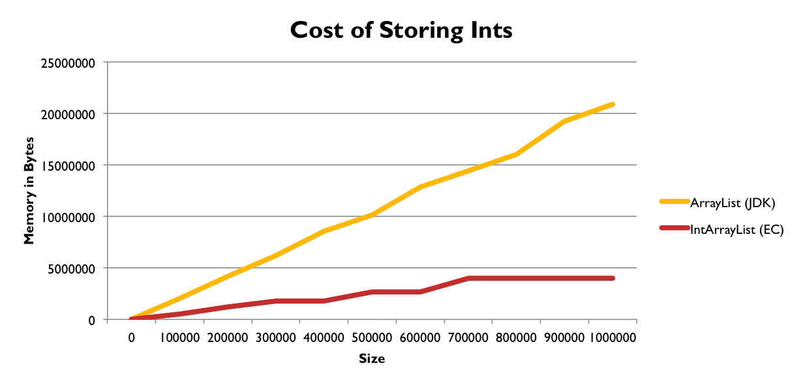
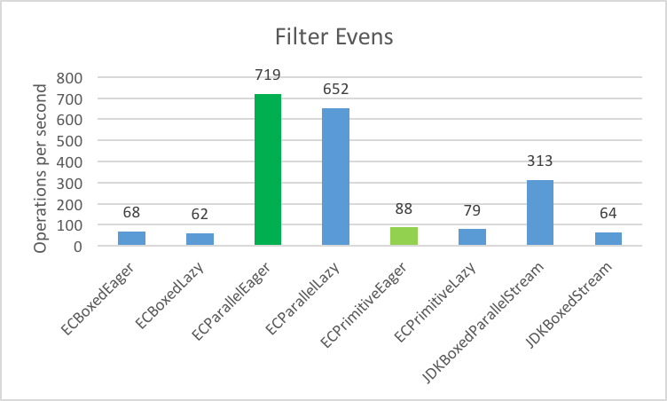
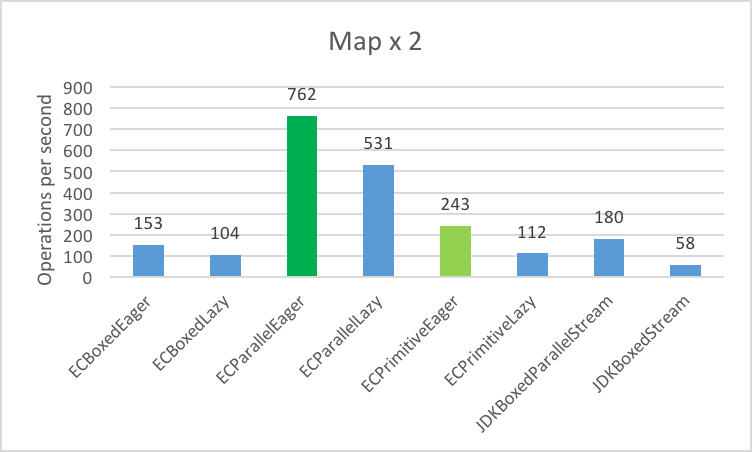
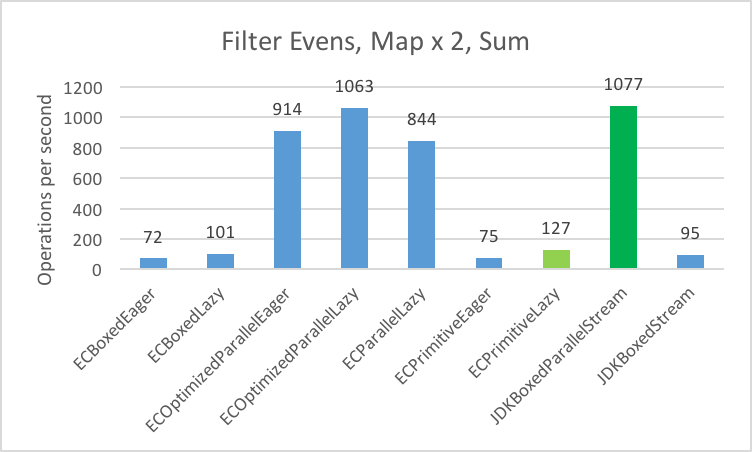

# Eclipse Collections API 设计

2026-08-05⭐
@author Jiawei Mao
***
## 简介

Eclipse Collections 是一款开源 Java 集合框架：

- 具备函数式、链式调用、引用
- 经过长期迭代，设计成熟
- 至少已有 20+ 年的开发历程

EC 最初是高盛集团内部自研工具库（2005），2012 年高盛对外开源（GC-Collections），2015 年项目移交至 Eclipse 基金会托管。

## 设计目标

- 功能完备、支持链式调用、易于上手且体验友好的丰富函数式 API
  - 支持即刻求值、惰性求值、串行执行、并行执行四种运算模式
- 具备内存效率高的数据结构
- 经过优化的算法实现、
- 和 Java 原生代码可无缝兼容
  - 　适配 Java 原生容器、Stream 流
- 提供不可变集合
- 补齐 JDK 缺失的容器类型
  - 区间容器、栈、包 (Bag)、多值映射 (Multimap)、双向映射 (BiMap)
- 原生基础类型专用容器

目前提供的集合类型如下：



## 对称适配原则（Symmetric Sympathy）

**协议与接口的对称性**



**对称式配-1**

| 接口方法                 | Eager   | Lazy    | Parallel | Eager(p)  | Lazy(p)   |
| ------------------------ | ------- | ------- | -------- | --------- | --------- |
| select（筛选）           | co*     | Lazy    | co*      | co*       | Lazy      |
| reject（反向筛选）       | co*     | Lazy    | co*      | co*       | Lazy      |
| collect（元素转换）      | co*     | Lazy    | co*      | co*       | Lazy      |
| detect（查找首个元素）   | T       | T       | T        | Primitive | Primitive |
| injectInto（归约累加）   | R       | R       | 无适配   | R         | R         |
| any/all/none（条件判断） | boolean | boolean | boolean  | boolean   | boolean   |
| toSet（转为集合）        | mSet    | mSet    | mSet     | m(p)Set   | m(p)Set   |
| toBag（转为多重集合）    | mBag    | mBag    | mBag     | m(p)Bag   | m(p)Bag   |
| toList（转为列表）       | mList   | mList   | mList    | m(p)List  | m(p)List  |

- co*=斜边返回
- m=mutable
- p=primitive

**对称适配-2**

| 接口方法                   | Eager        | Lazy         | Parallel | Eager(p) | Lazy(p) |
| -------------------------- | ------------ | ------------ | -------- | -------- | ------- |
| flatCollect（扁平化转换）  | co*          | Lazy         | co*      | R        | Lazy    |
| groupBy（分组）            | co*          | Multimap     | co*      | 无适配   | 无适配  |
| partition（分区拆分）      | co*          | RichIterable | 无适配   | 无适配   | 无适配  |
| chunk（分片）              | RichIterable | RichIterable | 无适配   | co*      | Lazy    |
| zip（配对合并）            | co*          | Lazy         | 无适配   | co*      | 无适配  |
| makeString（拼接字符串）   | String       | String       | String   | String   | String  |
| appendString（追加字符串） | void         | void         | void     | void     | void    |
| count（计数）              | int          | int          | int      | int      | int     |
| min/max（求取最值）        | T            | T            | T        | (p)      | (p)     |

## API 迭代演进方案

| 实现方案                                          | 开发成本  | 复杂程度  | 说明解读                                                     |
| ------------------------------------------------- | --------- | --------- | ------------------------------------------------------------ |
| Static Utility（静态工具类）                      | 低        | 低        | 新增工具静态方法，无需改动原有集合接口，改动代价最小         |
| Default methods（接口默认方法）                   | 较低‑中等 | 中等      | 依托 Java 8 接口 default 关键字扩展接口，需要兼顾旧版本兼容  |
| Lazy API（惰性求值接口）                          | 中等‑偏高 | 中等      | 需要实现惰性可迭代对象、延迟计算逻辑                         |
| Parallel Utility（并行工具）                      | 中等      | 中等‑偏高 | 处理线程、任务拆分、线程池与线程安全问题                     |
| Eager API（立即求值接口）                         | 高        | 中等      | 每一类容器都需要覆写该方法，所有实现类均要改动               |
| New Data Type (Object)（新增引用类型容器）        | 高        | 中等‑偏高 | 需要实现全部成套对称 API（select、collect、partition 等）    |
| Parallel Lazy API（并行‑惰性接口）                | 高        | 高        | 同时管控惰性求值、多线程调度，调试难度大                     |
| New Data Type (Primitive)（新增原生基础类型容器） | 高        | 高        | int/long/float 等每种基础类型都需要全套重载接口，代码体量庞大 |

## 内存效率

### Sets



### Immutable



### Primitives



## 性能优化策略

### Object vs. Primitive 性能

- 测试用例：筛选 (Filter)、映射 (Map)、求和 (Sum)、筛选‑映射‑求和链式运算

- 测试数据集：100 万个整型数字

- 处理器型号：12 核 英特尔 Xeon E5
- 处理器主频：2.7 GHz
- CPU 数量：1
- 物理内核总数：12
- 二级缓存（单核心）：256 KB
- 三级缓存：30 MB
- 运行内存：64 GB
- 性能计量单位：每秒可执行运算次数

### Object vs. Primitive - Filter Evens



- 测试场景：筛选偶数并存入全新列表
- 数值越大代表性能越优异

### Object vs. Primitive - Map x 2



- 测试场景：将每一个数值乘以 2，并把运算结果存入新列表
- 测试数值越大，性能表现越好

### Object vs. Primitive - Filter, Map, Sum



- 测试场景：筛选偶数、数值乘以二、再执行求和运算
- 测试数值越大，则性能越出色

## API

**主要 API 对比**

| **Eclipse Collections**                                      | **Java 8 Streams**                  |
| ------------------------------------------------------------ | ----------------------------------- |
| [`select`](https://www.eclipse.org/collections/javadoc/11.0.0/org/eclipse/collections/api/RichIterable.html#select(org.eclipse.collections.api.block.predicate.Predicate)) | `filter`                            |
| [`reject`](https://www.eclipse.org/collections/javadoc/11.0.0/org/eclipse/collections/api/RichIterable.html#reject(org.eclipse.collections.api.block.predicate.Predicate)) | `filter` (!)                        |
| [`collect`](https://www.eclipse.org/collections/javadoc/11.0.0/org/eclipse/collections/api/RichIterable.html#collect(org.eclipse.collections.api.block.function.Function)) | `map`                               |
| [`flatCollect`](https://www.eclipse.org/collections/javadoc/11.0.0/org/eclipse/collections/api/RichIterable.html#flatCollect(org.eclipse.collections.api.block.function.Function)) | `flatMap`                           |
| [`detect`](https://www.eclipse.org/collections/javadoc/11.0.0/org/eclipse/collections/api/RichIterable.html#detect(org.eclipse.collections.api.block.predicate.Predicate)) | `filter().findFirst().orElse(null)` |
| [`detectIfNone`](https://www.eclipse.org/collections/javadoc/11.0.0/org/eclipse/collections/api/RichIterable.html#detectIfNone(org.eclipse.collections.api.block.predicate.Predicate,org.eclipse.collections.api.block.function.Function0)) | `filter().findFirst().orElseGet()`  |
| [`detectOptional`](http://www.eclipse.org/collections/javadoc/11.0.0/org/eclipse/collections/api/RichIterable.html#detectOptional(org.eclipse.collections.api.block.predicate.Predicate)) | `filter().findFirst()`              |
| [`count`](https://www.eclipse.org/collections/javadoc/11.0.0/org/eclipse/collections/api/RichIterable.html#count(org.eclipse.collections.api.block.predicate.Predicate)) | `filter().count()`                  |
| [`injectInto`](https://www.eclipse.org/collections/javadoc/11.0.0/org/eclipse/collections/api/RichIterable.html#injectInto(IV,org.eclipse.collections.api.block.function.Function2)) | `reduce`                            |
| [`any`](https://www.eclipse.org/collections/javadoc/11.0.0/org/eclipse/collections/api/RichIterable.html#anySatisfy(org.eclipse.collections.api.block.predicate.Predicate)) |                                     |
| [`all`](https://www.eclipse.org/collections/javadoc/11.0.0/org/eclipse/collections/api/RichIterable.html#allSatisfy(org.eclipse.collections.api.block.predicate.Predicate)) |                                     |
| [`noneSatisfy`](https://www.eclipse.org/collections/javadoc/11.0.0/org/eclipse/collections/api/RichIterable.html#noneSatisfy(org.eclipse.collections.api.block.predicate.Predicate)) | `any/all/noneMatch`                 |

**高级 API 对比**

| **Eclipse Collections**                                      | **Java 8 Streams**                                    |
| ------------------------------------------------------------ | ----------------------------------------------------- |
| [`groupBy`](https://www.eclipse.org/collections/javadoc/11.0.0/org/eclipse/collections/api/RichIterable.html#groupBy(org.eclipse.collections.api.block.function.Function,R)) | `collect(Collectors.groupingBy)`                      |
| [`countBy`](https://www.eclipse.org/collections/javadoc/11.0.0/org/eclipse/collections/api/RichIterable.html#countBy(org.eclipse.collections.api.block.function.Function)) | `collect(Collectors.groupingBy(Collectors.counting))` |
| [`aggregateBy`](https://www.eclipse.org/collections/javadoc/11.0.0/org/eclipse/collections/api/RichIterable.html#aggregateBy(org.eclipse.collections.api.block.function.Function,org.eclipse.collections.api.block.function.Function0,org.eclipse.collections.api.block.function.Function2)) | `collect(Collectors.groupingBy(Collectors.reducing))` |
| [`minByOptional`](https://www.eclipse.org/collections/javadoc/11.0.0/org/eclipse/collections/api/RichIterable.html#minByOptional(org.eclipse.collections.api.block.function.Function)) | `min(Comparator.comparing)`                           |
| [`maxByOptional`](https://www.eclipse.org/collections/javadoc/11.0.0/org/eclipse/collections/api/RichIterable.html#maxByOptional(org.eclipse.collections.api.block.function.Function)) | `max(Comparator.comparing)`                           |
| [`distinct`](https://www.eclipse.org/collections/javadoc/11.0.0/org/eclipse/collections/api/ordered/OrderedIterable.html#distinct()) | `distinct.collect(Collectors.toList)`                 |
| [`partition`](https://www.eclipse.org/collections/javadoc/11.0.0/org/eclipse/collections/api/RichIterable.html#partition(org.eclipse.collections.api.block.predicate.Predicate)) | `collect(Collectors.partitioningBy)`                  |
| [`chunk`](https://www.eclipse.org/collections/javadoc/11.0.0/org/eclipse/collections/api/RichIterable.html#chunk(int)) | ~~N/A~~                                               |
| [`zip`](https://www.eclipse.org/collections/javadoc/11.0.0/org/eclipse/collections/api/ordered/OrderedIterable.html#zip(java.lang.Iterable)) | ~~N/A~~                                               |
| [`makeString`](https://www.eclipse.org/collections/javadoc/11.0.0/org/eclipse/collections/api/RichIterable.html#makeString(java.lang.String,java.lang.String,java.lang.String)) | `collect(Collectors.joining)`                         |

### EC 工厂

```java
MutableSet<Integer> set = Sets.mutable.with(1, 2, 3, 4);
MutableList<Integer> list = Lists.mutable.with(1, 2, 3, 4); 
MutableBag<Integer> bag = Bags.mutable.with(1, 2, 3, 4);

MutableList<Integer> array = ArrayAdapter.adapt(1, 2, 3, 4);

CharAdapter string = 
    CharAdapter.adapt("The Quick Brown Fox jumps over a lazy dog.");

MutableMap<Integer, String> map := 
    Maps.mutable.with(1, "1", 2, "2", 3, "3", 4, "4").

Interval interval = Interval.oneTo(4);
```

### EC 集合（Eager）

```java
MutableSet<Integer> set = Sets.mutable.with(1, 2, 3, 4);
MutableList<Integer> list = Lists.mutable.with(1, 2, 3, 4); 
MutableBag<Integer> bag = Bags.mutable.with(1, 2, 3, 4);

MutableList<Integer> array = ArrayAdapter.adapt(1, 2, 3, 4);

CharAdapter string = 
    CharAdapter.adapt("The Quick Brown Fox jumps over a lazy dog.");

MutableMap<Integer, String> map := 
    Maps.mutable.with(1, "1", 2, "2", 3, "3", 4, "4").

Interval interval = Interval.oneTo(4);
```

### EC 集合（Lazy）

```java
set.asLazy().select(each -> each % 2 == 1);    // Set(1 3)
list.asLazy().reject(each -> each % 2 == 0);   // List(1 3)
array.asLazy().collect(Object::toString);      // List("1" "2" "3" "4")

bag.asLazy().detect(each -> each < 2);         // Integer.valueOf(1)
map.asLazy().injectInto("", (r, s) -> r + s);  // "1234"

string.asLazy().anySatisfy(c -> c == 'e');          // true
set.asLazy().allSatisfy(each -> each < 5);          // true
map.asLazy().noneSatisfy(String.class::isInstance); // false

interval.asLazy().toSet();                     // Set(1 2 3 4)
map.asLazy().toBag();                          // Bag("1" "2" "3" "4")
set.asLazy().toList();                         // List(1 2 3 4)
```

