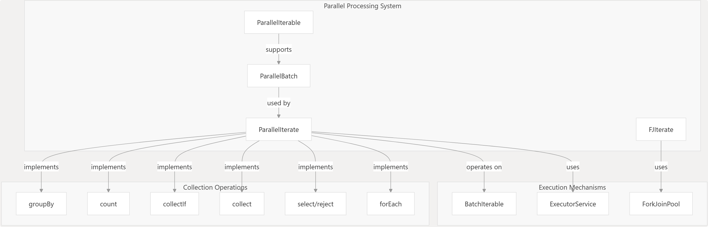
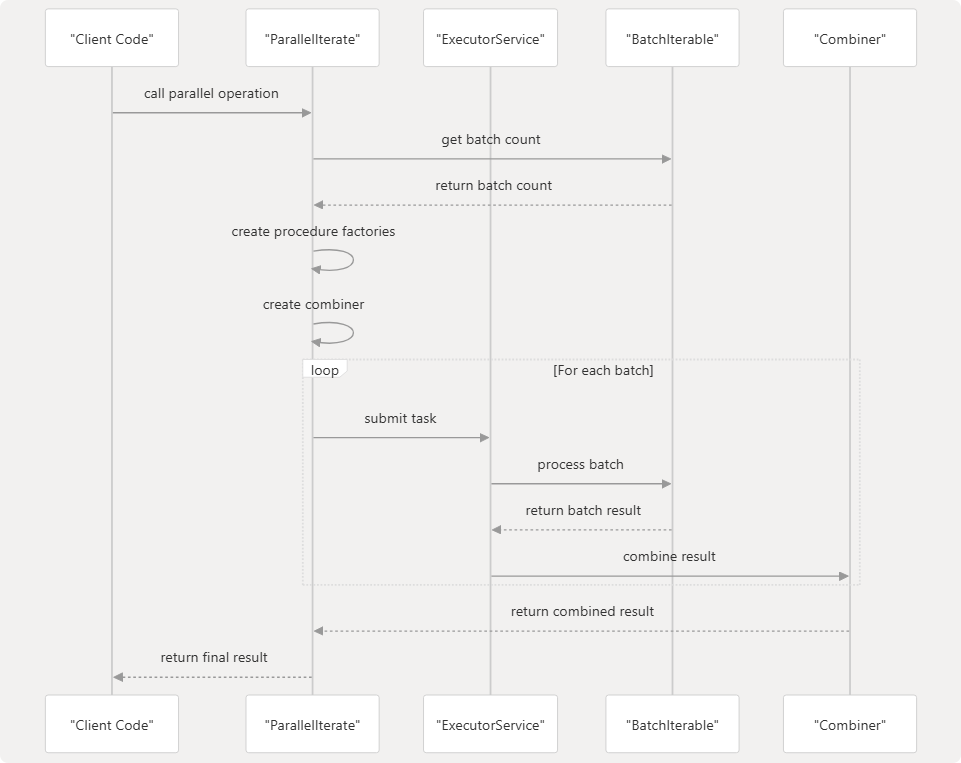
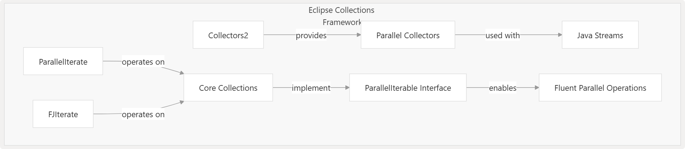
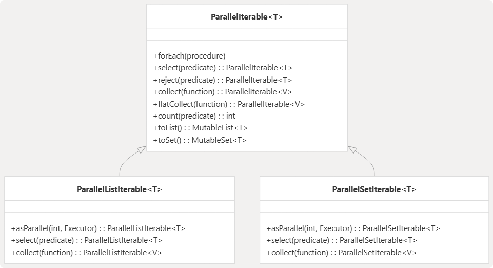

# Eclipse collections 并行处理

Eclipse Collections 主要提供了两种并行处理机制：

1. `ParallelIterate` 实现的基于 executor 的并行
2. `FJIterate` 实现的基于 fork-join 的并行

下面介绍 Eclipse Collections 并行处理架构、使用模式及重要注意事项。

## 并行处理架构

Eclipse Collections 提供了一套强大的并行处理架构，能够高效利用多核处理器。该框架包含了针对不同并行执行策略的专用组件。

### 核心组件



### 基于 Executor 的并行

Eclipse Collections 的主要并行机制通过 `ParallelIterate` 类实现，该类将工作划分为多个批次，并利用执行器服务（executor service）对这些批次进行并发处理。



### 基于 Fork-Join 的并行

Eclipse Collections 还通过 fork-join 模块中的 `FJIterate` 类提供了基于 fork-join 的并行处理能力，它利用 Java 的 Fork-Join 框架来实现递归式的“分而治之”并行处理。

## 使用并行处理



### 基于 Executor

使用基于执行器的并行处理，可以直接使用 `ParallelIterate` 类：

- Parallel forEach 示例

```java
ParallelIterate.forEach(
    collection,      // 待处理集合
    procedure,       // 应用于每个元素的处理过程（procedure）
    executor);       // 可选的 executor service (若省略，则使用默认 executor)
```

- Parallel select 示例

```java
MutableList<String> result = ParallelIterate.select(
    stringCollection,
    string -> string.length() > 5, // Predicate
    new FastList<>()); // 输出位置
```

### Parallel Collectors 与 Java Stream 集成

Eclipse Collections 通过 `Collectors2` 类提供了其收集器的并行版本，使其在与 Java 并行流（parallel streams）配合使用时，能够执行并行的集合操作：

```java
// Using parallel collectors with Java streams
List<Integer> result = list.parallelStream()
    .collect(Collectors2.toList());
```

### ParallelIterable API



该 API 允许对集合执行流畅的并行操作（fluent parallel operations）：

```java
MutableList<String> result = list
    .asParallel(executor, batchSize)
    .select(predicate)
    .collect(function)
    .toList();
```

## 配置与性能注意事项

### 并行化参数

`ParallelIterate` 类包含几个重要的配置参数：

| 参数                  | 描述                       | 默认值                      |
| --------------------- | -------------------------- | --------------------------- |
| `MIN_FORK_SIZE`       | 触发并行处理的最小批次大小 | 10,000                      |
| `TASK_RATIO`          | 任务数与处理器核心数的比例 | 2                           |
| `PARALLEL_TASK_COUNT` | 默认的并行任务数量         | 可用处理器数 * `TASK_RATIO` |

可以根据具体的应用场景和硬件环境对这些参数进行调优，以获得最佳性能。

### 性能注意事项

在 Eclipse Collections 中使用并行处理时，需考虑以下几点：

- **集合大小**：并行化通常对较大的集合更有利。对小型集合，并行化带来的开销可能会超过其带来的收益。
- **操作复杂度**：与 I/O 密集型或简单操作相比，CPU 密集型操作能从并行化中获得更大的收益。
- **批次大小**：需根据集合大小和操作的复杂度调整 batch-size。较大 batch-size 可降低协调开销，但可能导致负载不均衡。
- **线程安全性**：确保在并行操作中使用的过程（procedures）、断言（predicates）和函数（functions）是线程安全的。
- **自定义执行器**：对于资源密集型应用，建议提供一个针对您的工作负载进行过优化的自定义执行器服务（executor service）。

## 并行操作

Eclipse Collections 支持大多数集合操作的并行版本，包括：

| 操作        | 描述                                | 基于 Executor 的 API          | 基于 Fork-Join 的 API   |
| ----------- | ----------------------------------- | ----------------------------- | ----------------------- |
| `forEach`   | 对每个元素执行一个过程（procedure） | `ParallelIterate.forEach()`   | `FJIterate.forEach()`   |
| `select`    | 根据断言（predicate）过滤元素       | `ParallelIterate.select()`    | `FJIterate.select()`    |
| `reject`    | 根据断言排除元素                    | `ParallelIterate.reject()`    | `FJIterate.reject()`    |
| `collect`   | 使用函数转换元素                    | `ParallelIterate.collect()`   | `FJIterate.collect()`   |
| `collectIf` | 有条件地转换元素                    | `ParallelIterate.collectIf()` | `FJIterate.collectIf()` |
| `count`     | 统计满足条件的元素数量              | `ParallelIterate.count()`     | `FJIterate.count()`     |
| `groupBy`   | 根据键函数对元素进行分组            | `ParallelIterate.groupBy()`   | `FJIterate.groupBy()`   |

### collect

### collectIf

### flatCollect

### count

### forEach

对每个元素执行一个过程（`Procedure`）.

```java
ParallelIterate.forEach()
FJIterate.forEach()
```


### forEachInBatchWithExecutor

### forEachInListOnExecutor

### forEachWithIndex

### forEachWithIndexInListOnExecutor

### groupBy

### reject

### select

### aggregateBy

### aggregateInPlaceBy


