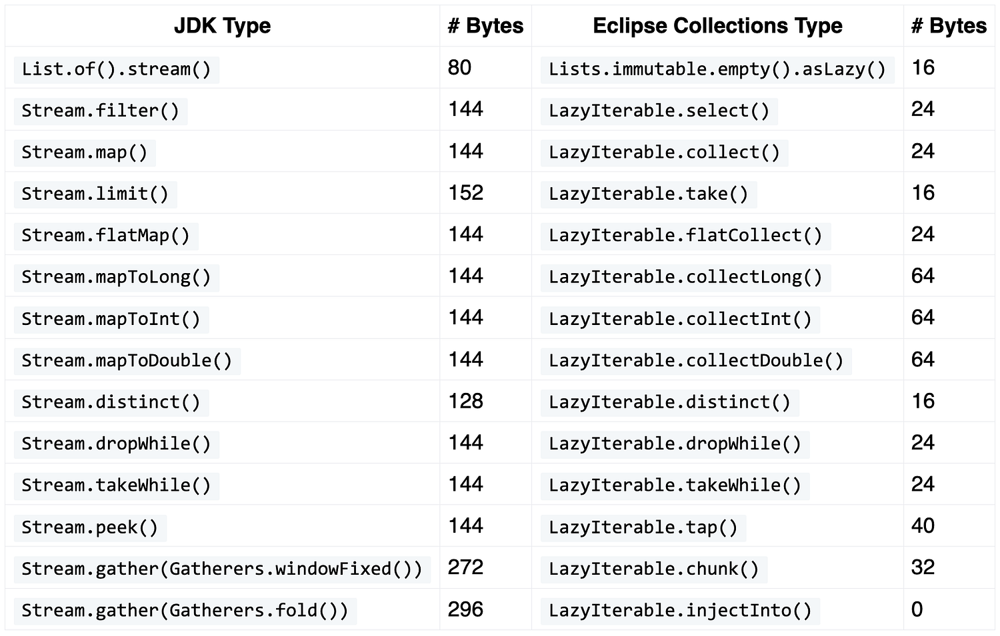

# LazyIterable

## 简介

`LazyIterable` 是 Eclipse Collections 中用于**延迟执行**集合操作（lazy evaluation）的接口。它类似 Java `Stream`，但设计目标不同：EC 的 `LazyIterable` 主要用于在多个迭代操作链中避免创建中间集合，并且只在最终消费时执行计算。

> [!TIP]
>
> 当集合操作链较长、数据量较大、存在大量中间结果或可能提前终止遍历时，应考虑使用 `LazyIterable`。

## EC API 的演变

EC 迭代方法的演变：

```java
MutableList<Integer> list = Lists.mutable.with(1, 2, 3, 4, 5);

MutableList<Object> eager = list.select(each -> each % 2 == 0)
        .collect(Object::toString);

MutableList<String> fused =
        list.collectIf(each -> each % 2 == 0, Object::toString);

MutableList<String> lazy = list.asLazy()
        .select(each -> each % 2 == 0)
        .collect(Object::toString)
        .toList();
assertEquals(eager, fused);
assertEquals(fused, lazy);
```

### 最初是 Eager

EC 最初的遍历方法全部采用 eager。Eager 目前依然是集合接口与实现的默认行为。

在 fluent 写法中连续调用多个 eager 方法，程序就会生成多少个中间集合对象。

```java
MutableList<Object> eager = list.select(each -> false)
        .collect(Object::toString);
```

- 调用 `select` 会生成一个 `MutableList<Integer>`
- 调用 `collect` 又新建一个 `MutableList<String>`

下面这段代码展示了 `select` 和 `collect` 各自的返回类型：

```java
MutableList<Integer> selectEager = list.select(each -> each % 2 == 0);
MutableList<String> collectEager = selectEager.collect(Objects::toString);
```

### 通过融合方法优化

在我们逐步使用高层遍历模式替代命令式 for‑循环之后，时常遇见能够执行多项逻辑的循环代码。这类循环可以拆解成 select（筛选）、collect（映射）等独立步骤，可是拆分之后会生成更多临时垃圾对象。为此 EC 最先推出一批融合式方法，`collectIf`便是其中之一。`collectIf`等同于 `selectAndCollect`，只是名称更为简短。

`collectIf` 接收 `Predicate` 和 `Function`，仅遍历一次就同时完成筛选和转换。

```java
MutableList<String> fused =
        list.collectIf(each -> each % 2 == 0, Object::toString);
```

下面是执行 `collectIf` 操作对应的命令式 for 循环写法：

```java
List<String> imperative = new ArrayList<>();
for (Integer integer : list)
{
    if(integer % 2 == 0){
        imperative.add(integer.toString());
    }
}
```

融合操作 `collectIf` 的执行效率几乎等同于手写命令式 for 循环，同时省去手动创建列表、编写循环、条件判断以及掉哦用集合 `add` 添加元素这些样板代码。

### 惰性求值到来

EC 框架先后完成立即求值 API、融合 API 之后，又为 Eclipse‑Collections 新增惰性编程接口。调用 `asLazy()` 便可开启惰性模式。惰性接口会推迟所有计算，直至触发终结操作（例如 `forEach`、`toList`）之后才开始运算。

惰性操作返回名为 `LazyIterable` 的可迭代类型。它不同于 Java 8 新增的 Stream，`LazyIterable` 支持重复多次使用。

惰性 API 的优势在于不会生成各类中间集合。调用 `asLazy`、`select`、`collect` 只会生成什么都不会执行的 `LazyIterable` 实例。只有最后的 `toList` 调用才会触发运算，并创建目标列表。

```java
MutableList<String> lazy = list.asLazy()
        .select(each -> each % 2 == 0)
        .collect(Object::toString)
        .toList();
```

下方代码展示每一步运算对应的返回结果。

```java
LazyIterable<Integer> lazy1 = list.asLazy();
LazyIterable<Integer> lazy2 = lazy1.select(each -> each % 2 == 0);
LazyIterable<String> lazy3 = lazy2.collect(Objects::toString);
MutableList<String> lazy = lazy3.toList();
```

最后的 `toList` 调用会触发运算执行，并生成结果列表。

## 建议

Eager, fused 和 lazy 各有使用场景。下面是针对 EC 给出的使用准则：

1. 只执行单次运算，或是处理小规模集合时，请选用 eager 求值方法
2. 业务场景刚好适配复合操作（例如 `collectIf`），优先使用融合式方法
3. 需要执行多步运算、采用 eager 模式会产生大量临时集合时，则启用 lazy 求值

### 适合使用 LazyIterable 的场景

1. **多步骤转换链**

```java
peptides.asLazy()
        .select(Peptide::isModified)
        .collect(Peptide::getProtein)
        .toSet();
```

2. **对规模数据，只需要最终结果的一部分**

寻找第一个高质量 PSM。

```java
PSM psm =
    psms.asLazy()
        .select(p -> p.getScore() > threshold)
        .getFirst();
```

3. **避免创建中间对象**
4. **无限或动态数据源**

```java
LazyIterable<Integer> values =
        LazyIterate.infinite(1);
```

可以处理：

```java
values
    .select(x -> x % 2 == 0)
    .take(10);
```

## 内存占用

Java `Stream` 与 Eclipse Collections `LazyIterable` 的内存占用对比：



## 参考

- https://donraab.medium.com/lazyiterable-will-get-back-to-you-later-1f4cf92ce5f5
- https://medium.com/javarevisited/eager-is-easy-lazy-is-labyrinthine-b12605f13048