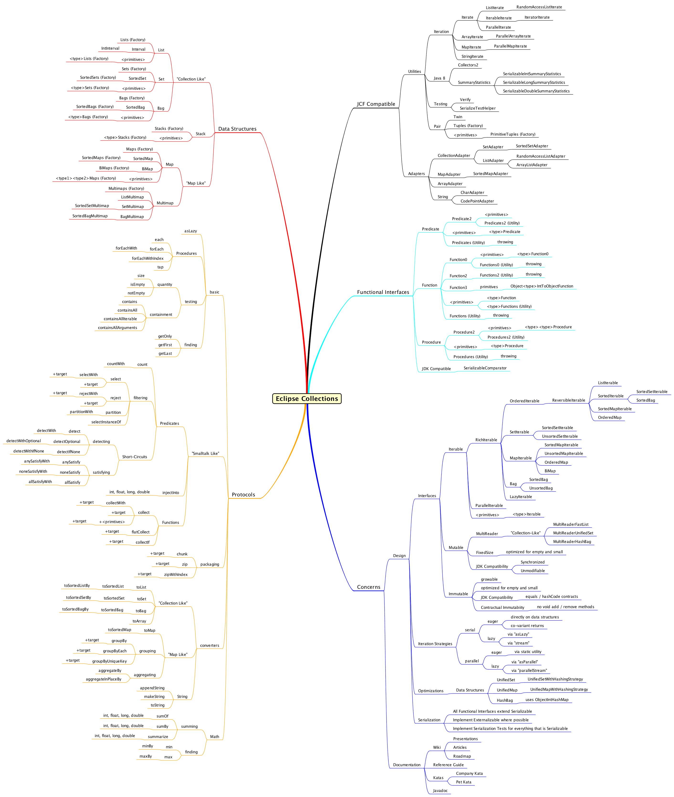

# EC 速查手册

2026-08-03⭐
@author Jiawei Mao
***

## RichIterable API

| [RichIterable](https://www.eclipse.org/collections/javadoc/11.1.0/org/eclipse/collections/api/RichIterable.html) API | 说明                                                         |
| ------------------------------------------------------------ | ------------------------------------------------------------ |
| **[allSatisfy](https://www.eclipse.org/collections/javadoc/11.1.0/org/eclipse/collections/api/RichIterable.html#allSatisfy(org.eclipse.collections.api.block.predicate.Predicate))** | 若全部元素满足断言 `Predicate`，返回 `true`；短路求值        |
| **[anySatisfy](https://www.eclipse.org/collections/javadoc/11.1.0/org/eclipse/collections/api/RichIterable.html#anySatisfy(org.eclipse.collections.api.block.predicate.Predicate))** | 若任意元素满足断言 `Predicate`，返回 true；短路求值          |
| **[appendString](https://www.eclipse.org/collections/javadoc/11.1.0/org/eclipse/collections/api/RichIterable.html#appendString(java.lang.Appendable))** | 将集合的字符串形式输出至指定 `Appendable`；输出内容与 `makeString` 一致 |
| **[asSynchronized](https://www.eclipse.org/collections/javadoc/11.1.0/org/eclipse/collections/api/collection/MutableCollection.html#asSynchronized())*** | 返回同步集合                                                 |
| **[asUnmodifiable](https://www.eclipse.org/collections/javadoc/11.1.0/org/eclipse/collections/api/collection/MutableCollection.html#asUnmodifiable())*** | 返回不可修改集合                                             |
| **[chunk](https://www.eclipse.org/collections/javadoc/11.1.0/org/eclipse/collections/api/RichIterable.html#chunk(int))** | 将集合划分为固定大小的多个子集合；若元素无法均分，最后一块会小一点 |
| **[collect](https://www.eclipse.org/collections/javadoc/11.1.0/org/eclipse/collections/api/RichIterable.html#collect(org.eclipse.collections.api.block.function.Function))** | 通过函数 `Function` 转换元素，返回存放转换结果的新集合（一对一映射） |
| **[count](https://www.eclipse.org/collections/javadoc/11.1.0/org/eclipse/collections/api/RichIterable.html#count(org.eclipse.collections.api.block.predicate.Predicate))** | 统计满足断言 `Predicate` 的元素数量                          |
| **[detect](https://www.eclipse.org/collections/javadoc/11.1.0/org/eclipse/collections/api/RichIterable.html#detect(org.eclipse.collections.api.block.predicate.Predicate))** | 查找第一个满足断言 `Predicate` 的元素数量；短路求值          |
| **[flatCollect](https://www.eclipse.org/collections/javadoc/11.1.0/org/eclipse/collections/api/RichIterable.html#flatCollect(org.eclipse.collections.api.block.function.Function))** | 使用 `Function` 转换元素，并对结果执行扁平化处理             |
| **[forEach](https://www.eclipse.org/collections/javadoc/11.1.0/org/eclipse/collections/api/RichIterable.html#forEach(org.eclipse.collections.api.block.procedure.Procedure))** | 对每个元素执行 `Procedure`，无返回值                         |
| **[groupBy](https://www.eclipse.org/collections/javadoc/11.1.0/org/eclipse/collections/api/RichIterable.html#groupBy(org.eclipse.collections.api.block.function.Function))** | 通过 `Function` 获取每个元素的 key，将 key 与元素存入 `Multimap` |
| **[groupByEach](https://www.eclipse.org/collections/javadoc/11.1.0/org/eclipse/collections/api/RichIterable.html#groupByEach(org.eclipse.collections.api.block.function.Function))** | `groupBy` 的特殊形式，但是返回一个集合。类似 `collect` 与 `flatCollect` 的差异 |
| **[injectInto](https://www.eclipse.org/collections/javadoc/11.1.0/org/eclipse/collections/api/RichIterable.html#injectInto(double,org.eclipse.collections.api.block.function.primitive.DoubleObjectToDoubleFunction))** | 归约计算：以初始值、集合元素依次迭代运算，持续传入上一轮运算结果，返回最终值 |
| **[makeString()](https://www.eclipse.org/collections/javadoc/11.1.0/org/eclipse/collections/api/RichIterable.html#makeString())** | 将集合转换为字符串，可指定可选的起始符、结束符、分隔符       |
| **[max](https://www.eclipse.org/collections/javadoc/11.1.0/org/eclipse/collections/api/RichIterable.html#max(java.util.Comparator))** | 根据自然顺序或指定 `Comparator`，返回最大元素                |
| **[maxBy](https://www.eclipse.org/collections/javadoc/11.1.0/org/eclipse/collections/api/RichIterable.html#maxBy(org.eclipse.collections.api.block.function.Function))** | 通过函数提取元素属性，返回属性值最大的元素                   |
| **[min](https://www.eclipse.org/collections/javadoc/11.1.0/org/eclipse/collections/api/RichIterable.html#min(java.util.Comparator))** | 根据自然顺序或指定 `Comparator`，返回最小元素                |
| **[minBy](https://www.eclipse.org/collections/javadoc/11.1.0/org/eclipse/collections/api/RichIterable.html#minBy(org.eclipse.collections.api.block.function.Function))** | 通过函数提取元素属性，返回属性值最小的元素                   |
| **[reject](https://www.eclipse.org/collections/javadoc/11.1.0/org/eclipse/collections/api/RichIterable.html#reject(org.eclipse.collections.api.block.predicate.Predicate))** | 返回不满足 `Predicate` 的所有元素（反向筛选）                |
| **[select](https://www.eclipse.org/collections/javadoc/11.1.0/org/eclipse/collections/api/RichIterable.html#select(org.eclipse.collections.api.block.predicate.Predicate))** | 返回满足 `Predicate` 的所有元素（正向筛选）                  |
| **[sortThis](https://www.eclipse.org/collections/javadoc/11.1.0/org/eclipse/collections/api/list/MutableList.html#sortThis())**** | 对 `MutableList` 内部数据排序，使用自然顺序或指定 `Comparator` |
| **[sortThisBy](https://www.eclipse.org/collections/javadoc/11.1.0/org/eclipse/collections/api/list/MutableList.html#sortThisBy(org.eclipse.collections.api.block.function.Function))**** | 通过 `Function` 提取元素属性，依据属性自然顺序对列表原地排序 |
| **[toBag()](https://www.eclipse.org/collections/javadoc/11.1.0/org/eclipse/collections/api/RichIterable.html#toBag())** | 将集合转换为默认 `MutableBag` 实现                           |
| **[toImmutable](https://www.eclipse.org/collections/javadoc/11.1.0/org/eclipse/collections/api/collection/MutableCollection.html#toImmutable())*** | 返回不可变集合                                               |
| **[toList()](https://www.eclipse.org/collections/javadoc/11.1.0/org/eclipse/collections/api/RichIterable.html#toList())** | 将集合转换为 `MutableList` 实现                              |
| **[toMap](https://www.eclipse.org/collections/javadoc/11.1.0/org/eclipse/collections/api/RichIterable.html#toMap(org.eclipse.collections.api.block.function.Function,org.eclipse.collections.api.block.function.Function))** | 使用指定 key 函数与 value 函数，将集合转换为 `MutableMap`    |
| **[toSet()](https://www.eclipse.org/collections/javadoc/11.1.0/org/eclipse/collections/api/RichIterable.html#toSet())** | 将集合转换为 `MutableSet`                                    |
| **[toSortedList](https://www.eclipse.org/collections/javadoc/11.1.0/org/eclipse/collections/api/RichIterable.html#toSortedList(java.util.Comparator))** | 将集合转换为 `MutableList`， 并按元素自然顺序排序（返回新集合） |
| **[toSortedListBy](https://www.eclipse.org/collections/javadoc/11.1.0/org/eclipse/collections/api/RichIterable.html#toSortedListBy(org.eclipse.collections.api.block.function.Function))** | 通过 `Function` 提取元素属性，返回依据属性自然排序的新 list  |
| **[toSortedSet](https://www.eclipse.org/collections/javadoc/11.1.0/org/eclipse/collections/api/RichIterable.html#toSortedSet(java.util.Comparator))** | 将集合转换为有序 `MutableSortedSet`，按自然顺序排序          |
| **[toSortedSetBy](https://www.eclipse.org/collections/javadoc/11.1.0/org/eclipse/collections/api/RichIterable.html#toSortedSetBy(org.eclipse.collections.api.block.function.Function))** | 将集合转换为 `MutableSortedSet`，依据 `Function` 返回属性的自然顺序排序 |
| **[zip](https://www.eclipse.org/collections/javadoc/11.1.0/org/eclipse/collections/api/RichIterable.html#zip(java.lang.Iterable))** | 接收另一个 `RichIterable`，将两方元素两两配对，长度较短一方遍历结束后，舍弃较长结合剩余元素 |
| **[zipWithIndex](https://www.eclipse.org/collections/javadoc/11.1.0/org/eclipse/collections/api/RichIterable.html#zipWithIndex®)** | 将集合元素与索引 0 到 n-1 配对                               |

\* on **MutableCollection**
** on **MutableList**

| **Interfaces**                                               | **Description**                             |
| ------------------------------------------------------------ | ------------------------------------------- |
| **[Bag](https://www.eclipse.org/collections/javadoc/11.1.0/org/eclipse/collections/api/bag/Bag.html)** | 类比 JCF *Map* <K, Integer>（统计元素频次） |
| **[Multimap](https://www.eclipse.org/collections/javadoc/11.1.0/org/eclipse/collections/api/multimap/Multimap.html)** | 类比 JCF *Map* <K, Iterable<V>>             |
| **[MutableList](https://www.eclipse.org/collections/javadoc/11.1.0/org/eclipse/collections/api/list/MutableList.html)** | 类比 JCF *List*                             |
| **[MutableMap](https://www.eclipse.org/collections/javadoc/11.1.0/org/eclipse/collections/api/map/MutableMap.html)** | 类比 JCF *Map*                              |
| **[MutableSet](https://www.eclipse.org/collections/javadoc/11.1.0/org/eclipse/collections/api/set/MutableSet.html)** | 类比 JCF *Set*                              |
| **[Pair](https://www.eclipse.org/collections/javadoc/11.1.0/org/eclipse/collections/api/tuple/Pair.html)** | 存放两个关联对象的容器                      |

| **Blocks**                                                   | 说明                                                         |
| ------------------------------------------------------------ | ------------------------------------------------------------ |
| **[Function](https://www.eclipse.org/collections/javadoc/11.1.0/org/eclipse/collections/api/block/function/Function.html)** | 将一种类型 `T` 转换为另一种类型 `V`                          |
| **[Function0](https://www.eclipse.org/collections/javadoc/11.1.0/org/eclipse/collections/api/block/function/Function0.html)** | 返回指定类型的 Java 8 无参 lambda，工厂函数                  |
| **[Function2](https://www.eclipse.org/collections/javadoc/11.1.0/org/eclipse/collections/api/block/function/Function2.html)** | 供 `injectInto` 方法使用，第一个参数为 accumulator，集合中的当前元素为第一个参数 |
| **[ObjectIntProcedure](https://www.eclipse.org/collections/javadoc/11.1.0/org/eclipse/collections/api/block/procedure/ObjectIntProcedure.html)** | 接收对象与 int 两个参数；int 通常为元素在集合中的 index，无返回值 |
| **[Predicate](https://www.eclipse.org/collections/javadoc/11.1.0/org/eclipse/collections/api/block/predicate/Predicate.html)** | 接受类型为 `T` 的对象，返回 boolean                          |
| **[Predicate2](https://www.eclipse.org/collections/javadoc/11.1.0/org/eclipse/collections/api/block/predicate/Predicate2.html)** | 用于 `selectWith`, `detectWith`, `rejectWith` 等方法。第一个参数为集合迭代的当前元素，第二个参数是调入方传入的外部参数 |
| **[Procedure](https://www.eclipse.org/collections/javadoc/11.1.0/org/eclipse/collections/api/block/procedure/Procedure.html)** | 接收类型为 `T` 的对象，无返回值（执行动作，不产生结果）      |
| **[Procedure2](https://www.eclipse.org/collections/javadoc/11.1.0/org/eclipse/collections/api/block/procedure/Procedure2.html)** | 接收 T1，T2 两个类型对象，无返回值                           |

## 静态工具

| 静态工具类                                   | 适用对象             |
| ------------------------------------------------------------ | --------------------------------- |
| [ArrayIterate](https://www.eclipse.org/collections/javadoc/11.1.0/org/eclipse/collections/impl/utility/ArrayIterate.html) | 数组（Arrays）                  |
| [Iterate](https://www.eclipse.org/collections/javadoc/11.1.0/org/eclipse/collections/impl/utility/Iterate.html) | 所有可迭代对象              |
| [LazyIterate](https://www.eclipse.org/collections/javadoc/11.1.0/org/eclipse/collections/impl/utility/LazyIterate.html) | 所有可迭代对象，用于惰性求值 |
| [ListIterate](https://www.eclipse.org/collections/javadoc/11.1.0/org/eclipse/collections/impl/utility/ListIterate.html) | 列表（Lists）                    |
| [MapIterate](https://www.eclipse.org/collections/javadoc/11.1.0/org/eclipse/collections/impl/utility/MapIterate.html) | 映射（Maps）                      |
| **[ParallelArrayIterate](https://www.eclipse.org/collections/javadoc/11.1.0/org/eclipse/collections/impl/utility/ParallelArrayIterate.html)** | 数组，并行迭代 |
| **[ParallelIterate](https://www.eclipse.org/collections/javadoc/11.1.0/org/eclipse/collections/impl/utility/ParallelIterate.html)** | 可迭代对象，并行迭代 |
| **[ParallelMapIterate](https://www.eclipse.org/collections/javadoc/11.1.0/org/eclipse/collections/impl/utility/ParallelMapIterate.html)** | 映射，并行迭代 |
| **[StringIterate](https://www.eclipse.org/collections/javadoc/11.1.0/org/eclipse/collections/impl/utility/StringIterate.html)** | 字符串（strings）               |

## Mindmap

