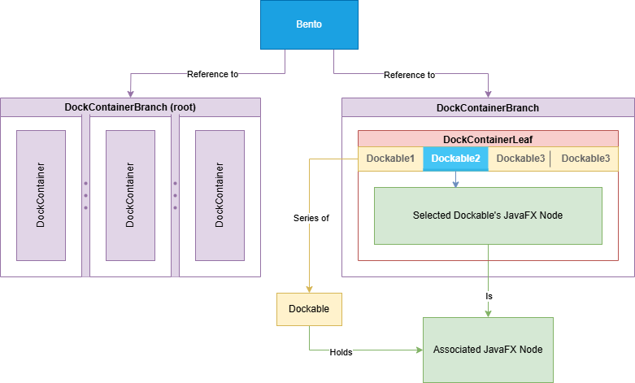
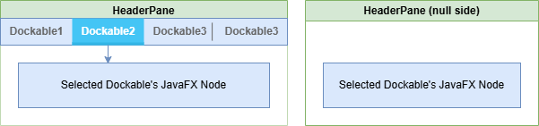

# BentoFX

## 结构

Bento 的 `Node` 结构如下：

- `DockContianerRootBranch`：根分支
  - `DockContainerBranch`：分支，嵌套层级取决于具体实现方式
    - `DockContainerLeaf`：叶节点
      - `Dockable`：可停靠组件，0 或多个

上述层级结构中的各个 `*DockContainer` 和 `Dockable` 实例可以通过 `bento.dockBuilding()` 提供的 Builder 创建。

### 容器

Bento 的 Branch 和 Leaf 模型非常简洁：

- 分支用于承载子容器；
- Leaf 用于显示 Dockable 组件，并处理拖放操作。

| 容器类型              | 说明                                                         |
| --------------------- | ------------------------------------------------------------ |
| `DockContainerBranch` | 在 `SplitPane` 中显示多个 `DockContainer` 实例。因此，其方向和子节点缩放比例的指定方式与 `SplitPane` 相同 |
| `DockContainerLeaf`   | 显示任何数量的 `Dockable` 实例，由 `HeaderPane` 负责渲染     |

### 组件

Bento 提供了一些自定义控件，为了最完美地契合你应用预期的外观和质感（Look and Feel），可能需要为它们编写自定义样式表。

框架依赖中附带了一个参考样式表，可以在 `bento.css` 中找到它。

| 控件                        | 描述                                                         |
| :-------------------------- | :----------------------------------------------------------- |
| **Header**                  | `Dockable`（可停靠组件）的视觉呈现模型。                     |
| **HeaderPane**              | 一个容器控件，内部包含多个 `Header` 子控件，并负责显示当前选中 `Header` 所关联的 `Dockable` 内容。 |
| **Headers**                 | `HeaderPane` 的子控件，本质上是一个 `HBox` 或 `VBox`，用于水平或垂直排列多个 `Header`。 |
| **ButtonHBar / ButtonVBar** | `HeaderPane` 的子控件，用于为 `DockContainerLeaf` 提供按钮区域，例如显示上下文菜单或选择溢出的 `Header` 项。 |

## 参考

- https://github.com/Col-E/BentoFX