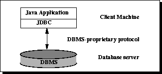
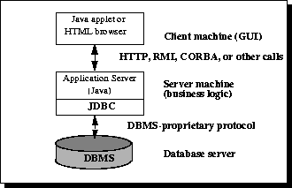

# JDBC 概述

2020-06-20

***

## 简介

JDBC 提供执行 SQL 语句以操作关系数据库的手段。

| 缩写 | 英文全称                   | 解释           |
| ---- | -------------------------- | -------------- |
| JDBC | Java DataBase Connectivity | Java数据库连接 |
| SQL  | Structure Query Language   | 结构化查询语言 |
| DBMS | Database Manage System     | 数据库关系系统 |

JDBC 是用于连接和执行数据库操作的 Java API，提供了一种与平台无关的用于执行SQL语句的标准 Java API，可以方便的实现多种关系型数据库的统一操作，它由一组用Java语言编写的类和接口组成。

在实际开发中可以直接使用 JDBC 进行各个数据库的连接与操作，而且可以向数据库发送各种SQL命令。JDBC 提供了一套标准的接口，各个支持 JAVA 的数据库生产商只要按照此接口提供相应的实现，就可以使用JDBC进行操作。极大的体现了JAVA的可移植性的设计思想。

JDCB 提供以下三种编程操作：

1. 连接到数据源（如数据库）
2. 向数据库发送查询和更新语句
3. 检索并处理数据库响应查询而返回的结果

以下简单的代码片段展示了这三个步骤的基本示例：

```java
public void connectToAndQueryDatabase(String username, String password) {

    Connection con = DriverManager.getConnection(
                         "jdbc:myDriver:myDatabase",
                         username,
                         password);

    Statement stmt = con.createStatement();
    ResultSet rs = stmt.executeQuery("SELECT a, b, c FROM Table1");

    while (rs.next()) {
        int x = rs.getInt("a");
        String s = rs.getString("b");
        float f = rs.getFloat("c");
    }
}
```

1. 首先实例化了一个 `DriverManager` 对象，用于连接数据库驱动并登录数据库；
2. 接着实例化了一个 `Statement` 对象，用来将你的 SQL 查询语句发送到数据库；
3. 然后实例化了一个 `ResultSet` 对象，用于获取查询的结果。
4. 最后，代码执行了一个简单的 `while` 循环来检索并展示这些结果。

就是这么简单！

## JDBC 组成

JDBC 包含四个组件：

- **JDBC API** —— JDBC™ API 提供了从 Java™ 编程语言对关系数据进行编程访问的能力。使用 JDBC API，应用程序可以执行 SQL 语句、检索结果，并将更改传回底层的数据源。JDBC API 还可以在分布式、异构的环境中与多个数据源进行交互。

  JDBC API 是 Java 平台的一部分，该平台包括 Java™ 标准版（Java™ SE）和 Java™ 企业版（Java™ EE）。JDBC 4.0 API 分为两个包：`java.sql` 和 `javax.sql`。这两个包均包含在 Java SE 和 Java EE 平台中。

- **JDBC 驱动程序管理器（DriverManager）** —— JDBC 的 `DriverManager` 类定义的对象可以将 Java 应用程序连接到 JDBC 驱动程序。`DriverManager` 一直是 JDBC 架构的核心。它非常小巧且简单。

  标准扩展包 `javax.naming` 和 `javax.sql` 允许你使用在 Java 命名和目录接口™（JNDI）命名服务中注册的 `DataSource` 对象来建立与数据源的连接。你可以使用这两种连接机制中的任何一种，但建议尽可能使用 `DataSource` 对象。

- **JDBC 测试套件（Test Suite）** —— JDBC 驱动程序测试套件可以帮助你确定 JDBC 驱动程序能否正常运行你的程序。这些测试虽然并非全面详尽，但确实涵盖了 JDBC API 中许多重要的功能。

- **JDBC-ODBC 桥接器（Bridge）** —— Java Software 桥接器提供了通过 ODBC 驱动程序进行 JDBC 访问的功能。请注意，使用此驱动程序需要在每台客户端机器上加载 ODBC 二进制代码。因此，ODBC 驱动程序最适合用在客户端安装不是主要问题的企业网络中，或者用于三层架构中用 Java 编写的应用服务器代码。

本教程（Trail）使用了这四个 JDBC 组件中的前两个来连接数据库，然后构建一个使用 SQL 命令与测试关系数据库进行通信的 Java 程序。最后两个组件则用于专门的环境中，以测试 Web 应用程序或与支持 ODBC 的数据库管理系统（DBMS）进行通信。

## JDBC 架构

JDBC API 支持用于数据库访问的两层和三层处理模型。

**图 1：数据访问的两层架构**



在两层模型中，Java 应用程序直接与数据源进行通信。这要求 JDBC 驱动程序能够与正在访问的特定数据源进行通信。用户的命令被发送到数据库或其他数据源，而这些语句的执行结果则返回给用户。数据源可能位于另一台机器上，用户通过网络与之连接。这被称为客户端/服务器配置，其中用户的机器作为客户端，承载数据源的机器作为服务器。网络可以是企业内网（例如，用于连接公司内部员工的网络），也可以是互联网。

在三层模型中，命令被发送到服务的“中间层”，然后由中间层将命令发送给数据源。数据源处理这些命令并将结果返回给中间层，中间层再将结果发送给用户。MIS（管理信息系统）主管通常非常青睐三层模型，因为中间层使得控制访问权限以及企业数据的更新类型成为可能。另一个优点是它简化了应用程序的部署。最后，在许多情况下，三层架构还能提供性能优势。

**图 2：数据访问的三层架构**



直到最近，中间层通常使用 C 或 C++ 等能提供高性能的语言编写。然而，随着将 Java 字节码转换为高效机器特定代码的优化编译器的引入，以及 Enterprise JavaBeans™ 等技术的出现，Java 平台正迅速成为中间层开发的标准平台。这是一个巨大的优势，使得开发者能够充分利用 Java 的健壮性、多线程和安全性特性。

随着企业越来越多地使用 Java 编程语言编写服务器代码，JDBC API 在三层架构的中间层中得到了越来越广泛的应用。使 JDBC 成为一项服务器技术的特性包括：它对连接池、分布式事务和断开连接的行集（disconnected rowsets）的支持。此外，正是 JDBC API 使得从 Java 中间层访问数据源成为可能。

这段文本主要介绍了关系型数据库的基本概念和完整性规则，翻译如下：

## 关系型数据库概述

数据库是一种以能够被检索的方式存储信息的手段。用最简单的术语来说，关系型数据库是指以包含行和列的表格形式展示信息的数据库。表（Table）被称为“关系（Relation）”，因为它是相同类型对象（即行）的集合。表中的数据可以根据公共键或概念相互关联，而从表中检索相关数据的能力正是“关系型数据库”这一名称的由来。数据库管理系统（DBMS）负责处理数据的存储、维护和检索方式。在关系型数据库的情况下，这些任务由**关系型数据库管理系统**（RDBMS）执行。本书中使用的 DBMS 是一个通用术语，包含了 RDBMS。

### 完整性规则

关系表遵循某些完整性规则，以确保其中包含的数据准确无误且始终可访问。

首先，关系表中的所有行应当是唯一的。如果存在重复行，在确定两种可能的选择中哪一个是正确的时就会产生问题。对于大多数 DBMS，用户可以指定不允许出现重复行；如果进行了此设置，DBMS 将阻止添加任何与现有行重复的新行。

传统关系模型的第二个完整性规则是：列值不能是重复组或数组。数据完整性的第三个方面涉及空值（null）的概念。当某些数据可能不可用时，数据库会使用空值来指示该值缺失。空值并不等同于空白或零。空白被视为与另一个空白相等，零被视为与另一个零相等，但两个空值并不被视为相等。

当表中的每一行都不同时，就可以使用一列或多列来标识特定的行。这个唯一的列或列组合称为**主键**（Primary Key）。作为主键一部分的任何列都不能为空；如果为空，包含它的主键就不再是一个完整的标识符。这一规则被称为**实体完整性**（Entity Integrity）。

**员工表（Employees Table）**

员工表阐释了关系型数据库的一些核心概念。它包含五列和六行，每一行代表一名不同的员工。

| 员工编号 (Employee_Number) | 名 (First_name) | 姓 (Last_Name) | 出生日期 (Date_of_Birth) | 车辆编号 (Car_Number) |
| -------------------------- | --------------- | -------------- | ------------------------ | --------------------- |
| 10001                      | Axel            | Washington     | 1943年8月28日            | 5                     |
| 10083                      | Arvid           | Sharma         | 1954年11月24日           | null                  |
| 10120                      | Jonas           | Ginsberg       | 1969年1月1日             | null                  |
| 10005                      | Florence        | Wojokowski     | 1971年7月4日             | 12                    |
| 10099                      | Sean            | Washington     | 1966年9月21日            | null                  |
| 10035                      | Elizabeth       | Yamaguchi      | 1959年12月24日           | null                  |

该表的**主键** 通常是“员工编号”，因为每个编号都保证是不同的。（此外，在进行比较时，数字也比字符串更高效。）

理论上也可以使用 `First_Name` 和 `Last_Name` 的组合，因为在我们这个示例数据库中，这两个字段的组合也能唯一标识一行。但仅使用 `Last_Name` 是行不通的，因为有两名员工的姓氏都是“Washington”。在这个特定案例中，所有的 `First_Name` 都是不同的，所以有人可能会设想使用该列作为主键，但最好避免使用可能出现重复值的列。如果 Elizabeth Yamaguchi 也在这家公司入职，且主键被设定为“名”，那么 RDBMS 将不允许添加她的名字（前提是已指定不允许重复）。因为表中已经存在一个 Elizabeth，再添加第二个会使主键失去仅标识唯一一行的作用。

请注意，尽管“名”和“姓”的组合在本例中是唯一的复合键，但在更大的数据库中它可能并不唯一。另外还要注意，员工表（Employees table）的前提假设是每名员工只能拥有一辆车。

### SELECT 语句

SQL 是一种专为关系型数据库设计的语言。SQL 包含一组被视为标准的基本命令，所有的关系型数据库管理系统（RDBMS）都会使用它们。例如，所有的 RDBMS 都会使用 `SELECT` 语句。

`SELECT` 语句（也称为查询）用于从表中获取信息。它会指定一个或多个列标题、要从中进行选择的一个或多个表，以及某些选择条件。RDBMS 会返回满足所述条件的列条目所在的行。例如，以下 `SELECT` 语句将获取拥有公司配车的员工的名和姓：

```sql
SELECT First_Name, Last_Name
FROM Employees
WHERE Car_Number IS NOT NULL
```

以下是返回的结果集（即满足“车辆编号”列不为空这一要求的行集合）。因为 `SELECT` 语句（第一行）指定了 `First_Name` 和 `Last_Name` 列，所以会为每个满足条件的行打印出名字和姓氏。`FROM` 子句（第二行）则指明了将从哪个表中选择这些列。

| FIRST_NAME | LAST_NAME  |
| ---------- | ---------- |
| Axel       | Washington |
| Florence   | Wojokowski |

以下代码生成的结果集包含了整张表，因为它请求获取 `Employees` 表中的所有列，且没有任何限制条件（没有 `WHERE` 子句）。请注意，`SELECT *` 的意思是“选择所有列”。

```sql
SELECT *
FROM Employees
```

> [!TIP]
>
> - `SELECT` 选择返回内容
> - `FROM` 选择表格
> - `WHERE` 设置筛选条件

这段文本详细讲解了 SQL 中 `WHERE` 子句的用法及条件匹配规则，翻译如下：

### WHERE 子句

`SELECT` 语句中的 `WHERE` 子句提供了筛选值的条件。例如，在以下代码片段中，只有当某行的 `Last_Name`（姓氏）列以字符串 `'Washington'` 开头时，才会选中该行的值。

```sql
SELECT First_Name, Last_Name
FROM Employees
WHERE Last_Name LIKE 'Washington%'
```

关键字 `LIKE` 用于字符串比较，它支持使用包含通配符的模式进行匹配。例如，在上面的代码片段中，`'Washington'` 末尾有一个百分号（`%`），这表示任何包含 `'Washington'` 字符串且其后跟零个或多个额外字符的值，都将满足此筛选条件。因此，`'Washington'` 或 `'Washingtonian'` 会匹配成功，但 `'Washing'` 则不会。`LIKE` 子句中使用的另一个通配符是下划线（`_`），它代表任意单个字符。例如，

```sql
WHERE Last_Name LIKE 'Ba_man'
```

这条语句会匹配 `'Barman'`、`'Badman'`、`'Balman'`、`'Bagman'`、`'Bamman'` 等。

> [!TIP]
>
> `LIKE` 子句用于比较字符串。

下面的代码片段在 `WHERE` 子句中使用等号（`=`）来比较数字。它会选出被分配了 12 号车的员工的名和姓。

```sql
SELECT First_Name, Last_Name
FROM Employees
WHERE Car_Number = 12
```

下一个代码片段会选出员工编号大于 10005 的员工的名和姓：

```sql
SELECT First_Name, Last_Name
FROM Employees
WHERE Employee_Number > 10005
```

`WHERE` 子句可以变得相当复杂，包含多个条件，在某些 DBMS 中甚至可以嵌套条件。本概述不会涵盖复杂的 `WHERE` 子句，但以下代码片段展示了一个包含两个条件的 `WHERE` 子句；该查询会选出员工编号小于 10100 且没有公司配车的员工的名和姓。

```sql
SELECT First_Name, Last_Name
FROM Employees
WHERE Employee_Number < 10100 AND Car_Number IS NULL
```

还有一种特殊类型的 `WHERE` 子句涉及连接（Join），这将在下一节中解释。

### 连接（Joins）

关系型数据库的一个显著特征是，可以通过一种称为“连接（Join）”的操作从多个表中获取数据。假设在检索到拥有公司配车的员工姓名后，我们还想进一步了解谁驾驶哪辆车，包括车辆的品牌、型号和年份。这些信息存储在另一张名为 Cars 的表中：

**Cars 表**

| Car_Number | Make   | Model    | Year |
| ---------- | ------ | -------- | ---- |
| 5          | Honda  | Civic DX | 1996 |
| 12         | Toyota | Corolla  | 1999 |

为了将这两张表关联起来，它们之间必须有一个**共同的列**。这个列在其中一张表中必须是主键，而在另一张表中则被称为**外键**（foreign key）。在本例中，同时出现在两张表中的列是 `Car_Number`，它是 `Cars` 表的主键，同时也是 `Employees` 表的外键。如果那辆 1996 年的本田思域（Honda Civic）报废并从 `Cars` 表中删除，那么为了维护所谓的“引用完整性（Referential Integrity）”，也必须从 `Employees` 表中移除 5 号车（Car_Number 5）的记录。否则，`Employees` 表中的外键列（`Car_Number`）就会包含一个在 `Cars` 表中没有任何对应项的条目。外键的值必须为空（null），或者等于其所引用表中现有的主键值。这与主键不同，主键是不允许为空的。`Employees` 表的 `Car_Number` 列中存在多个空值，因为员工完全可能没有公司配车。

以下代码用于查询拥有公司配车的员工的名和姓，以及这些车辆的品牌、型号和年份。请注意，`FROM` 子句中同时列出了 `Employees` 表和 `Cars` 表，因为请求的数据分别包含在这两张表中。在列名前使用表名加一个点（`.`），可以明确指出该列属于哪张表。

```sql
SELECT Employees.First_Name, Employees.Last_Name,
    Cars.Make, Cars.Model, Cars.Year
FROM Employees, Cars
WHERE Employees.Car_Number = Cars.Car_Number
```

这将返回一个结果集，大致如下所示：

| FIRST_NAME | LAST_NAME  | LICENSE_PLATE | MILEAGE | YEAR |
| ---------- | ---------- | ------------- | ------- | ---- |
| John       | Washington | ABC123        | 5000    | 1996 |
| Florence   | Wojokowski | DEF123        | 7500    | 1999 |

这段文本介绍了 SQL 中最基础且常用的命令分类，为您翻译如下：

### 常用 SQL 命令

SQL 命令分为不同的类别，其中最主要的两类是数据操纵语言（DML）命令和数据定义语言（DDL）命令。DML 命令用于处理数据，包括检索数据或修改数据以保持其最新状态。DDL 命令则用于创建或修改表以及其他数据库对象（如视图和索引）。

以下是更常用的 DML 命令列表：

- **SELECT** —— 用于查询和显示数据库中的数据。`SELECT` 语句用于指定结果集中需要包含哪些列。应用程序中使用的绝大多数 SQL 命令都是 `SELECT` 语句。
- **INSERT** —— 向表中添加新行。`INSERT` 用于向新创建的表中填充数据，或向已存在的表中添加一行（或多行）新数据。
- **DELETE** —— 从表中删除指定的行或一组行。
- **UPDATE** —— 更改表中一列或一组列中的现有值。

以下是更常用的 DDL 命令：

- **CREATE TABLE** —— 根据用户提供的列名创建表。用户还需要为每列中的数据指定数据类型。不同的关系型数据库管理系统（RDBMS）支持的数据类型各不相同，因此用户可能需要使用元数据（metadata）来确定特定数据库所使用的数据类型。由于表通常只需创建一次，而添加、删除行或更改单个值的操作发生得更为频繁，因此 `CREATE TABLE` 的使用频率通常低于数据操纵命令。
- **DROP TABLE** —— 删除所有行，并从数据库中移除该表的定义。按照 SQL92 过渡级（Transitional Level）规范的要求，JDBC API 的实现必须支持 `DROP TABLE` 命令。但是，对 `DROP TABLE` 的 `CASCADE`（级联）和 `RESTRICT`（限制）选项的支持是可选的。此外，当存在引用了该表的视图或完整性约束时，`DROP TABLE` 的具体行为由具体的实现来决定。
- **ALTER TABLE** —— 向表中添加或删除列。它还可以用于添加或删除表约束，以及修改列的属性。

### 结果集与游标（Result Sets and Cursors）

满足查询条件的行被称为“结果集（Result Set）”。结果集中返回的行数可以是零行、一行或多行。用户可以一次访问结果集中的一行数据，而“游标（Cursor）”正是实现这一操作的机制。你可以将游标想象成指向包含结果集行的文件的一个指针，该指针能够记录当前正在访问的是哪一行。游标允许用户从上到下处理结果集中的每一行，因此常被用于迭代处理。大多数 DBMS 在生成结果集时会自动创建游标。

在早期的 JDBC API 版本中，为结果集游标增加了新功能，允许其向前和向后移动，还允许移动到指定的行，或相对于另一行移动。

### 事务（Transactions）

当一个用户正在访问数据库中的数据时，另一个用户可能同时在访问相同的数据。例如，如果第一个用户正在更新表中的某些列，而第二个用户同时从该表中查询数据，第二个用户可能会获取到部分旧数据和部分更新后的数据。因此，DBMS 使用“事务（Transaction）”来在允许多个用户同时访问数据库（数据并发性）的同时，保持数据处于一致状态（数据一致性）。

事务是由一条或多条 SQL 语句组成的逻辑工作单元。根据数据一致性或并发性是否出现问题，事务以“提交（Commit）”或“回滚（Rollback）”结束。`COMMIT` 语句会将事务中 SQL 语句产生的更改永久保存，而 `ROLLBACK` 语句则会撤销事务中 SQL 语句产生的所有更改。

锁（Lock）是一种禁止两个事务同时操作同一数据的机制。例如，如果某个表上存在未提交的事务，表锁（Table Lock）会阻止该表被删除。在某些 DBMS 中，表锁还会锁定表中的所有行。行锁（Row Lock）则用于防止两个事务修改同一行，或者防止在一个事务仍在修改某行时，另一个事务去查询该行。

### 存储过程（Stored Procedures）

存储过程是一组可以通过名称调用的 SQL 语句。换句话说，它是执行特定任务的可执行代码（微型程序），其调用方式与调用函数或方法相同。传统上，存储过程是使用特定于 DBMS 的编程语言编写的。而新一代的数据库产品允许使用 Java 编程语言和 JDBC API 来编写存储过程。使用 Java 编写的存储过程具有字节码可移植性，可以在不同的 DBMS 之间迁移。一旦编写完成，存储过程就可以被反复使用，因为支持存储过程的 DBMS 会（顾名思义）将其存储在数据库中。

### 元数据（Metadata）

数据库不仅存储用户数据，还存储关于数据库本身的信息。大多数 DBMS 都拥有一组系统表，用于列出数据库中的表、每个表的列名、主键、外键、存储过程等信息。每个 DBMS 都有自己获取表结构和数据库功能信息的函数。JDBC 提供了 `DatabaseMetaData` 接口，驱动程序编写者必须实现该接口，以便其方法能够返回有关该驱动程序和/或其所连接的 DBMS 的信息。例如，该接口中有大量方法用于返回驱动程序是否支持某项特定功能。该接口为用户和工具提供了一种获取元数据的标准化方式。通常，编写工具和驱动程序的开发者是最有可能关注元数据的群体。

## JDBC优缺点

优点

- JDBC API与微软的ODBC(Open Data Base Connection)十分相似，利于用户理解；
- JDBC 使得编程人员从复杂的驱动器调用命令和函数中解脱出来，可以致力于应用程序中的关键地方；
- JDBC 支持不同的关系数据库，这使得程序的可移植性大大加强；
- JDBC API是面向对象的。

缺点

- 使用JDBC，访问数据记录的速度会受到一定程序的影响；
- JDBC结构中包含不同厂家的产品，这就给更改数据源带来了很大麻烦。
