# Eclipse Collections

2026-08-03
@author Jiawei Mao
***
## 简介

Eclipse Collections 是一款功能完备的 Java 集合类库。该类库提供表达力强、执行高效的一套 API 与数据类型，兼顾开发效率与运行性能。其迭代范式借鉴了 Smalltalk 集合框架的设计思想，并且所有集合容器均可与 Java 集合框架（JCF）原生类型兼容混用。

Eclipse Collections 当前正式稳定版（13.0.0）要求 Java 17+；若项目暂无法升级至 Java 17，可选用 12.x 版本，该分支兼容 Java 11+。Eclipse Collections 参与了 OpenJDK 质量推广计划，已在多个 OpenJDK 版本中完成兼容性验证。

主要特点：

- 开发效率（Productivity）
  - 支持**立即求值、懒加载、单线程串行、多线程并行**四种迭代模式
  - 提供语义丰富、函数式风格、链式流式调用的 API，集合类型可直接调用立即执行方法
  - 内置容器类型：列表（List）、集合（Set）、计次集合（Bag）、栈（Stack）、映射表（Map）、一对多映射（Multimap）、双向映射（BiMap）、区间对象（Interval）
  - 每种集合均提供**只读、可变、不可变**三套接口，且支持协变返回类型
    - 参考博文：[Rich, Lazy, Mutable, and Immutable Interfaces in Eclipse Collections](https://medium.com/better-programming/rich-lazy-mutable-and-immutable-interfaces-in-eclipse-collections-ce64a31b5936)
  - 可变集合与不可变集合工厂方法
    - 系列博文：[As a matter of factory, factories matter](https://medium.com/oracledevs/as-a-matter-of-factory-factories-matter-482d8adff094)
  - 为 JDK 原生集合框架（JCF）提供适配器与工具类
    - 参考博文：[Iterate over any Iterable in Java](https://medium.com/javarevisited/iterate-over-any-iterable-in-java-bec78eeeb452)
- 运行性能（Performance）
  - 内存高度优化的容器实现
    - 博文：[**UnifiedMap: How it works?**](https://medium.com/oracledevs/unifiedmap-how-it-works-48af0b80cb37)
    - 博文：[UnifiedSet — The Memory Saver](https://medium.com/oracledevs/unifiedset-the-memory-saver-25b830745959)
  - 经过深度优化的立即求值、懒加载、并行执行 API
    - 博文：[The unparalleled design of Eclipse Collections](https://medium.com/javarevisited/the-unparalleled-design-of-eclipse-collections-e4340b00f79f)
  - 全覆盖基础数据类型的原生特化集合（规避装箱拆箱开销）
    - 基础类型专属容器：原生类型 List、Set、Bag、Stack、Map、Interval
- 成熟度（Maturity）
  - Eclipse Collections 自 2004 年起持续迭代开发，长期在金融系统生产环境落地使用
  - 在 Java 8 引入简洁 Lambda 表达式之前，该框架已稳定运行十余年
    - 博文：[My ten-year quest for concise lambda expressions in Java](https://medium.com/better-programming/my-ten-year-quest-for-concise-lambda-expressions-in-java-39fde576b950)

**添加依赖项**：

```xml
<dependency>
    <groupId>org.eclipse.collections</groupId>
    <artifactId>eclipse-collections</artifactId>
    <version>13.0.0</version>
    <scope>compile</scope>
</dependency>
```

Eclipse Collections 项目主要包含两个 Jar 包：eclipse-collections-api 和 eclipse-collections。前者存放接口定义，后者包含具体实现类。

## 1. 创建集合

学习 Eclipse Collections 首先要掌握各类集合类型的创建方式。该框架同时支持**可变集合**与**不可变集合**两种形态，也兼容对象集合与基本类型特化集合。基本类型特化集合完整覆盖 Java 全部八种原生基本类型：`boolean`、`byte`、`char`、`short`、`int`、`float`、`long`、`double`。

在 Eclipse Collections 中有三种创建集合实例的方式：

1. 直接调用构造函数（例如 `new FastList()`）
2. 调用静态工厂方法（例如 `FastList.newList()`）
3. **使用工厂类**（例如 `Lists.mutable.empty()`）

创建集合最便捷的方式是使用**工厂类**。调用构造方法与静态工厂方法虽然可用，但需要使用者记住目标具体实现类的类名。如果想要统一、规范地创建可变与不可变两种容器，同时不用记忆大量额外的实现类名称，唯一稳妥的方案就是采用工厂类写法。

> [!TIP]
>
> 使用工厂类最简单。

### 通过工厂类创建容器

下面演示如何使用 Eclipse Collections 工厂类创建**可变容器**与**不可变容器**。`eclipse-collections` 实现包与 `eclipse-collections-api` 接口包中都存在一套对等的工厂类。之所以在两个 Jar 中重复定义工厂类，是为了让接口包内的默认方法能够直接实例化各类集合，而无需硬编码依赖具体实现类。两个包内的工厂类均可正常使用，效果完全一致。

工厂类的命名分别为：`Lists`、`Sets`、`Stacks`、`Bags`、`SortedSets`、`SortedBags`、`Maps`、`BiMaps`、`Multimaps`。只要确定要创建的集合类型，只需将类型名称变为复数形式，就能对应找到工厂类名。

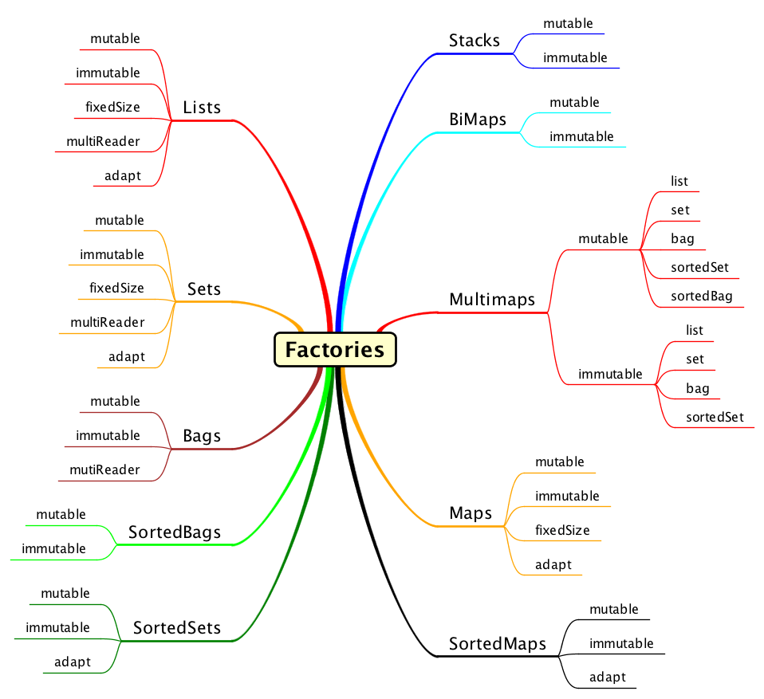

### 对象集合类型

以下是 Eclipse Collections 支持的泛型对象集合类型。所有对象集合均实现了 `java.lang.Iterable` 接口，因此从 Java 5 开始都可以直接使用 Java 增强 for-each 循环遍历。所有**可变集合（MutableCollection）**都继承自 JDK 原生的 `java.util.Collection`；而**不可变集合（ImmutableCollection）**接口并未继承该接口，以此从类型契约层面保证真正的不可变性（不暴露任何增删改等修改元素的方法）。

1. **List** - 有序集合，允许元素重复。内存占用更优，适合快速遍历与按索引查找。
2. **Set** - 无序集合，不允许重复元素。常用于去重、快速判断元素是否存在。
3. **Stack** - 后进先出（LIFO）数据结构。该接口不继承 JDK `Collection`，自有入栈（push）、出栈（pop）方法管理容量。
4. **Bag** - 无序集合，允许重复元素。适合**频次统计**；做内容相等性判断时不依赖元素顺序。
5. **SortedSet** - 有序排序集合，元素不可重复。用于维持数据有序且唯一。
6. **SortedBag** - 可排序集合，允许重复元素。用于有序存储 + 元素计数统计。
7. **Map** - 键值对集合，可通过键快速检索对应值。
8. **SortedMap** - 按键排序的键值对集合，支持按键快速取值。
9. **BiMap** - 双向映射 Map，可通过键查值、也可通过值反向查键。
10. **MultiMap** - 值为集合类型的 `Map`，值容器可以是 `List` / `Set` / `Bag` / `SortedSet` / `SortedBag`。
11. **Interval** - 整数闭区间对象。实现了 `List<Integer>` 和惰性迭代器 `LazyIterable<Integer>`。

#### 创建 Lists

下面演示如何通过 `Lists` 工厂类创建可变列表（`MutableList`）与不可变列表（`ImmutableList`）实例。

```java
// Empty MutableList
MutableList<String> emptyList =
        Lists.mutable.empty();

// MutableList with three elements
MutableList<String> list =
        Lists.mutable.with("1", "2", "3");

// Empty ImmutableList
ImmutableList<String> emptyImmutableList =
        Lists.immutable.empty();

// ImmutableList with three elements
ImmutableList<String> immutableList =
        Lists.immutable.with("1", "2", "3");
```

下方类图展示了 `MutableList`（可变列表）与 `ImmutableList`（不可变列表）之间的继承关系，同时体现如何通过 `Lists` 工厂类创建这两种不同类型的实例。

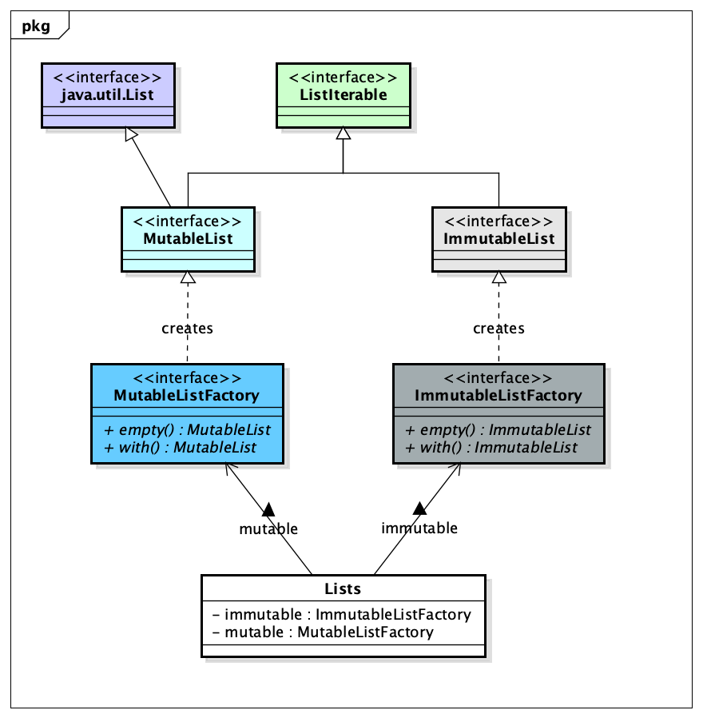

下方时序图展示了发送至 `Lists` 类的调用消息，以及对应的 `MutableListFactory`和 `ImmutableListFactory`类型，直观呈现了上述代码示例的底层执行流程。

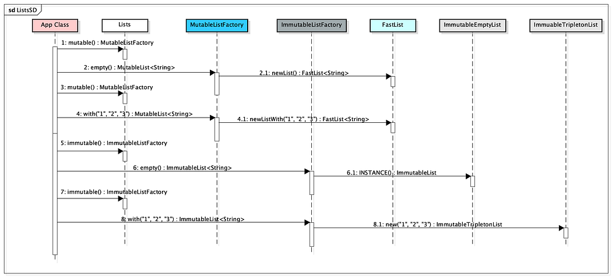

#### 创建 Sets

下面演示如何通过 `Sets` 工厂类创建可变集合 `MutableSet` 和不可变集合 `ImmutableSet` 实例。

```java
// Empty MutableSet
MutableSet<String> emptySet =
        Sets.mutable.empty();

// MutableSet with three elements
MutableSet<String> set =
        Sets.mutable.with("1", "2", "3");

// Empty ImmutableSet
ImmutableSet<String> emptyImmutableSet =
        Sets.immutable.empty();

// ImmutableSet with three elements
ImmutableSet<String> immutableSet =
        Sets.immutable.with("1", "2", "3");
```

下方类图展示了 `MutableSet`（可变集）与 `ImmutableSet`（不可变集）的继承关系，同时说明了如何通过 `Sets` 工厂类创建这两种类型的对象。

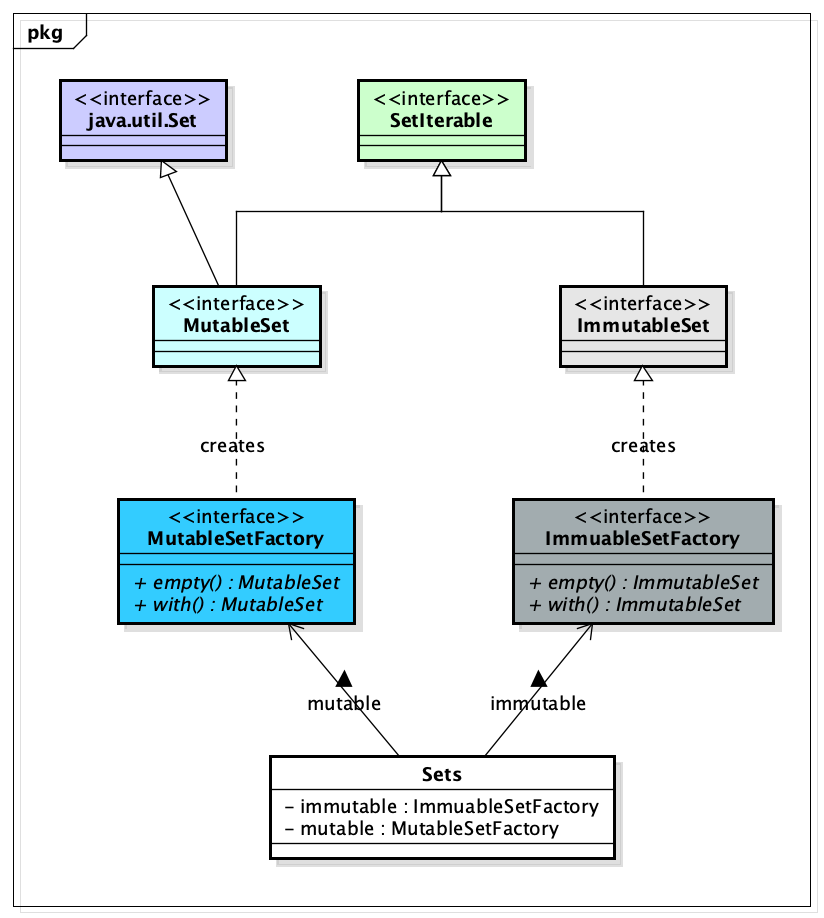

#### 创建 Stacks

下面演示如何通过 `Stacks` 工厂类创建可变栈 `MutableStack` 和不可变栈 `ImmutableStack` 实例。

```java
// Empty MutableStack
MutableStack<String> emptyStack =
        Stacks.mutable.empty();

// MutableStack with three elements
MutableStack<String> stack =
        Stacks.mutable.with("1", "2", "3");

// Empty MutableStack
ImmutableStack<String> emptyImmutableStack =
        Stacks.immutable.empty();

// ImmutableStack with three elements
ImmutableStack<String> immutableStack =
        Stacks.immutable.with("1", "2", "3");
```

下方类图展示了 `MutableStack`（可变栈）与 `ImmutableStack`（不可变栈）之间的继承关系，以及如何通过 `Stacks` 工厂类创建这两种类型。

> [!NOTE]
>
> Eclipse Collections 中的 `Stack` 接口和 JDK 的 `java.util.Stack` 没有任何继承关联。JDK 本身并未定义通用的 `Stack` 顶层接口。

`MutableStack` 并未继承 `MutableCollection`，原因是可变栈的修改方法（`push`、`pop`）和可变集合的修改方法（`add`、`remove`）设计完全不同。

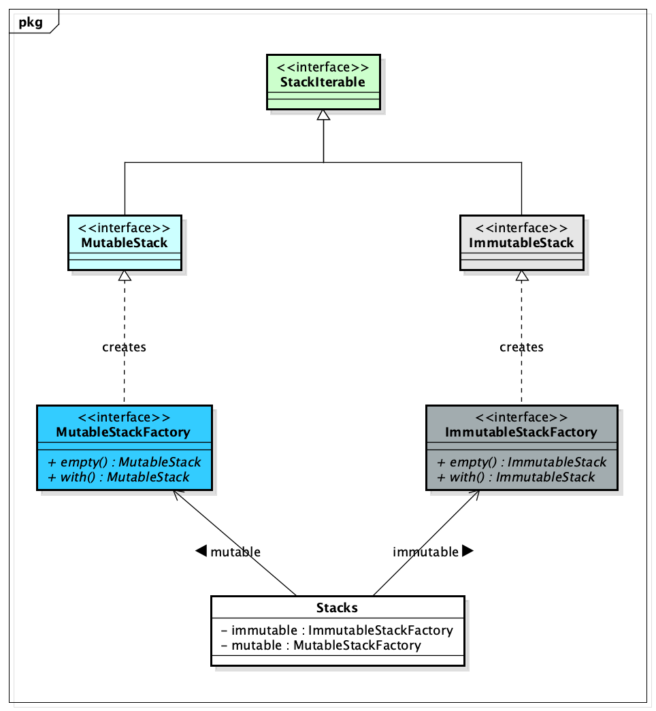

#### 创建 Bags

下面演示如何使用 `Bags` 工厂类创建可变袋子集合 `MutableBag` 和不可变袋子集合 `ImmutableBag` 实例。

```java
// Empty MutableBag
MutableBag<String> emptyBag =
        Bags.mutable.empty();

// MutableBag with three elements
MutableBag<String> bag =
        Bags.mutable.with("1", "2", "3");

// Empty ImmutableBag
ImmutableBag<String> emptyImmutableBag =
        Bags.immutable.empty();

// ImmutableBag with three elements
ImmutableBag<String> immutableBag =
        Bags.immutable.with("1", "2", "3");
```

下方类图展示了 `MutableBag`（可变计数袋）与 `ImmutableBag`（不可变计数袋）的继承层级关系，同时说明通过 `Bags` 工厂类可以创建这两种不同类型的对象。

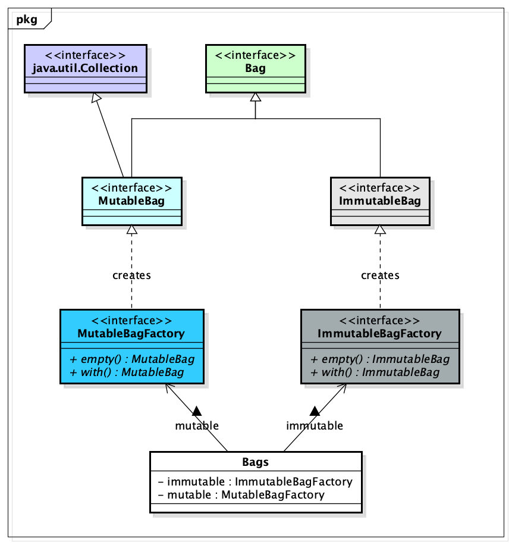

#### 创建 SortedSets

下面演示如何使用 `SortedSets` 工厂类创建**可变有序集合 MutableSortedSet** 和**不可变有序集合 ImmutableSortedSet** 实例。

```java
// Empty MutableSortedSet
MutableSortedSet<String> emptySortedSet =
        SortedSets.mutable.empty();

// MutableSortedSet with three elements
MutableSortedSet<String> sortedSet =
        SortedSets.mutable.with("1", "2", "3");

// Empty ImmutableSortedSet
ImmutableSortedSet<String> emptyImmutableSortedSet =
        SortedSets.immutable.empty();

// MutableSortedSet with three elements
ImmutableSortedSet<String> immutableSortedSet =
        SortedSets.immutable.with("1", "2", "3");
```

下方类图展示了 `MutableSortedSet`（可变有序不重复集合）与 `ImmutableSortedSet`（不可变有序不重复集合）的继承关系，以及如何通过 `SortedSets` 工厂类创建这两种类型。

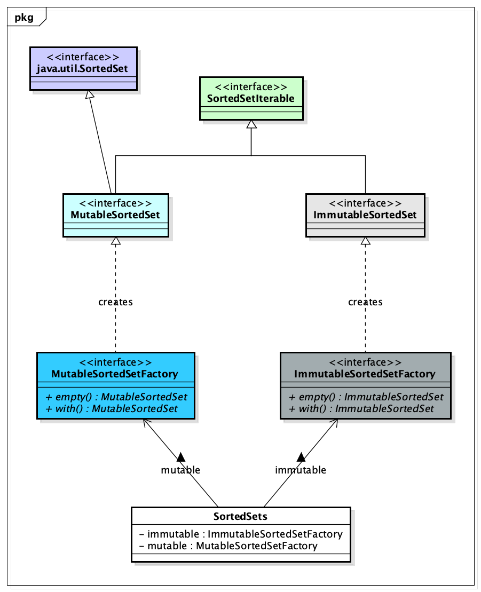

#### 创建 SortedBags

下面演示通过 `SortedBags` 工厂类创建**可变有序计数袋 MutableSortedBag** 和**不可变有序计数袋 ImmutableSortedBag** 实例。

```java
// Empty MutableSortedBag
MutableSortedBag<String> emptySortedBag =
        SortedBags.mutable.empty();

// MutableSortedBag with three elements
MutableSortedBag<String> sortedBag =
        SortedBags.mutable.with("1", "2", "3");

// Empty ImmutableSortedBag
ImmutableSortedBag<String> emptyImmutableSortedBag =
        SortedBags.immutable.empty();

// ImmutableSortedBag with three elements
ImmutableSortedBag<String> immutableSortedBag =
        SortedBags.immutable.with("1", "2", "3");
```

下方类图展示了**可变有序计数袋 MutableSortedBag**与**不可变有序计数袋 ImmutableSortedBag**的继承关联，同时说明如何借助 `SortedBags` 工厂类创建这两种对象。

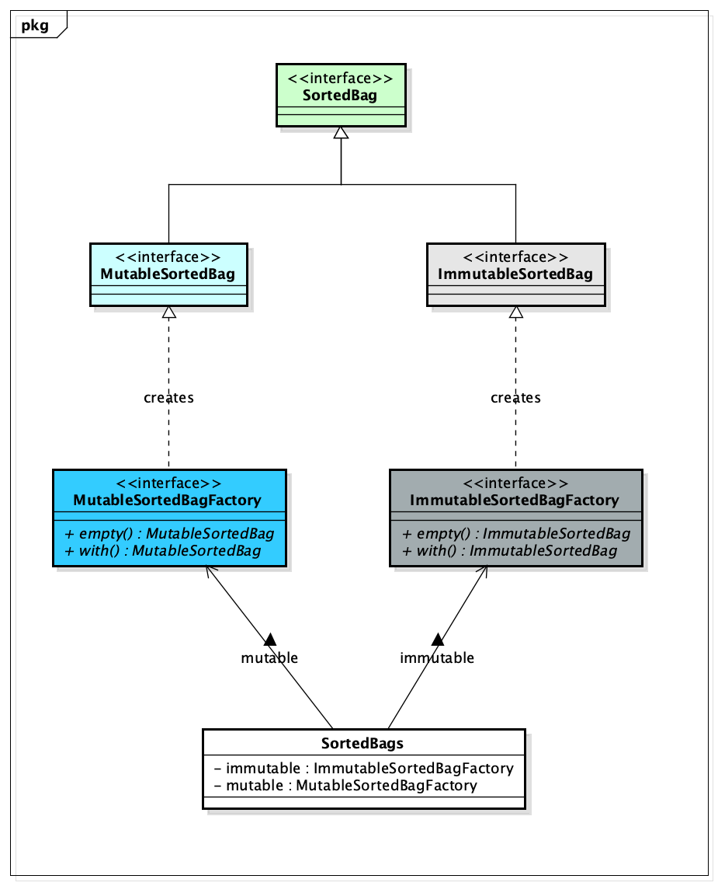

#### 创建 Maps

以下代码示例演示使用 `Maps` 工厂类创建**可变映射 MutableMap** 和**不可变映射 ImmutableMap** 实例。

```java
// Empty MutableMap
MutableMap<String, String> emptyMap =
        Maps.mutable.empty();

// MutableMap with three elements
MutableMap<Integer, String> map =
        Maps.mutable.with(1, "1", 2, "2", 3, "3");

// Empty MutableMap
ImmutableMap<String, String> emptyImmutableMap =
        Maps.immutable.empty();

// MutableMap with three elements
ImmutableMap<Integer, String> immutableMap =
        Maps.immutable.with(1, "1", 2, "2", 3, "3");
```

下方类图展示了 `MutableMap`（可变键值对映射）与 `ImmutableMap`（不可变键值对映射）的继承关系，以及如何通过 `Maps` 工厂类分别创建这两种类型。

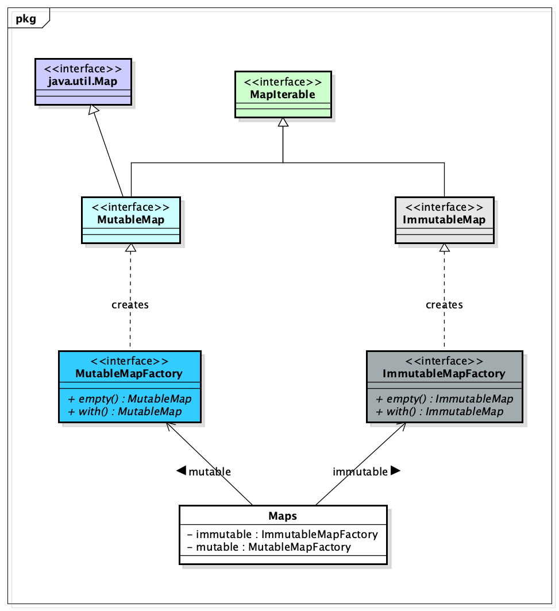

#### 创建 SortedMaps

以下代码示例演示使用 `SortedMaps` 工厂类创建**可变有序映射 MutableSortedMap** 和**不可变有序映射 ImmutableSortedMap** 实例。

```java
// Empty MutableSortedMap
MutableSortedMap<String, String> emptySortedMap =
        SortedMaps.mutable.empty();

// MutableSortedMap with three elements
MutableSortedMap<Integer, String> sortedMap =
        SortedMaps.mutable.with(1, "1", 2, "2", 3, "3");

// Empty MutableSortedMap
ImmutableSortedMap<String, String> emptyImmutableSortedMap =
        SortedMaps.immutable.empty();

// MutableSortedMap with three elements
ImmutableSortedMap<Integer, String> immutableSortedMap =
        SortedMaps.immutable.with(1, "1", 2, "2", 3, "3");
```

下方类图展示了**可变有序 Map（MutableSortedMap）**与**不可变有序 Map（ImmutableSortedMap）**的继承关系，同时说明通过 `SortedMaps` 工厂类可分别创建这两种类型实例。

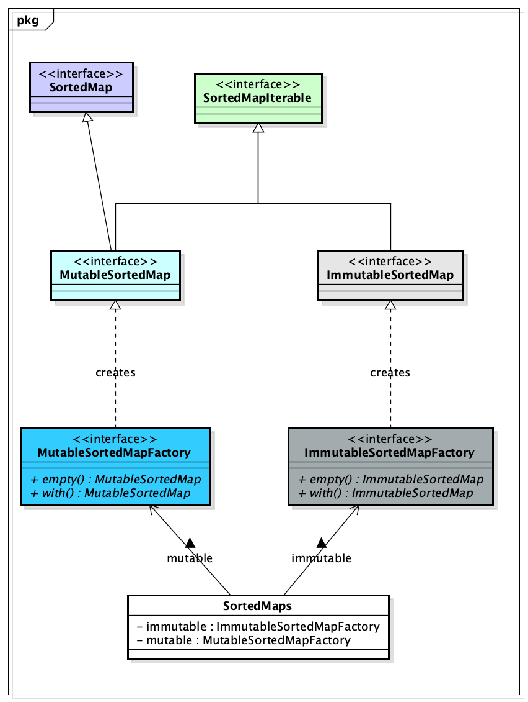

#### 创建 BiMaps

以下代码示例演示如何使用 `BiMaps` 工厂类创建**可变双向映射 MutableBiMap** 和**不可变双向映射 ImmutableBiMap** 实例，同时通过 `inverse()` 方法对双向 Map 进行反转。

```java
// Empty MutableMap
MutableBiMap<Integer, String> emptyBiMap =
        BiMaps.mutable.empty();

// Inverting the MutableMap
MutableBiMap<String, Integer> emptyInverse =
        emptyBiMap.inverse();

// MutableMap with three elements
MutableBiMap<Integer, String> biMap =
        BiMaps.mutable.with(1, "1", 2, "2", 3, "3");

// Inverting the MutableMap
MutableBiMap<String, Integer> biMapInverse =
        biMap.inverse();

// Empty MutableMap
ImmutableBiMap<Integer, String> emptyImmutableBiMap =
        BiMaps.immutable.empty();

// Inverting the ImmutableBiMap
ImmutableBiMap<String, Integer> emptyImmutableBiMapInverse =
        emptyImmutableBiMap.inverse();

// MutableMap with three elements
ImmutableBiMap<Integer, String> immutableBiMap =
        BiMaps.immutable.with(1, "1", 2, "2", 3, "3");

// Inverting the ImmutableBiMap
ImmutableBiMap<String, Integer> immutableBiMapInverse = 
        immutableBiMap.inverse();
```

下方类图展示了**可变双向映射 MutableBiMap**与**不可变双向映射 ImmutableBiMap**的继承关系，同时说明通过 `BiMaps` 工厂类可创建这两种类型实例。

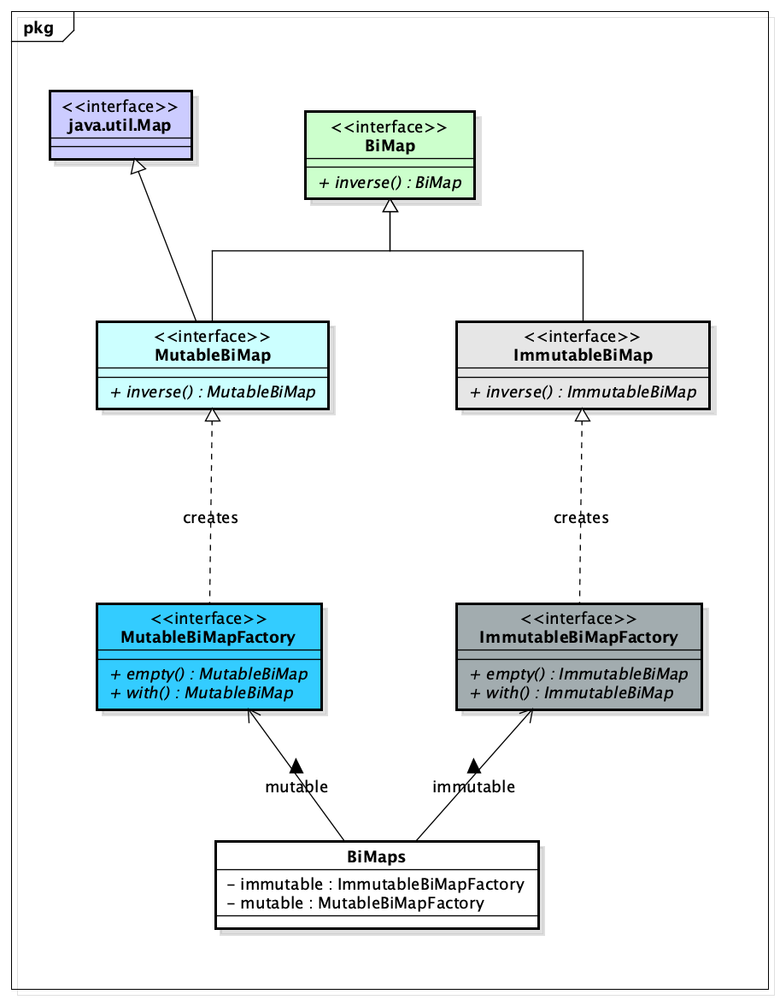

#### 创建 Multimaps

以下代码示例演示如何通过 `Multimaps` 工厂类创建**可变多值映射 MutableMultimap** 和**不可变多值映射 ImmutableMultimap** 实例。`Multimap` 分为基于` List`、`Set`、Bag、SortedSet、SortedBag 的不同实现变体；每一种 Multimap 类型又各自提供可变（Mutable）与不可变（Immutable）两个版本。

```java
// Empty MutableListMultimap
MutableListMultimap<String, String> listMultimap =
        Multimaps.mutable.list.empty();

// Empty MutableSetMultimap
MutableSetMultimap<String, String> setMultimap =
        Multimaps.mutable.set.empty();

// Empty MutableBagMultimap
MutableBagMultimap<String, String> bagMultimap =
        Multimaps.mutable.bag.empty();

// Empty MutableSortedSetMultimap
MutableSortedSetMultimap<String, String> sortedSetMultimap =
        Multimaps.mutable.sortedSet.with(Comparator.<String>naturalOrder());

// Empty MutableSortedBagMultimap
MutableSortedBagMultimap<String, String> sortedBagMultimap =
        Multimaps.mutable.sortedBag.with(Comparator.<String>naturalOrder());

// Empty ImmutableListMultimap
ImmutableListMultimap<String, String> immutableListMultimap =
        Multimaps.immutable.list.empty();

// Empty ImmutableSetMultimap
ImmutableSetMultimap<String, String> immutableSetMultimap =
        Multimaps.immutable.set.empty();

// Empty ImmutableBagMultimap
ImmutableBagMultimap<String, String> immutableBagMultimap =
        Multimaps.immutable.bag.empty();

// Empty ImmutableSortedSetMultimap
ImmutableSortedSetMultimap<String, String> immutableSortedSetMultimap =
        Multimaps.immutable.sortedSet.with(Comparator.<String>naturalOrder());

// Empty ImmutableSortedBagMultimap
ImmutableSortedBagMultimap<String, String> immutableSortedBagMultimap =
        Multimaps.immutable.sortedBag.with(Comparator.<String>naturalOrder());
```

下方类图展示了**可变多值映射 MutableMultimap**与**不可变多值映射 ImmutableMultimap**之间的继承层级关系，同时说明如何通过 `Multimaps` 工厂类创建各类不同实现变体的 Multimap。

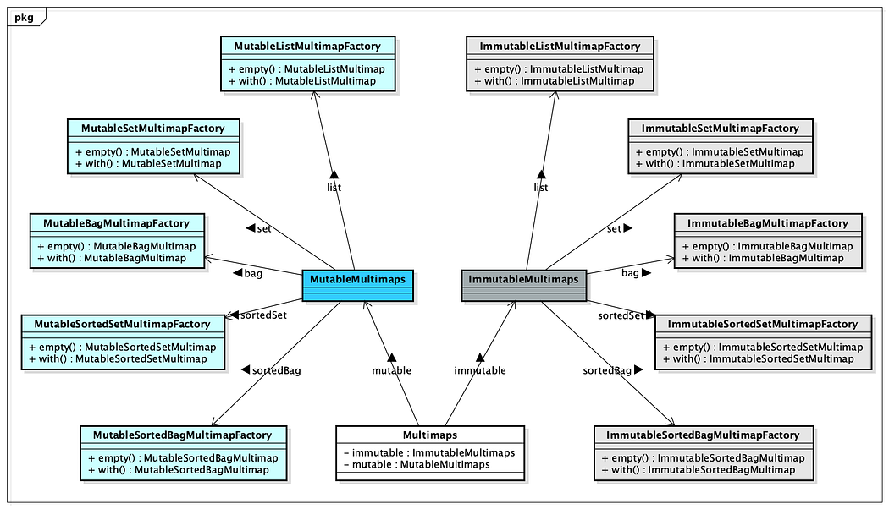

#### 创建 Intervals

`Interval` 类代表**两端闭区间的整数范围**，并且实现了 `List<Integer>` 接口。`Interval` 是**不可变对象**，对于它从 List 接口继承而来的所有**修改**方法，调用时都会抛出 `UnsupportedOperationException`（不支持操作异常）。

一个 `Interval` 包含三个参数：起始值 `from`、终止值 `to`（均为闭区间，包含自身）、步长 `step`。Eclipse Collections 中的 `Interval` 类没有独立的工厂类，也没有单独抽离出顶层接口，仅作为实现类存在于依赖包的实现 jar 中。

```java
// One element Interval
Interval one = Interval.fromToBy(1, 1, 1);

// One to Ten
Interval oneToTen = Interval.oneTo(10);

// Zero to Nine
Interval zeroToNine = Interval.zeroTo(9);

// Evens from 1 to 100
Interval evens = Interval.evensFromTo(1, 100);

// Odds from 1 to 100
Interval odds = Interval.oddsFromTo(1, 100);

// 1 to 20 by 5
Interval oneToTwentybyFive = Interval.fromToBy(1, 100, 5);

// 0 to -100
Interval negativeRange = Interval.zeroTo(-100);
```

### 不常见集合类型

Eclipse Collections 提供了大量 JDK 标准集合库中不存在的扩展集合类型。

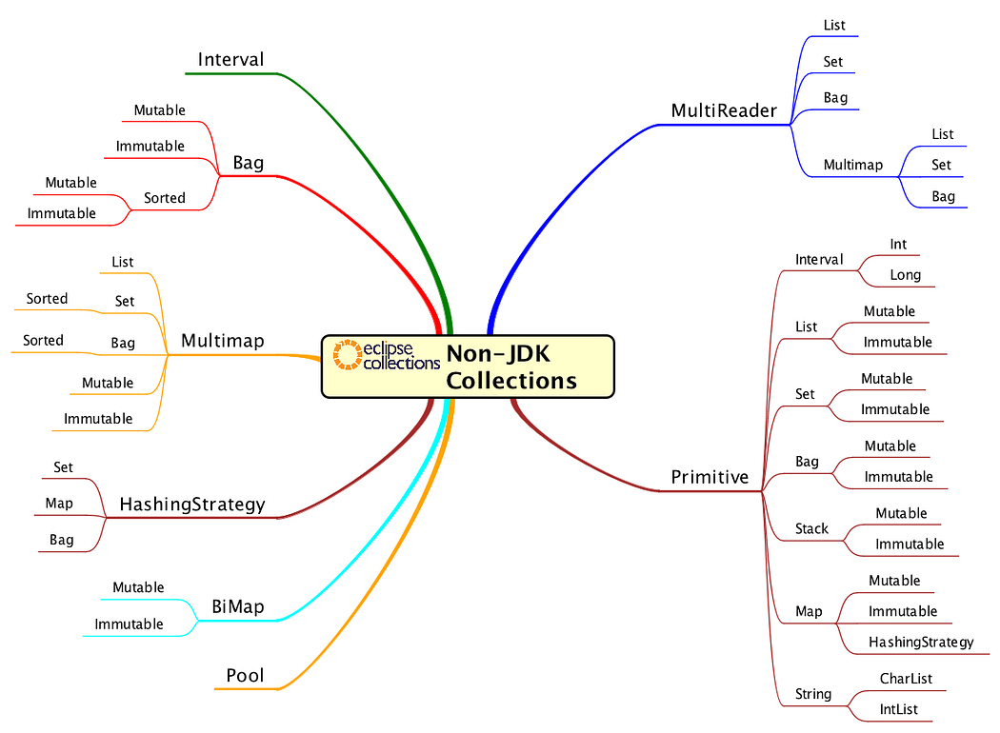

### Primitive 基本类型集合

Eclipse Collections 对 Java 全部 8 种基本数据类型（boolean、byte、char、short、int、float、long、double）都提供了原生集合支持。所有基本类型容器均分为**可变（Mutable）**和**不可变（Immutable）**两种版本。

**基本类型集合工厂类**的命名规则非常简洁：前缀为基础数据类型全称（Boolean、Byte、Char、Short、Int、Float、Long、Double），后面紧跟**复数形式的容器类型名**（Lists、Sets、Bags、Stacks、Maps）。

部分基本类型工厂类示例：`DoubleLists`、`ShortSets`、`FloatBags`、`IntStacks`、`ObjectIntMaps`、`IntObjectMaps`、`CharLongMaps`。

以下为 Eclipse Collections 所支持的全部基本类型（Primitive）集合种类：

1. List
2. Set
3. Stack
4. Bag
5. 基本类型 Key + 基本类型 Value Map
6. 对象 Key + 基本类型 Value Map
7. 基本类型 Key + 对象 Value Map
8. 字符串适配器（String Adapter）
9. Interval（整数区间）

#### 创建 Primitive Lists

下面代码示例演示如何使用 `DoubleLists` 工厂类创建**可变双精度浮点列表 MutableDoubleList** 和**不可变双精度浮点列表 ImmutableDoubleList** 实例。其余全部 8 种基本类型，都有功能完全对等的基本类型 List 工厂类。

```java
// Empty MutableDoubleList
MutableDoubleList emptyList =
        DoubleLists.mutable.empty();

// MutableDoubleList with three elements
MutableDoubleList list =
        DoubleLists.mutable.with(1.0, 2.0, 3.0);

// Empty ImmutableDoubleList
ImmutableDoubleList emptyImmutableList =
        DoubleLists.immutable.empty();

// ImmutableDoubleList with three elements
ImmutableDoubleList immutableList =
        DoubleLists.immutable.with(1.0, 2.0, 3.0);
```

下方类图展示了 `MutableDoubleList`（可变 double 基础类型列表）与 `ImmutableDoubleList`（不可变 double 基础类型列表）之间的继承关系，以及如何通过 `DoubleLists` 工厂类分别创建这两种实例。其余所有基本类型集合的工厂类类图结构都和这个高度相同，因此不再额外附上其他类图。

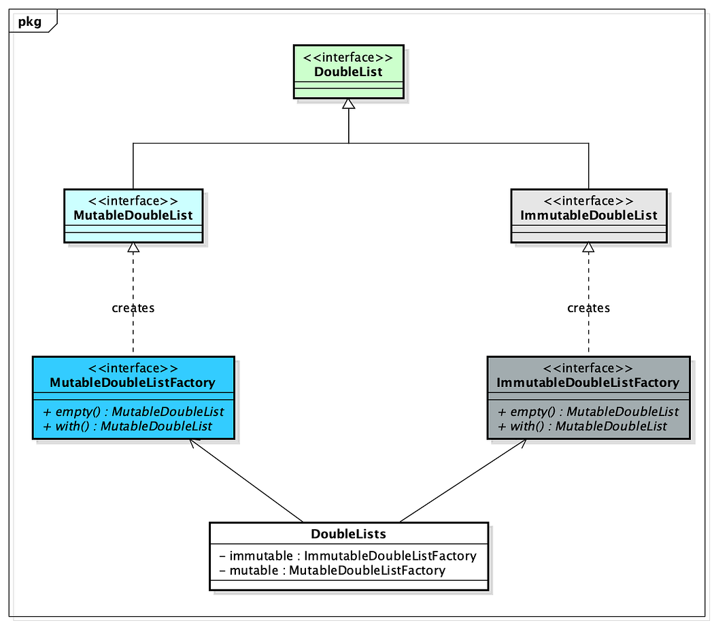

下面的时序图展示了调用 `DoubleLists` 类时发送的方法调用消息，以及其内部对应的 `MutableDoubleListFactory`、`ImmutableDoubleListFactory` 工厂类型的交互过程，直观呈现上面代码示例底层的执行逻辑。

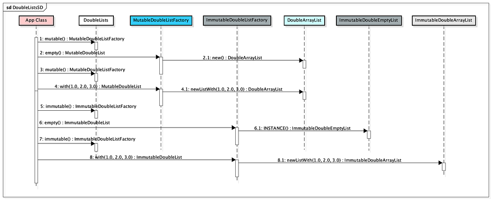

#### 创建 Primitive Sets

以下代码示例演示如何使用 `ShortSets` 工厂类创建**可变短整型集合 MutableShortSet** 和**不可变短整型集合 ImmutableShortSet** 实例。其余 8 种基本数据类型，都有功能完全对等的基础类型 Set 工厂类。

```java
// Empty MutableShortSet
MutableShortSet emptySet =
        ShortSets.mutable.empty();

// MutableShortSet with three elements
MutableShortSet set =
        ShortSets.mutable.with((short) 1, (short) 2, (short) 3);

// Empty ImmutableShortSet
ImmutableShortSet emptyImmutableSet =
        ShortSets.immutable.empty();

// ImmutableShortSet with three elements
ImmutableShortSet immutableSet =
        ShortSets.immutable.with((short) 1, (short) 2, (short) 3);
```

#### 创建 Primitive Stacks

下面代码示例演示使用 `IntStacks` 工厂类创建**可变整型栈 MutableIntStack**与**不可变整型栈 ImmutableIntStack**实例。其余 8 种基本类型均提供等价的基础类型 Stack 工厂。

```java
// Empty MutableIntStack
MutableIntStack emptyStack =
        IntStacks.mutable.empty();

// MutableIntStack with three elements
MutableIntStack stack =
        IntStacks.mutable.with(1, 2, 3);

// Empty ImmutableIntStack
ImmutableIntStack emptyImmutableStack =
        IntStacks.immutable.empty();

// ImmutableIntStack with three elements
ImmutableIntStack immutableStack =
        IntStacks.immutable.with(1, 2, 3);
```

#### 创建 Primitive Bags

以下代码示例演示如何通过 `FloatBags` 工厂类创建**可变浮点型计数袋 MutableFloatBag** 和**不可变浮点型计数袋 ImmutableFloatBag** 实例。其余全部 8 种基本数据类型，都提供功能完全一致的基础类型 Bag 工厂。

```java
// Empty MutableFloatBag
MutableFloatBag emptyBag =
        FloatBags.mutable.empty();

// MutableFloatBag with three elements
MutableFloatBag bag =
        FloatBags.mutable.with(1.0f, 2.0f, 3.0f);

// Empty ImmutableFloatBag
ImmutableFloatBag emptyImmutableBag =
        FloatBags.immutable.empty();

// ImmutableFloatBag with three elements
ImmutableFloatBag immutableBag =
        FloatBags.immutable.with(1.0f, 2.0f, 3.0f);
```

#### 创建 Primitive/Primitive Maps

下面示例演示使用 `CharLongMaps` 工厂类创建**可变 char→long 映射 MutableCharLongMap**与**不可变 char→long 映射 ImmutableCharLongMap**实例。所有「基本类型作为 Key、基本类型作为 Value」的两两组合，都有对等的 `Primitive/Primitive Map` 工厂类。

```java
// Empty MutableCharLongMap
MutableCharLongMap emptyMap =
        CharLongMaps.mutable.empty();

// MutableCharLongMap with three elements
MutableCharLongMap map =
        CharLongMaps.mutable.with('1', 1L, '2', 2L, '3', 3L);

// Empty ImmutableCharLongMap
ImmutableCharLongMap emptyImmutableMap =
        CharLongMaps.immutable.empty();

// ImmutableCharLongMap with three elements
ImmutableCharLongMap immutableMap =
        CharLongMaps.immutable.with('1', 1L, '2', 2L, '3', 3L);
```

#### 创建 Object/Primitive Maps

以下代码示例演示使用 `ObjectIntMaps` 工厂类创建**可变对象 - 整型映射 MutableObjectIntMap**和**不可变对象 - 整型映射 ImmutableObjectIntMap**实例。对于其余 8 种基本数据类型，都存在与之对等的「对象为 Key、基础类型为 Value」的 Map 工厂类。

```java
// Empty MutableObjectIntMap
MutableObjectIntMap<String> emptyMap =
        ObjectIntMaps.mutable.empty();

// MutableObjectIntMap with three elements
MutableObjectIntMap<String> map =
        ObjectIntMaps.mutable.with("1", 1, "2", 2, "3", 3);

// Empty ImmutableObjectIntMap
ImmutableObjectIntMap<String> emptyImmutableMap =
        ObjectIntMaps.immutable.empty();

// ImmutableObjectIntMap with one element
ImmutableObjectIntMap<String> immutableMap =
        ObjectIntMaps.immutable.with("1", 1);
```

#### 创建 Primitive/Object Maps

下面代码示例演示如何使用 `IntObjectMaps` 工厂类创建**可变 int - 对象映射 MutableIntObjectMap** 和**不可变 int - 对象映射 ImmutableIntObjectMap** 实例。Java 八种基本数据类型，都有对应的「基本类型作为 Key、引用对象作为 Value」的 Map 工厂。

```java
// Empty MutableIntObjectMap
MutableIntObjectMap<String> emptyMap =
        IntObjectMaps.mutable.empty();

// MutableIntObjectMap with three elements
MutableIntObjectMap<String> map =
        IntObjectMaps.mutable.with(1, "1", 2, "2", 3, "3");

// Empty ImmutableObjectIntMap
ImmutableIntObjectMap<String> emptyImmutableMap =
        IntObjectMaps.immutable.empty();

// ImmutableObjectIntMap with one element
ImmutableIntObjectMap<String> immutableMap =
        IntObjectMaps.immutable.with(1, "1");
```

#### 创建 String Adapters

Eclipse Collections 提供了三种字符串适配器类，分别是：`CharAdapter`、`CodePointAdapter`、`CodePointList`。可以直接调用类自身的静态工厂方法实例化它们，也可以通过 `Strings` 工厂类来创建。

```java
// Hello World! as a CharAdapter
CharAdapter charAdapter =
        Strings.asChars("Hello World!");

// Hello World! as a CodePointAdapter
CodePointAdapter codePointAdapter =
        Strings.asCodePoints("Hello World!");

// Hello World! from code point values
CodePointAdapter fromCodePoints =
        Strings.toCodePoints(72, 101, 108, 108, 111, 32, 87, 111, 114, 108, 100, 33);

// Hello World! from char values
CharAdapter fromChars =
        Strings.toChars('H', 'e', 'l', 'l', 'o', ' ', 'W', 'o', 'r', 'l', 'd', '!');
```

#### 创建 Primitive Intervals

EC 提供两种基本类型版区间容器：`IntInterval` 和 `LongInterval`。之前介绍过的普通 `Interval` 是对象集合，实现 `List<Integer>`、`LazyIterable<Integer>`；而**基本类型区间直接实现原生不可变基础类型列表**：`IntInterval` 实现 `ImmutableIntList`，`LongInterval` 实现 `ImmutableLongList`。

```java
// One element IntInterval
IntInterval one = IntInterval.fromToBy(1, 1, 1);

// One to Ten LongInterval
LongInterval oneToTen = LongInterval.oneTo(10L);

// Zero to Nine IntInterval
IntInterval zeroToNine = IntInterval.zeroTo(9);

// Evens from 1 to 100 LongInterval
LongInterval evens = LongInterval.evensFromTo(1L, 100L);

// Odds from 1 to 100 IntInterval
IntInterval odds = IntInterval.oddsFromTo(1, 100);

// 1 to 20 by 5 LongInterval
LongInterval oneToTwentybyFive = LongInterval.fromToBy(1L, 100L, 5L);

// 0 to -100 IntInterval
IntInterval negativeRange = IntInterval.zeroTo(-100);
```

## 2. 添加与删除元素

集合最基础的操作方法就是向集合中添加元素、从集合中移除元素。Eclipse Collections 为**可变集合（MutableCollection）**与**不可变集合（ImmutableCollection）**的扩容、缩容提供了设计灵活且成对对称的方法。部分场景下，还会针对特定集合类型提供专属的增删方法。

### Mutable 集合

Eclipse Collections 中所有 `MutableCollection` 类型，除了 `MutableStack` 之外，全都继承自 JDK 的 `java.util.Collection`。`MutableStack` 仅实现了 `java.lang.Iterable` 接口。下文类图展示了 JDK 与 Eclipse Collections 中定义各类集合、可迭代对象增删行为的核心可变接口。

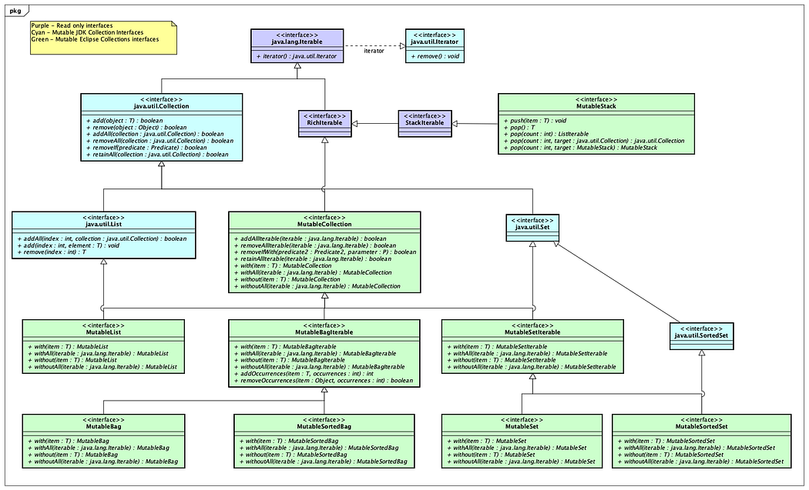

接下来按照可变集合（`MutableCollection`）类型层级自上而下的顺序，逐一讲解并举例演示各类增删元素的方法。

`MutableCollection` 体系下的所有类型都继承了 JDK 的 `java.util.Collection` 接口，这意味着 Eclipse Collections 的可变集合可以与 JDK 原生集合兼容、互相替换使用。下面从 JDK 原生集合接口继承而来的方法开始讲解，包括 `java.util.Collection`、`java.util.List`、`java.util.Set` 中定义的通用增删操作。

#### java.util.Collection

Java 中的 `java.util.Collection` 接口定义了 `add` 和 `remove` 方法，这是向集合添加元素、移除元素最核心的方式。两个方法均接收一个 Object 类型入参，并且都返回布尔值 `boolean`。

`add` 方法的返回值由具体集合类型决定。其通用契约为：如果调用该方法后集合发生了修改，则返回 `true`:

- 对 `List` 而言，该方法几乎永远返回 `true`；
- 对 `Set`，返回值取决于元素是否真正被新增：成功插入返回 `true`，元素已存在未做任何修改则返回 `false`。

`remove` 方法在所有 `Collection` 实现类中的返回规则是统一的：如果集合中存在该元素并且执行了删除操作，就返回 `true`。

`Collection` 的 `add` 方法接收泛型类型参数，而 `remove` 方法入参为 `Object` 类型。Stack Overflow 上有大量问答讨论为什么 `remove` 要设计为接收 `Object`。这种设计让 `remove` 方法约束更宽松、使用更灵活。

`java.util.Collection` 还提供了批量修改方法，共三个：`addAll`、`removeAll`、`retainAll`，它们均接收一个 `Collection` 集合作为入参。另外还有一个特殊方法 `removeIf`，接收断言函数式接口 `Predicate` 作为参数。

下面是在 Eclipse Collections 的 `MutableList` 上使用 JDK `java.util.Collection` 可变修改方法的代码示例。

```java
@Test
public void javaUtilCollection()
{
    Collection<String> collection = Lists.mutable.empty();

    // add
    Assertions.assertTrue(collection.add("1"));
    Assertions.assertTrue(collection.add("2"));
    Assertions.assertTrue(collection.add("3"));
    Assertions.assertEquals(List.of("1", "2", "3"), collection);

    // remove
    Assertions.assertTrue(collection.remove("2"));
    Assertions.assertEquals(List.of("1", "3"), collection);
    Assertions.assertFalse(collection.remove("4"));

    // addAll
    Assertions.assertTrue(collection.addAll(List.of("2")));
    Assertions.assertEquals(List.of("1", "3", "2"), collection);
    Assertions.assertTrue(collection.addAll(List.of("4", "5")));
    Assertions.assertEquals(List.of("1", "3", "2", "4", "5"), collection);

    // removeAll
    Assertions.assertTrue(collection.removeAll(List.of("2", "4")));
    Assertions.assertEquals(List.of("1", "3", "5"), collection);

    // retainAll
    Assertions.assertTrue(collection.retainAll(List.of("1", "3")));
    Assertions.assertEquals(List.of("1", "3"), collection);

    // removeIf
    Assertions.assertFalse(collection.removeIf(
            each -> Integer.parseInt(each) % 2 == 0));
    Assertions.assertEquals(List.of("1", "3"), collection);
    Assertions.assertTrue(collection.removeIf(
            each -> Integer.parseInt(each) % 2 != 0));
    Assertions.assertEquals(List.of(), collection);
}
```

#### java.util.List

`java.util.List` 接口继承了 `Collection` 全部增删方法，同时额外提供了**按指定索引插入**的 `add`、`addAll` 重载，以及接收索引参数的 `remove` 方法。

List 的 `remove(int index)` 是对 `Collection` 原有 `remove(Object o)` 的方法重载。调用 List 的 remove 时必须格外小心，确保调用到预期的重载版本，Stack Overflow 上有大量关于 List 重载 remove 方法踩坑的讨论。

下面是在 Eclipse Collections 的 `MutableList` 上使用 JDK `java.util.List` 接口扩展的可变修改方法的示例。

```java
@Test
public void javaUtilList()
{
    List<String> list = Lists.mutable.with("1", "3", "5");

    // add(index, element) - Note: returns void, not boolean
    list.add(1, "2");
    list.add(3, "4");

    var expected1 = Lists.mutable.with("1", "2", "3", "4", "5");
    Assertions.assertEquals(expected1, list);

    // addAll(index, collection) - Note: returns boolean
    Assertions.assertTrue(list.addAll(0, List.of("0")));

    var expected2 = Lists.mutable.with("0", "1", "2", "3", "4", "5");
    Assertions.assertEquals(expected2, list);

    // remove(index) - Note: returns the element removed
    Assertions.assertEquals("0", list.remove(0));
    Assertions.assertEquals("2", list.remove(1));
    Assertions.assertEquals("4", list.remove(2));

    var expected3 = Lists.mutable.with("1", "3", "5");
    Assertions.assertEquals(expected3, list);
}
```

#### java.util.Set

`java.util.Set` 接口继承了 `Collection` 全部增删方法，**自身没有新增任何额外的添加、删除方法**。不过 `Set` 实现类的 `add` 返回值规则和 List 略有区别：List 调用 `add` 几乎永远返回 `true`；而 Set 的返回值取决于集合内是否已存在等价元素：不存在则添加成功返回 `true`，已存在则不执行插入、直接返回 `false`。

下面演示在 Eclipse Collections 的 `MutableSet` 上使用 JDK `java.util.Set` 继承而来的所有可变增删方法。

```java
@Test
public void javaUtilSet()
{
    Set<String> set = Sets.mutable.empty();

    // add - returns true if new element, or false if element exists
    Assertions.assertTrue(set.add("1"));
    Assertions.assertFalse(set.add("1"));
    Assertions.assertEquals(Set.of("1"), set);
}
```

#### MutableCollection

Eclipse Collections 绝大多数可变集合的顶层父接口是 `MutableCollection`，该接口继承自 JDK 的 `java.util.Collection`，并扩展了一系列用于集合增删扩容、缩容的增强方法。首先，`MutableCollection` 新增了一组**批量修改对称方法**，语义和 JDK `Collection` 的批量方法完全对应，但入参接收 `Iterable` 而非限定死 `Collection`，分别是：`addAllIterable`、`removeAllIterable`、`retainAllIterable`。除此之外还提供了 `removeIfWith` 方法，接收 `Predicate2` 双参数断言外加一个自定义入参，实现带外部参数的条件删除。

下面演示在 Eclipse Collections 的 `MutableList` 上调用父接口 `MutableCollection` 扩展出来的增强可变修改方法。

```java
@Test
public void mutableCollectionPart1()
{
    MutableCollection<String> collection = Lists.mutable.with("1", "2", "3");

    // addAllIterable
    Assertions.assertTrue(
        collection.addAllIterable(Lists.immutable.with("4", "5")));

    var expected1 = Lists.mutable.with("1", "2", "3", "4", "5");
    Assertions.assertEquals(expected1, collection);

    // retainAllIterable
    Assertions.assertTrue(
        collection.retainAllIterable(Lists.immutable.with("4", "5")));

    var expected2 = Lists.mutable.with("4", "5");
    Assertions.assertEquals(expected2, collection);

    // removeAllIterable
    Assertions.assertFalse(
        collection.removeAllIterable(Lists.immutable.with("1", "2", "3")));
    Assertions.assertEquals(expected2, collection);
    Assertions.assertTrue(
        collection.removeAllIterable(Lists.immutable.with("5")));

    var expected3 = Lists.mutable.with("4");
    Assertions.assertEquals(expected3, collection);

    // removeIfWith
    Assertions.assertFalse(
        collection.removeIfWith(Predicates2.equal(), "5"));
    Assertions.assertTrue(
        collection.removeIfWith(Predicates2.equal(), "4"));
    Assertions.assertTrue(collection.isEmpty());
}
```

`MutableCollection` 还提供另一组增删方法：`with`、`withAll`、`without`、`withoutAll`，它们在语义上分别对标 JDK `Collection` 的 `add`、`addAll`、`remove`、`removeAll`。

核心区别仅在于返回值：JDK 原生批量 / 单个增删方法都返回 `boolean`，而 EC 这一组 `with/without` 系列方法返回**集合自身（MutableCollection）**，支持链式调用。

这一组 `with` 开头的方法让集合实例可以变身成流式构建器，通过链式连续调用完成添加、批量添加、删除、批量删除操作。

下面演示在 Eclipse Collections 的 `MutableList` 可变列表上使用 `MutableCollection` 定义的 `with/withAll/without/withoutAll` 流式方法。

```java
@Test
public void mutableCollectionPart2()
{
    MutableCollection<String> collection = Lists.mutable.with("1", "2", "3");

    // with - returns MutableCollection
    MutableCollection<String> with =
            collection.with("4").with("5");

    Assertions.assertSame(with, collection);
    var expected1 = Lists.mutable.with("1", "2", "3", "4", "5");
    Assertions.assertEquals(expected1, collection);

    // withAll - returns MutableCollection
    MutableCollection<String> withAll =
            collection.withAll(List.of("6"));

    Assertions.assertSame(withAll, collection);
    var expected2 = Lists.mutable.with("1", "2", "3", "4", "5", "6");
    Assertions.assertEquals(expected2, collection);

    // without - returns MutableCollection
    MutableCollection<String> without =
            collection.without("5").without("6");

    Assertions.assertSame(without, collection);
    var expected3 = Lists.mutable.with("1", "2", "3", "4");
    Assertions.assertEquals(expected3, collection);

    // withoutAll - returns MutableCollection
    MutableCollection<String> withoutAll =
            collection.withoutAll(List.of("4"));

    Assertions.assertSame(withAll, collection);
    var expected4 = Lists.mutable.with("1", "2", "3");
    Assertions.assertEquals(expected4, collection);
}
```

#### with* 方法的协变返回类型

`MutableList`、`MutableSet`、`MutableBag`、`MutableSortedSet`、`MutableSortedBag`、`MutableBagIterable`、`MutableSetIterable` 这些子接口，全都重写了父接口 `MutableCollection` 中 `with` / `withAll` / `without` / `withoutAll` 四个方法，返回更具体的子类型。这是一项非常实用、便利性极强的设计。

下面通过代码示例，演示 Eclipse Collections 中不同集合类型下 `with` 方法如何通过**协变返回类型**保留具体子接口类型。

```java
@Test
public void covariantReturnTypesForWithMethods()
{
    // with - MutableList
    MutableList<?> list = Lists.mutable.empty()
            .with("1")
            .with("2");

    Assertions.assertEquals(List.of("1", "2"), list);

    // with - MutableSet
    MutableSet<?> set = Sets.mutable.empty()
            .with("1")
            .with("2");

    Assertions.assertEquals(Set.of("1", "2"), set);

    // with - MutableBag
    MutableBag<?> bag = Bags.mutable.empty()
            .with("1")
            .with("2");

    Assertions.assertEquals(Bags.mutable.with("1", "2"), bag);

    // with - MutableSortedSet
    MutableSortedSet<?> sortedSet = SortedSets.mutable.empty()
            .with("1")
            .with("2");

    Assertions.assertEquals(SortedSets.mutable.with("1", "2"), sortedSet);

    // with - MutableSortedBag
    MutableSortedBag<?> sortedBag = SortedBags.mutable.empty()
            .with("1")
            .with("2");

    Assertions.assertEquals(SortedBags.mutable.with("1", "2"), sortedBag);
}
```

`with` 系列方法在自定义 `Collector` 收集器实现时非常实用，用法和 Eclipse Collections 内置 `Collectors2` 工具类中的收集器高度相似。得益于**协变重写能够返回具体集合子类型**，我们可以直接使用**方法引用（Method Reference）**，而不用书写多行逻辑的 Lambda 表达式。

下面代码演示如何将 `MutableList`、`MutableSet` 的 `withAll` 方法作为**方法引用**，用来定义 `Collector` 第三个参数 `combiner`（并行流容器合并器）。

```java
@Test
public void collectorsDefinedUsingCovariantWithAllMethods()
{
    var mutableListCollector = Collector.of(
            Lists.mutable::empty,
            MutableList::add,
            MutableList::withAll);

    MutableList<?> mutableList = List.of(1, 2, 3)
            .stream()
            .collect(mutableListCollector);

    Assertions.assertEquals(List.of(1, 2, 3), mutableList);

    var mutableSetCollector = Collector.of(
            Sets.mutable::empty,
            MutableSet::add,
            MutableSet::withAll);

    MutableSet<?> mutableSet = Set.of(1, 2, 3)
            .stream()
            .collect(mutableSetCollector);

    Assertions.assertEquals(Set.of(1, 2, 3), mutableSet);
}
```

注意：如果为 JDK 原生的 `ArrayList`、`HashSet` 自定义 `Collector`，代码远不如 EC 简洁优雅，根源就是它们的 `addAll` 方法返回值是 `boolean`，无法直接用作方法引用。

下面代码展示：为 JDK 原生 `ArrayList`、`HashSet` 实现 Collector 的合并器（combiner）时，**必须使用多行 Lambda**，无法直接使用简洁的方法引用。

```java
@Test
public void collectorsDefinedUsingAddAllMethods()
{
    var arrayListCollector = Collector.of(
            ArrayList::new,
            List::add,
            (left, right) -> {
                left.addAll(right);
                return left;
            });

    List<?> list = List.of(1, 2, 3)
            .stream()
            .collect(arrayListCollector);

    Assertions.assertEquals(List.of(1, 2, 3), list);

    var hashSetCollector = Collector.of(
            HashSet::new,
            Set::add,
            (left, right) -> {
                left.addAll(right);
                return left;
            });

    Set<?> set = Set.of(1, 2, 3)
            .stream()
            .collect(hashSetCollector);

    Assertions.assertEquals(Set.of(1, 2, 3), set);
}
```

#### MutableBagIterable

`MutableBagIterable` 是 `MutableBag`（可变哈希袋子）与 `MutableSortedBag`（可变有序袋子）的父接口。它除了继承 JDK `Collection` 和 EC `MutableCollection` 的所有方法外，还额外定义了两个核心方法：`addOccurrences` 和 `removeOccurrences`。

Bag 对外使用体验和普通集合一致，增删语义完全兼容，但底层内部本质是一个 **Key→计数（count）的 Map 结构**。借助这两个方法，可以直接对元素的出现次数做增加 / 扣减，不用循环多次调用 `add` 或 `remove` 来达到相同效果。

下面的代码示例演示如何在 `MutableBagIterable` 上使用 `addOccurrences` 和 `removeOccurrences` 方法。

```java
@Test
public void mutableBagIterable()
{
    MutableBagIterable<Integer> bagIterable1 = Bags.mutable.with(1);

    // addOccurences
    bagIterable1.addOccurrences(2, 4);
    bagIterable1.addOccurrences(3, 6);

    // removeOccurences
    bagIterable1.removeOccurrences(2, 2);
    bagIterable1.removeOccurrences(3, 3);

    Bag<Integer> expected1 = Bags.mutable.withOccurrences(1, 1, 2, 2, 3, 3);
    Assertions.assertEquals(expected1, bagIterable1);
}
```

#### MutableStack

唯一一个没有继承 `java.util.Collection` 也没有继承 `MutableCollection` 的集合接口是 **MutableStack（可变栈）**。`MutableStack` 通过 `push`（入栈）和 `pop`（出栈）方法，按照**后进先出（LIFO）**规则完成元素新增与移除。

- `push` 方法返回值为 `void`（无返回）；
- `pop` 方法返回被移除的栈顶元素。

它还提供了重载版本的 `pop`，可以传入一个数量值，一次性弹出多个元素，并以 `List` 列表形式返回所有出栈元素。

以下代码示例演示如何在 `MutableStack` 上使用 `push` 入栈方法以及多个重载版本的 `pop` 出栈方法。

```java
@Test
public void mutableStack()
{
    MutableStack<Integer> stack = Stacks.mutable.empty();

    // push
    stack.push(1);
    stack.push(2);
    stack.push(3);

    var expected1 = Stacks.mutable.with(1, 2, 3);
    Assertions.assertEquals(expected1, stack);

    // pop
    Assertions.assertEquals(3, stack.pop());
    Assertions.assertEquals(2, stack.pop());
    Assertions.assertEquals(1, stack.pop());

    // push
    expected1.forEach(stack::push);

    var expected2 = Stacks.mutable.with(3, 2, 1);
    Assertions.assertEquals(expected2, stack);

    // pop with count
    ListIterable<Integer> popCount = stack.pop(3);

    var expected3 = Lists.mutable.with(1, 2, 3);
    Assertions.assertEquals(expected3, popCount);
}
```

### Immutable 集合

## Eclipse Collections 可视化

下面使用思维导图概览 EC 的 API、接口、工厂方法、静态工具与适配器体系。

### 对称接口体系对称

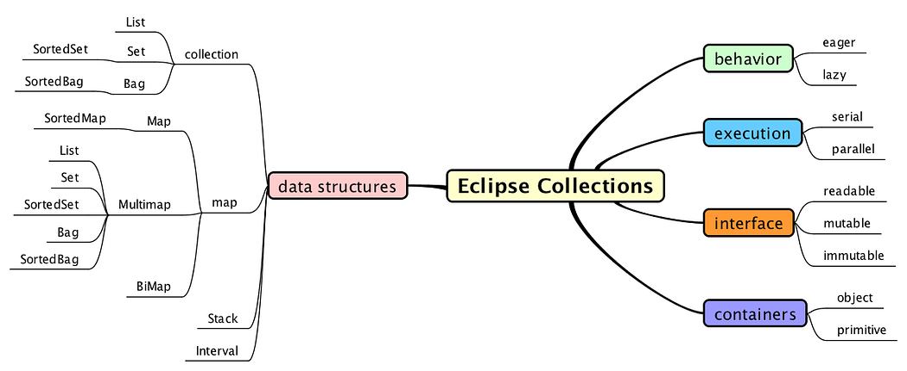

### RichIterable API

`RichIterable` API 是 Eclipse Collections 中所有容器类共享的一套通用方法集合。部分方法提供了重载版本，可接收额外入参。下图按照功能类型对这组方法进行了归类。

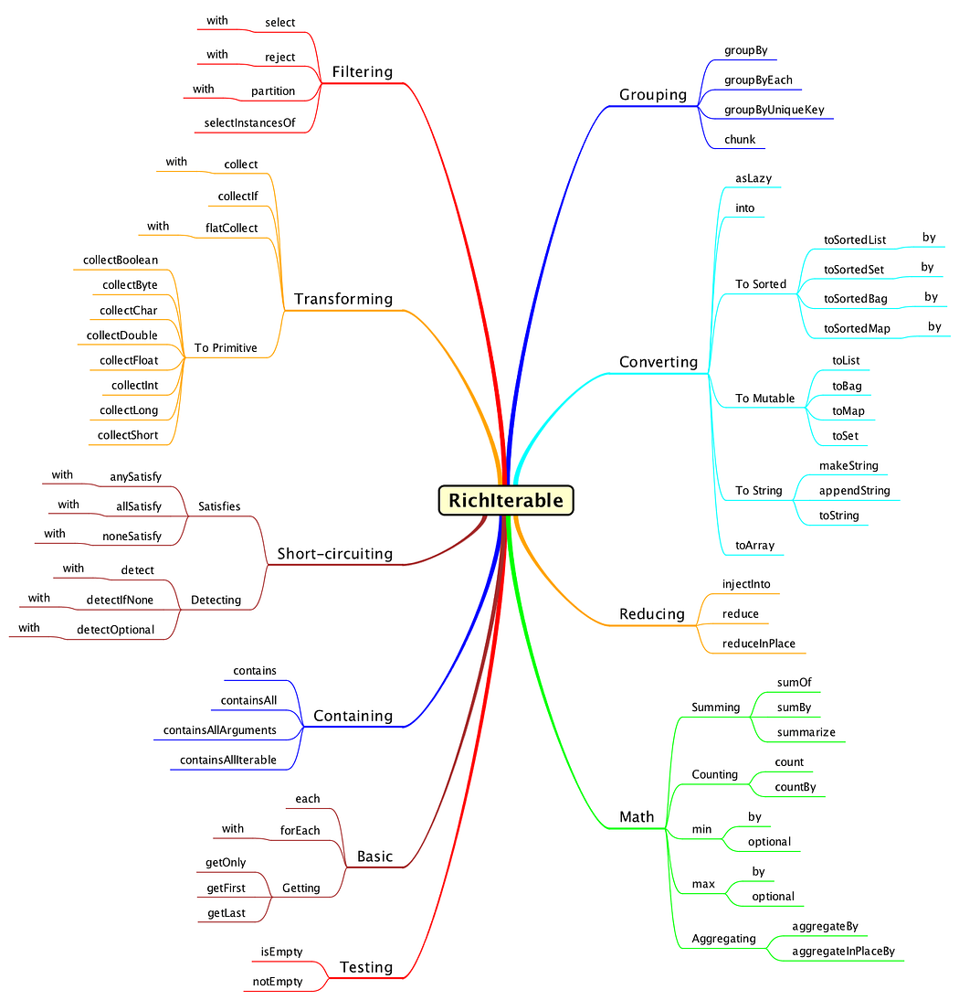

### RichIterable 接口继承体系

RichIterable 是 Eclipse Collections 绝大多数容器类型的顶层基类。即便是存储对象值的 Map 类型，在框架中也继承自 `RichIterable`。

对于键类型为 `K`、值类型为 `V` 的 Map，它等价于继承了 `RichIterable<V>`，这让 Map 可以直接对**值集合**调用一整套丰富的行为方法。你依然可以单独遍历键，或者同时遍历键值对，框架为此提供了专门的独立方法。

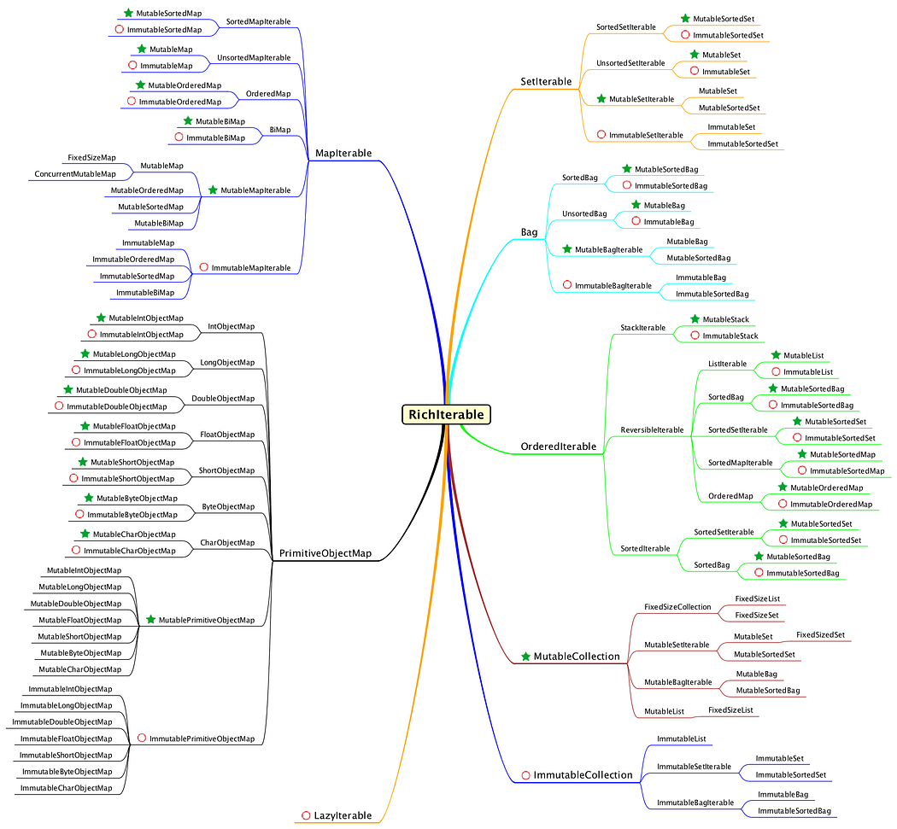


## 参考

- [Eclipse Collections Home](https://eclipse.dev/collections/)
- [Eclipse Collections GitHub](https://github.com/eclipse-collections/eclipse-collections)
- [Eclipse Collections Reference Guide](https://github.com/eclipse-collections/eclipse-collections/blob/master/docs/0-RefGuide.adoc)

- https://medium.com/oracledevs/visualizing-eclipse-collections-646dad9533a9