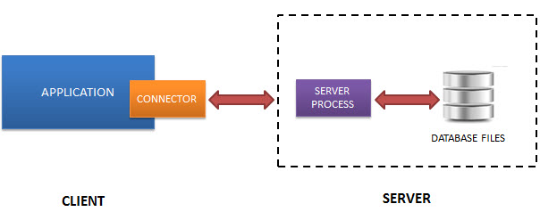
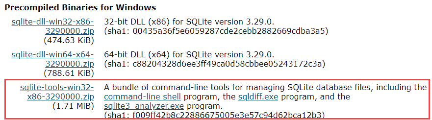
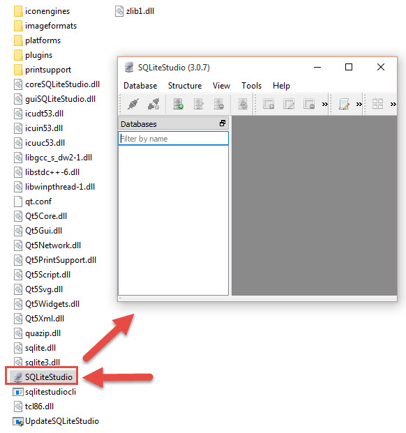
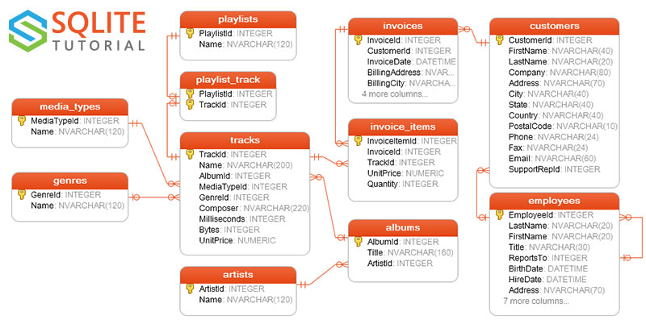

# SQLite 快速入门

2020-06-20, 09:35

***

## 1. 简介

SQLite 是轻量级的关系数据库管理系统，其轻量级体现在设置、数据库管理和所需资源方面。

SQLite 具有自包含、无服务器、零配置等特征。

### Serverless (无服务器)

一般来说，关系型数据库管理系统（RDBMS） 如 MySQL, PostgreSQL 等，需要运行一个独立的服务器进程。访问程序通过 TCP/IP 协议发送和接收请求，即客户端/服务器框架。如下图所示：



SQLite 没有采用这种框架，SQLite 的运行不需要任何服务器。

SQLite 数据库和访问数据库集成在一起，应用程序直接用 SQLite 数据库的数据库文件读写，其结构如下：


### Self-Container (自包含)

自包含，表示SQLite对系统和外部库的依赖极少。这使得 SQLite 可以在任何系统，特别是嵌入式设备，如 iPhone, Android 手机，游戏机，手持媒体播放器中使用。

SQLite 使用 ANSI-C 开发。其源码为一个 `sqlite3.c` 和头文件 `sqlite3.h`。如果需要嵌入 SQLite源码，只需要包含这两个文件即可。

### Zero-configuration (零配置)

SQLite的非服务器框架使其不用安装就可以直接使用，无需配置、启动和终止的服务器进程。

另外，SQLite 不使用任何配置文件。

### Transactional (事务性)

SQLite 的所有事务都是 ACID 兼容的。即所有的查询和修改操作都具备原子性（Atomic）、一致性（Consistent）、隔离型（Isolated）和持久性（Durable）。

换句话说，事物中的所有更改要么全部完成，要么完全不生效。因此在遇到应用程序崩溃、断电或操作系统关机等意外状况，该机制依然有效。

### SQLite 的独有特征

SQLite 数据库表采用动态类型，即每一列都可以存储各种类型的数据。

SQLite 通过单个连接可以访问多个数据库文件，从而可以在不同数据库连接表之间进行复制操作等。

并且，SQLite 可以创建 in-memory 数据库，可以快速访问。

### **何时使用 SQLite**

当你需要简单、快速且占用资源极少时，可以考虑使用 SQLite。例如：

- **嵌入式应用**：SQLite 非常适合需要本地存储数据且无需独立数据库服务器开销的应用，如移动应用和桌面软件。
- **本地存储**：SQLite 适用于需要在本地存储用户偏好、设置或缓存数据的应用。
- **跨平台应用**：由于 SQLite 可在多种平台上运行，它非常适合需要跨平台运行的应用。
- **原型设计与开发**：SQLite 无需复杂的配置，非常适合快速原型设计、开发和测试。
- **物联网（IoT）设备**：物联网设备的资源通常有限。SQLite 非常轻量，因此非常适合物联网设备。

## 2. 下载和安装 SQLite 工具

### 下载 SQLite 工具

访问 SQLite 官方网站的下载页面：

1. 访问 [https://www.sqlite.org](https://www.sqlite.org/) 网站。
2. 打开下载页面 https://www.sqlite.org/download.html。

SQLite 为包括 Windows、Linux 和 Mac 在内的多个平台提供了各种工具。您需要选择一个合适的版本进行下载。

例如，若要在 Windows 上使用 SQLite，您可以下载命令行 Shell 程序，如下图所示：



下载的文件是 ZIP 格式的。

### 运行 SQLite 工具

将 SQLite 工具复制到指定目录中：

1. 首先，创建一个新目录，例如 `C:\sqlite`。
2. 其次，将上一步下载的 ZIP 文件内容解压到 `C:\sqlite` 目录中。解压后，您应该能在 `C:\sqlite` 目录下看到以下 4 个程序，如下图所示：

```
sqlite3_analyzer.exe
sqlite3_rsync.exe
sqldiff.exe
sqlite3.exe
```

1. 首先，打开命令行窗口：

然后，进入 `C:\sqlite` 目录：

```bash
cd sqlite
```

2. 其次，输入 `sqlite3` 并按回车键：

```bash
sqlite3
```

此时将返回以下输出信息：

```text
SQLite version 3.53.4 2026-07-24 19:02:57
Enter ".help" for usage hints.
Connected to a transient in-memory database.
Use ".open FILENAME" to reopen on a persistent database.
sqlite>
```

*(注：原文本中的代码语言标签为格式残留，翻译时已作优化处理)*

3. 接着，您可以在 `sqlite>` 提示符下输入 `.help` 命令，以查看 sqlite3 中所有可用的命令：

```bash
.help
```

输出结果如下：

```text
sqlite> .help
.archive ...             Manage SQL archives
.auth ON|OFF             Show authorizer callbacks
.backup ?DB? FILE        Backup DB (default "main") to FILE
.bail on|off             Stop after hitting an error.  Default OFF
.cd DIRECTORY            Change the working directory to DIRECTORY
...
```

4. 最后，若要退出 `sqlite>` 提示符，请使用 `.quit` 命令：

```bash
.quit
```

### 安装 SQLite 图形界面（GUI）工具

虽然 sqlite3 命令行工具非常好用……

但是，有时您可能希望使用直观的图形界面（GUI）工具来操作 SQLite 数据库。目前市面上有许多用于管理 SQLite 数据库的 GUI 工具可供选择，涵盖了从免费软件到商业授权的各种类型。

#### SQLiteStudio

SQLiteStudio 是一款免费的 SQLite 数据库管理 GUI 工具。它具有免费、便携、直观和跨平台等特点。

此外，该工具还提供了一些操作 SQLite 数据库的核心功能，例如支持导入和导出多种格式的数据，包括 CSV、XML 和 JSON。

您可以访问其下载页面，获取 [SQLiteStudio](https://github.com/pawelsalawa/sqlitestudio/releases) 的安装包或便携版。然后，将下载的文件解压（或安装）到指定目录（例如 `C:\sqlite\gui\`），即可启动该工具。

下图展示了如何启动 SQLiteStudio：



#### 其他 SQLite 图形界面工具

除了 SQLiteStudio，您还可以使用以下免费的 SQLite GUI 工具：

- **DBeaver**：这是一款免费的多平台数据库工具。它支持所有主流的关系型数据库系统，包括 MySQL、PostgreSQL、Oracle、DB2、SQL Server、Sybase 等，当然也包括 SQLite。
- **DB Browser for SQLite**：这是一款开源工具，专门用于管理与 SQLite 兼容的数据库文件。

在本教程中，您已经学习了如何在计算机上下载和安装 SQLite 工具。现在，您应该已经准备好开始使用 SQLite 了。

## 3. SQLite 示例数据库

下面介绍一个名为 Chinook 的 SQLite 示例数据库。接着，我们会提供该示例数据库及其结构图的下载链接。最后，我们将向您演示如何使用 `sqlite3` 工具连接到该示例数据库。

### SQLite 示例数据库简介

这里提供了一个名为 `Chinook` 的 SQLite 示例数据库，非常适合用于 SQLite 的练习。

以下数据库结构图展示了 Chinook 数据库中的表及其相互关系。



Chinook 示例数据库包含 11 张表，具体如下：

- **employees（员工）表**：存储员工数据，如 id、姓氏、名字等。它还包含一个名为 ReportsTo 的字段，用于指定员工之间的汇报关系。
- **customers（客户）表**：存储客户数据。
- **invoices（发票）和 invoice_items（发票明细）表**：这两张表用于存储发票数据。invoices 表存储发票的头部信息，而 invoice_items 表存储发票的明细行数据。
- **artists（艺术家）表**：存储艺术家数据。这是一张简单的表，仅包含 id 和 name 字段。
- **albums（专辑）表**：存储曲目列表的数据。每张专辑只属于一位艺术家，但一位艺术家可以拥有多张专辑。
- **media_types（媒体类型）表**：存储媒体类型，例如 MPEG 音频和 AAC 音频文件。
- **genres（流派）表**：存储音乐流派，例如摇滚、爵士、金属等。
- **tracks（曲目）表**：存储歌曲数据。每首曲目只属于一张专辑。
- **playlists（播放列表）和 playlist_track（播放列表曲目）表**：playlists 表存储播放列表的数据。每个播放列表包含一个曲目列表。每首曲目可以属于多个播放列表。playlists 表和 tracks 表之间是多对多关系，playlist_track 表正是用来体现这种关系的。

### 下载 SQLite 示例数据库

您可以使用以下链接下载 SQLite 示例数据库：

[Download SQLite sample database](https://www.sqlitetutorial.net/wp-content/uploads/2018/03/chinook.zip)

如果您希望参考数据库结构图，可以下载 PDF 格式的黑白版或彩色版。

[Download the SQLite sample database diagram](https://www.sqlitetutorial.net/wp-content/uploads/2018/03/sqlite-sample-database-diagram.pdf)

[Download the SQLite sample database diagram (color version)](https://www.sqlitetutorial.net/wp-content/uploads/2018/03/sqlite-sample-database-diagram-color.pdf)

### 如何连接到 SQLite 示例数据库

示例数据库文件为 ZIP 格式，因此您需要先将其解压到指定目录（例如 `C:\sqlite\`）。解压后的数据库文件名为 `chinook.db`。

1. 在 Windows 上打开命令提示符（Command Prompt），或在类 Unix 系统上打开终端（Terminal），然后进入 `sqlite3`（或 `sqlite3.exe`）文件所在的 SQLite 目录。
2. 使用 `sqlite3` 命令连接到位于同一目录下的 chinook 示例数据库：

```shell
sqlite3 chinook.db
```

此时将显示类似以下的信息：

```javascript
SQLite version 3.53.4 2026-07-24 19:02:57
Enter ".help" for usage hints.
sqlite>
```

3. 接着，使用 `.tables` 命令查看 Chinook 数据库中的所有表：

```css
.tables
```

输出结果如下：

```sql
albums  artists  customers  employees  genres  invoice_items  invoices  media_types  playlist_track  playlists  tracks
```

4. 最后，输入 `.quit` 命令退出 sqlite3 工具：

```css
.quit
```

## 4. SQLite 命令

下面介绍如何使用 sqlite3 命令行工具，通过命令与 SQLite 数据库文件进行交互。

SQLite 项目提供了一个名为 sqlite3（在 Windows 系统上为 sqlite3.exe）的简单命令行工具，使您能够高效地与 SQLite 数据库进行交互。

### 打开 sqlite3 工具

1. 打开终端。

2. 输入 `sqlite3` 命令，如下所示：

```shell
sqlite3
```

输出结果：

```shell
SQLite version 3.53.4 2026-07-24 19:02:57
Enter ".help" for usage hints.
Connected to a transient in-memory database.
Use ".open FILENAME" to reopen on a persistent database.
```

默认情况下，SQLite 会话使用的是内存数据库。这意味着当会话结束时，您所做的所有更改都将丢失。

sqlite3 启动后，会显示以下命令提示符，等待您输入命令：

```shell
sqlite>
```

### 获取帮助

要查看所有可用的 sqlite3 命令及其用途，您可以使用 `.help` 命令，如下所示：

```css
.help
```

> [!NOTE]
>
> 对于以点号（`.`）开头的命令（如 `.help`），不需要在末尾添加分号（`;`）。

### 退出 sqlite3

要退出 sqlite3 程序，您可以使用 `.quit` 命令：

```css
.quit
```

### 创建 SQLite 数据库

如果您启动 sqlite3 时指定的数据库文件不存在，sqlite3 工具会自动创建该数据库。

例如，以下命令会在 `C:\sqlite\db\` 目录下创建一个名为 sales 的数据库：

```css
sqlite3 c:\sqlite\db\sales.db
```

输出结果：

```css
SQLite version 3.44.3 2024-03-24 21:15:01 (UTF-16 console I/O)
Enter ".help" for usage hints.
sqlite>
```

### 使用 sqlite3 打开 SQLite 数据库文件

要打开现有的数据库文件，您可以使用 `.open` 命令：

```css
.open FILENAME
```

其中，`FILENAME` 指定了您想要打开的 SQLite 数据库。

例如，以下语句会打开位于 `c:\sqlite\db\chinook.db` 的 chinook.db 数据库：

首先，在终端中启动 sqlite3 工具：

```shell
sqlite3
```

其次，打开 chinook.db 数据库文件：

```shell
.open c:\sqlite\db\chinook.db
```

如果您希望在连接到 SQLite 数据库时直接打开指定的数据库文件，可以使用以下命令：

```css
sqlite3 c:\sqlite\db\chinook.db
```

输出结果：

```css
SQLite version 3.44.3 2024-03-24 21:15:01 (UTF-16 console I/O)
Enter ".help" for usage hints.
sqlite>
```

### 显示当前数据库

要显示当前连接中的所有数据库，您可以使用 `.databases` 命令。

`.databases` 命令至少会显示一个名为 `main` 的数据库。例如，以下命令会显示当前连接的所有数据库：

```css
.databases
```

输出结果：

```shell
main: c:\sqlite\db\sales.db r/w
```

要将数据库添加到当前连接中，您可以使用 `ATTACH DATABASE` 语句。

例如，以下命令会将 chinook 数据库添加到当前会话中：

```shell
ATTACH DATABASE "c:\sqlite\db\chinook.db" AS chinook;
```

此时，如果您再次运行 `.databases` 命令，sqlite3 将返回两个数据库：`main` 和 `chinook`。

```css
.databases
```

输出结果：

```shell
main: c:\sqlite\db\sales.db r/w
chinook: c:\sqlite\db\chinook.db r/w
```

> [!TIP]
>
> 为了节省输入命令的时间，可以使用键盘上的向上和向下方向键在之前输入过的命令之间进行切换。

### 显示数据库中的表

要显示当前数据库中的所有表，您可以使用 `.tables` 命令：

```css
.tables
```

以下命令演示了如何打开一个到 chinook 数据库的新连接并显示其中的表：

**第一步**：打开 chinook 数据库：

```css
sqlite3 c:\sqlite\db\chinook.db
```

**第二步**：显示所有的表：

```shell
.tables
```

输出结果：

```shell
albums          employees       invoices        playlists
artists         genres          media_types     tracks
customers       invoice_items   playlist_track
```

如果您想根据特定模式查找表，可以使用 `.table pattern` 命令。sqlite3 使用 `LIKE` 运算符进行模式匹配。

例如，以下语句会返回以字符串 `es` 结尾的表：

```javascript
.table '%es'
```

输出结果：

```shell
employees    genres       invoices     media_types
```

### 显示表结构

要显示表的结构，您可以使用 `.schema TABLE` 命令：

```css
.schema TABLE
```

`TABLE` 参数可以是表名，也可以是指定一个或多个表的模式匹配。例如，以下命令显示了 `albums` 表的结构：

```css
.schema albums
```

输出结果：

```css
CREATE TABLE IF NOT EXISTS "albums"
(
    [AlbumId] INTEGER PRIMARY KEY AUTOINCREMENT NOT NULL,
    [Title] NVARCHAR(160)  NOT NULL,
    [ArtistId] INTEGER  NOT NULL,
    FOREIGN KEY ([ArtistId]) REFERENCES "artists" ([ArtistId])
                ON DELETE NO ACTION ON UPDATE NO ACTION
);
CREATE INDEX [IFK_AlbumArtistId] ON "albums" ([ArtistId]);
```

如果省略 `TABLE` 参数，`.schema` 命令将显示所有表的结构：

```css
.schema
```

要显示 `sqlite_stat` 表的结构及其内容，您可以使用 `.fullschema` 命令：

```css
.fullschema
```

### 显示索引

要显示当前数据库中的所有索引，您可以使用 `.indexes` 命令，如下所示：

```css
.indexes
```

输出结果：

```shell
IFK_AlbumArtistId                  IFK_PlaylistTrackTrackId
IFK_CustomerSupportRepId           IFK_TrackAlbumId
IFK_EmployeeReportsTo              IFK_TrackGenreId
IFK_InvoiceCustomerId              IFK_TrackMediaTypeId
IFK_InvoiceLineInvoiceId           sqlite_autoindex_playlist_track_1
IFK_InvoiceLineTrackId
```

如果您对索引不太熟悉，可以在 SQLite 索引教程中了解相关内容。

要显示特定表的索引，您可以使用 `.indexes TABLE` 命令：

```css
.indexes TABLE
```

例如，要显示 `albums` 表的索引，您可以使用以下命令：

```css
.indexes albums
```

输出结果：

```shell
IFK_AlbumArtistId
```

### 执行 SQL 语句

要执行 SQL 语句，您可以在 `sqlite>` 命令提示符下输入语句并按回车键，以开始新的一行：

```shell
sqlite> select *
      > (在此输入下一个子句)
```

一旦您使用分号（`;`）结束该 SQL 语句并按下回车键，sqlite3 就会执行该语句。

例如：

```javascript
sqlite> select *
   ...> from albums
   ...> order by AlbumId
   ...> limit 3;
```

输出结果：

```javascript
1|For Those About To Rock We Salute You|1
2|Balls to the Wall|2
3|Restless and Wild|2
```

这种默认的输出格式不够清晰。

### 格式化查询输出

要格式化查询的输出结果，您可以执行以下命令：

```css
.mode column
.header on
.nullvalue NULL
```

- `.mode` 命令将输出模式设置为列对齐（column）。
- `.header` 命令用于在输出结果中显示列名。
- `.nullvalue` 命令用于设置代表 `NULL` 值的字符串。

如果您再次执行上述查询，将会看到格式美观的输出结果：

```javascript
sqlite> select *
   ...> from albums
   ...> order by AlbumId
   ...> limit 3;
```

输出结果：

```javascript
AlbumId  Title
-------  -------------------------------------
1        For Those About To Rock We Salute You
2        Balls to the Wall
3        Restless and Wild
```

## 参考

- https://www.sqlitetutorial.net/what-is-sqlite/
