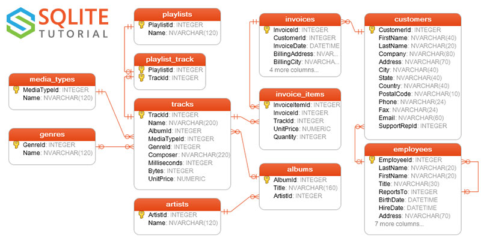
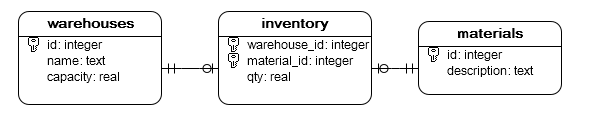
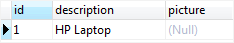
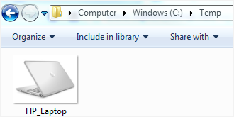
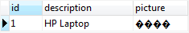
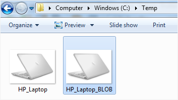

# SQLite Java

2026-09-07⭐
@author Jiawei Mao
***
## 简介

下面介绍如何使用 Java JDBC API 与 SQLite 进行交互。

在 Java 中，有多种接口可用于与 SQLite 交互。其中一些是对原生 C API 的封装，而另一些则实现了标准的 Java 数据库连接（JDBC）API。

下面介绍现代的 SQLite JDBC 包，这是一款专为 SQLite 打造的 JDBC 驱动程序。该 SQLite JDBC 包不仅包含了相关的 Java 类，还**内置了**适用于 Windows、macOS 和 Linux 系统的原生 SQLite 库。

## 1. 连接 SQLite


### 1.1 下载 SQLite JDBC 驱动

2026-09-01：**https://mvnrepository.com/artifact/org.xerial/sqlite-jdbc**

当前最新 SQLite JDBC

```xml
<dependency>
    <groupId>org.xerial</groupId>
    <artifactId>sqlite-jdbc</artifactId>
    <version>3.53.4.0</version>
    <scope>compile</scope>
</dependency>
```

sqlite-jdbc 包含 SQLite 和 Java 接口类。

### 1.2 SQLite 连接格式

可以使用如下格式在 SQLite JDBC 中连接 SQLite 数据库文件：

```java
jdbc:sqlite:sqlite_database_file_path
```

其中 `sqlite_database_file_path` 是 SQLite 数据库文件的路径，可以是相对路径：

```txt
jdbc:sqlite:sample.db
```

也可以是绝对路径：

```txt
jdbc:sqlite:C:/sqlite/db/chinook.db
```

也可以连接内存中数据库：

```txt
jdbc:sqlite::memory:
```

### 1.3 使用 JDBC 连接数据库

连接 `chinook.db` 文件指向的数据库：

```java
public class SQLiteDemo {

    public static void connect() {
        URL fileURL = SQLiteDemo.class.getResource("chinook.db");
        String url = "jdbc:sqlite:"+fileURL.getPath(); // 数据库路径
        try (var conn = DriverManager.getConnection(url)) { // 连接数据库
            System.out.println("Connection to SQLite has been established.");
        } catch (SQLException e) {
            System.out.println(e.getMessage());
        }
    }

    static void main() {
        connect();
    }
}
```

样例数据库 `chinook.db` 包含 13 个表格。



## 2. 创建新的数据库

在 Java 中创建 SQLite 数据库分两步：

1. 指定数据库文件名称和路径
2. 通过 SQLite JDBC driver 连接数据库

当连接的数据库不存在，SQLite会自动创建一个新的数据库。所以，创建新的数据库，只需要指定数据库名称，然后连接即可，和连接数据库语法一样。

例如，创建一个 `test.db` 数据库：

```java
String url = "jdbc:sqlite:D:\\code\\test\\test.db";
try (Connection conn = DriverManager.getConnection(url)) {
    if (conn != null) {
        DatabaseMetaData metaData = conn.getMetaData();
        assertEquals(metaData.getDriverName(), "SQLite JDBC");
    }
} catch (SQLException e) {
    System.out.println(e.getMessage());
}
```


## 3. Create Table

创建表格步骤：

1. 准备好 `CREATE TABLE` 语句
2. 连接数据库
3. 使用 `Connection` 对象创建 `Statement`
4. 使用 `Statement` 的 `executeUpdate()` 方法执行 `CREATE TABLE` 语句

例如：

```java
String url = "jdbc:sqlite:D:\\code\\test\\tests.db";
String sql = "CREATE TABLE IF NOT EXISTS warehouses (" +
        "id integer PRIMARY KEY, " +
        "name text NOT NULL, " +
        "capacity real);";
try (Connection conn = DriverManager.getConnection(url);
        Statement stmt = conn.createStatement()) {
    stmt.execute(sql);
} catch (SQLException e) {
    e.printStackTrace();
}
```

## 4. 插入数据

使用 `INSERT` 语句插入数据到表格，步骤如下：

1. 连接 SQLite 数据库
2. 准备 `INSERT` 语句。如果语句中包含参数，请使用 `?` 占位符
3. 使用 `Connection` 对象创建 `PreparedStatement`
4. 使用 `PreparedStatement` 的 `setInt()`, `setString()` 等方法为每个占位符设置对应值
5. 执行 `executeUpdate()` 方法

例如，下面在 `warehouses` 中插入三行：

```java
String url = "jdbc:sqlite:test.db";
String[] names = new String[]{"Raw Materials", "Semifinished Goods", "Finished Goods"};
int[] capacities = new int[]{3000, 4000, 5000};

String sql = "INSERT INTO warehouses (name, capacity) VALUES (?, ?)";
try (var conn = DriverManager.getConnection(url);
     var pstmt = conn.prepareStatement(sql)) {
    for (int i = 0; i < 3; i++) {
        pstmt.setString(1, names[i]);
        pstmt.setDouble(2, capacities[i]);
        pstmt.executeUpdate();
    }
} catch (SQLException e) {
    System.err.println(e.getMessage());
}
```

这段文本主要讲解了如何验证数据是否成功插入，为您翻译如下：

**验证插入结果**

程序运行完毕后，你可以使用以下 `SELECT` 语句来检查 `test.db` 数据库中的 `warehouses` 表：

```sql
SELECT
  id,
  name,
  capacity
FROM
  warehouses;
```

输出结果：

```text
id  name                capacity
--  ------------------  --------
1   Raw Materials       3000.0
2   Semifinished Goods  4000.0
3   Finished Goods      5000.0
```

## 5. 更新数据

按如下步骤通过 Java 程序使用 JDBC 更新表中的数据：

1. 连接 SQLite 数据库
2. 准备 `UPDATE` 语句。对于带参数的 `UPDATE` 语句，需要在 `SET` 和 `WHERE` 子句中使用问号（`?`）作为占位符。
3. 通过调用 `Connection` 对象的 `prepareStatement()` 方法，创建 `PreparedStatement` 实例。
4. 使用 `PreparedStatement` 对象的 `set*` 方法（例如 `setString()`、`setInt()` 等）为每个占位符设置对应的值。
5. 调用 `PreparedStatement` 对象的 `executeUpdate()` 方法来执行该 `UPDATE` 语句。

以下 Java 程序演示了如何更新 id 为 3 的仓库的名称和容量：

```java
import java.sql.DriverManager;
import java.sql.SQLException;

public class Main {
    public static void main(String[] args) {
        var url = "jdbc:sqlite:my.db";
        var sql = "UPDATE warehouses SET name = ? , "
                + "capacity = ? "
                + "WHERE id = ?";

        var name = "Finished Products";
        var capacity = 5500;
        var id = 3;

        try (var conn = DriverManager.getConnection(url);
             var pstmt = conn.prepareStatement(sql)) {
            // set the parameters
            pstmt.setString(1, name);
            pstmt.setDouble(2, capacity);
            pstmt.setInt(3, id);
            // update
            pstmt.executeUpdate();
        } catch (SQLException e) {
            System.err.println(e.getMessage());
        }
    }
}
```

## 6. 查询数据

按以下步骤从表中查询数据：

1. 创建一个 `Connection` 对象连接到 SQLite 数据库。
2. 通过该 `Connection` 对象创建一个 `Statement` 类的实例。
3. 调用 `Statement` 对象的 `executeQuery()` 方法来创建一个 `ResultSet` 类的实例。`executeQuery()` 方法接收一个 `SELECT` 语句作为参数。
4. 使用 `ResultSet` 对象的 `next()` 方法遍历结果集。
5. 在每次遍历（迭代）中，使用 `ResultSet` 对象的 `get*` 方法（如 `getInt()`、`getString()`、`getDouble()` 等）来获取数据。

### 查询所有 rows

以下程序从 `warehouses`（仓库）表中查询所有行（数据）。

```java
import java.sql.DriverManager;
import java.sql.SQLException;

public class Main {
    public static void main(String[] args) {
        var url = "jdbc:sqlite:my.db";
        var sql = "SELECT id, name, capacity FROM warehouses";

        try (var conn = DriverManager.getConnection(url);
             var stmt = conn.createStatement();
             var rs = stmt.executeQuery(sql)) {

            while (rs.next()) {
                System.out.printf("%-5s%-25s%-10s%n",
                        rs.getInt("id"),
                        rs.getString("name"),
                        rs.getDouble("capacity")
                );
            }
        } catch (SQLException e) {
            System.err.println(e.getMessage());
        }
    }
}
```

### 使用参数查询数据

以下程序将检索出容量（capacity）大于 3600 的仓库。

```java
import java.sql.DriverManager;
import java.sql.SQLException;

public class Main {
    public static void main(String[] args) {
        var url = "jdbc:sqlite:my.db";
        var sql = "SELECT id, name, capacity FROM warehouses WHERE capacity > ?";
        var capacity = 3600;

        try (var conn = DriverManager.getConnection(url);
             var pstmt = conn.prepareStatement(sql)) {

            pstmt.setDouble(1, capacity);

            var rs = pstmt.executeQuery();

            while (rs.next()) {
                System.out.printf("%-5s%-25s%-10s%n",
                        rs.getInt("id"),
                        rs.getString("name"),
                        rs.getDouble("capacity")
                );
            }
        } catch (SQLException e) {
            System.err.println(e.getMessage());
        }
    }
}
```

## 7. 删除数据

按以下步骤从 Java 程序中删除数据库表中的一行或多行数据：

1. 创建到 SQLite 数据库的连接。
2. 准备 `DELETE` 语句。如果你希望该语句包含参数，请在语句中使用问号（`?`）作为占位符。
3. 调用 `Connection` 对象的 `prepareStatement()` 方法，创建一个 `PreparedStatement` 类的新实例。
4. 使用 `PreparedStatement` 对象的 `set*` 方法（如 `setInt()`、`setString()` 等）为问号占位符提供具体的值。
5. 调用 `PreparedStatement` 对象的 `executeUpdate()` 方法来执行该 `DELETE` 语句。

以下程序将删除我们在“创建表”教程中创建的 `my.db` 数据库里 `warehouses`（仓库）表中 id 为 3 的仓库记录。

```java
import java.sql.DriverManager;
import java.sql.SQLException;

public class Main {
    public static void main(String[] args) {
        var url = "jdbc:sqlite:my.db";
        var sql = "DELETE FROM warehouses WHERE id = ?";
        var id = 3;

        try (var conn = DriverManager.getConnection(url);
             var pstmt = conn.prepareStatement(sql)) {

            pstmt.setInt(1, id);

            // execute the delete statement
            pstmt.executeUpdate();

        } catch (SQLException e) {
            System.err.println(e.getMessage());
        }
    }
}
```

## 8. 管理事物

下面介绍使用 JDBC API 来管理 SQLite 数据库中的事务。

### 用于演示事务的示例数据库

我们在 `my.db` 数据库中再创建两张新表：

1. `materials`（物料）表用于存储物料信息。
2. `inventory`（库存）表用于存储仓库与物料表之间的关系。此外，`inventory` 表还包含一个 `qty` 列，用于存储数量。

以下语句用于创建 `materials` 表和 `inventory` 表：

```sql
CREATE TABLE materials (
    id INTEGER PRIMARY KEY, 
    description TEXT NOT NULL
);

CREATE TABLE inventory (
    warehouse_id INTEGER,
    material_id INTEGER,
    qty REAL,
    PRIMARY KEY (warehouse_id, material_id),
    FOREIGN KEY (warehouse_id) REFERENCES warehouses (id),
    FOREIGN KEY (material_id) REFERENCES materials (id)
);
```

下图展示了这些表及其相互关系：



### 数据库事务简介

事务代表作为单一工作单元执行的一组操作。换句话说，如果这组操作中的任何一个操作失败，SQLite 就会中止其他操作，并将数据回滚到其初始状态。

事务具有四个属性，通常被称为 **ACID**：

- 字母 **A** 代表**原子性（Atomicity）**。它意味着每个事务必须是“全有或全无”的。如果事务中的任何操作失败，数据库的状态将保持不变。
- 字母 **C** 代表**一致性（Consistency）**。它确保任何事务都会将数据库中的数据从一个有效状态带入另一个有效状态。
- 字母 **I** 代表**隔离性（Isolation）**。这是用于并发控制的。它确保所有并发执行的事务产生的结果，与它们按顺序执行的结果相同。
- 字母 **D** 代表**持久性（Durability）**。它意味着当事务被提交后，无论发生任何错误（如断电），它都将保持完整。

### Java SQLite 事务示例

当你使用 JDBC 连接到 SQLite 数据库时，默认会启用自动提交（auto-commit）模式。这意味着每个查询都会被自动提交。

要禁用自动提交模式，你可以使用 `Connection` 对象的 `setAutoCommit()` 方法，如下所示：

```java
conn.setAutoCommit(false);
```

要提交事务，你可以使用 `Connection` 对象的 `commit()` 方法：

```java
conn.commit();
```

如果发生错误，你可以使用 `Connection` 对象的 `rollback()` 方法将事务回滚：

```java
conn.rollback();
```

以下程序在同一个事务中向 `materials` 表添加新物料，并录入相应的库存：

```java
import java.sql.*;

public class Main {
    public void addInventory(String material, int warehouseId, double qty) {
        String url = "jdbc:sqlite:my.db";

        // 存储插入的物料 ID
        int materialId = 0;
        // 连接到 SQLite 数据库
        try (var conn = DriverManager.getConnection(url)) {
            // 禁用自动提交模式
            conn.setAutoCommit(false);

            // 插入新物料
            try (var pstmt1 = conn.prepareStatement("INSERT INTO materials(description) VALUES(?)")) {
                pstmt1.setString(1, material);
                pstmt1.executeUpdate();

            } catch (SQLException e) {
                conn.rollback();
            }

            // 获取插入的物料 ID
            try (var stmt = conn.createStatement()) {
                var generatedKeys = stmt.executeQuery("SELECT last_insert_rowid()");

                if (generatedKeys.next()) {
                    materialId = generatedKeys.getInt(1);
                }
            } catch (SQLException e) {
                conn.rollback();
            }

            // 插入库存记录
            try (var pstmt2 = conn.prepareStatement("INSERT INTO inventory(warehouse_id,material_id,qty) VALUES(?,?,?)")) {
                pstmt2.setInt(1, warehouseId);
                pstmt2.setInt(2, materialId);
                pstmt2.setDouble(3, qty);
                pstmt2.executeUpdate();
            } catch (SQLException e) {
                conn.rollback();
            }

            // 提交工作
            conn.commit();
        } catch (SQLException e){
            e.printStackTrace();
        }
    }

    public static void main(String[] args) {
        var app = new Main();
        app.addInventory("HP Laptop", 3, 100);
    }
}
```

要检查结果，你可以使用 `INNER JOIN` 子句从 `materials` 表和 `inventory` 表中查询数据，如下所示：

```sql
SELECT
  name,
  description,
  qty
FROM
  materials
  INNER JOIN inventory ON inventory.material_id = materials.id
  INNER JOIN warehouses ON warehouses.id = inventory.warehouse_id;
```

输出结果：

```text
name           description  qty
-------------  -----------  -----
Raw Materials  HP Laptop    100.0
```

## 9. BLOB

下面介绍如何更新和从 SQLite 数据库中选择 BLOB 数据。

为了演示，我们将使用在“创建表”教程中创建的 `materials`（材料）表。

假设我们需要为 `materials` 表中的每种材料存储一张图片。为此，需要向 `materials` 表中添加一个数据类型为 `BLOB` 的列。

以下 `ALTER TABLE` 语句向 `materials` 表添加了 `picture`（图片）列：

```sql
ALTER TABLE materials ADD COLUMN picture blob;
```

### 将 BLOB 数据插入 SQLite 数据库

**首先**，查询 `materials` 表中的数据以查看其内容：

```sql
SELECT
	id,
	description,
	picture
FROM
	materials;
```



`picture` 列目前是 `NULL`。

**然后**，准备一个图片文件并将其放置在文件夹中，例如 `C:\temp`，如下所示：




要使用图片文件中的数据更新 `picture` 列：

1. 首先，准备一个 `UPDATE` 语句。
2. 其次，连接到 SQLite 数据库以获取 `Connection` 对象。
3. 然后，从 `Connection` 对象创建一个 `PreparedStatement` 对象。
4. 接着，使用 `PreparedStatement` 对象的 `set*` 方法为相应的参数提供值。
5. 最后，通过调用 `PreparedStatement` 对象的 `executeUpdate()` 方法来执行 `UPDATE` 语句。

> **注意**：SQLiteJDBC 驱动程序没有实现 `setBinaryStream()` 方法，因此，你必须改用 `setBytes` 方法。

以下 `readFile` 方法读取一个文件并返回一个字节数组，我们可以将其传递给 `setBytes` 方法。

```java
/**
 * Read the file and returns the byte array
 * @param file
 * @return the bytes of the file
 */
private byte[] readFile(String file) {
    ByteArrayOutputStream bos = null;
    try {
        File f = new File(file);
        FileInputStream fis = new FileInputStream(f);
        byte[] buffer = new byte[1024];
        bos = new ByteArrayOutputStream();
        for (int len; (len = fis.read(buffer)) != -1;) {
            bos.write(buffer, 0, len);
        }
    } catch (FileNotFoundException e) {
        System.err.println(e.getMessage());
    } catch (IOException e2) {
        System.err.println(e2.getMessage());
    }
    return bos != null ? bos.toByteArray() : null;
}
```

要连接到 `test.db` 数据库，你可以使用如下所示的 `connect()` 方法：

```java
/**
 * Connect to the test.db database
 *
 * @return the Connection object
 */
private Connection connect() {
    // SQLite connection string
    String url = "jdbc:sqlite:C://sqlite/db/test.db";
    Connection conn = null;
    try {
        conn = DriverManager.getConnection(url);
    } catch (SQLException e) {
        System.out.println(e.getMessage());
    }
    return conn;
}
```

以下 `updatePicture()` 方法为特定材料更新由文件名指定的图片。

```java
/**
 * Update picture for a specific material
 *
 * @param materialId
 * @param filename
 */
public void updatePicture(int materialId, String filename) {
    // update sql
    String updateSQL = "UPDATE materials "
            + "SET picture = ? "
            + "WHERE id=?";

    try (Connection conn = connect();
            PreparedStatement pstmt = conn.prepareStatement(updateSQL)) {

        // set parameters
        pstmt.setBytes(1, readFile(filename));
        pstmt.setInt(2, materialId);

        pstmt.executeUpdate();
        System.out.println("Stored the file in the BLOB column.");

    } catch (SQLException e) {
        System.out.println(e.getMessage());
    }
}
```

要为材料 ID 1 更新图片，你可以使用以下代码：

```java
package net.sqlitetutorial;

import java.io.ByteArrayOutputStream;
import java.io.File;
import java.io.FileInputStream;
import java.io.FileNotFoundException;
import java.io.FileOutputStream;
import java.io.IOException;
import java.io.InputStream;
import java.sql.Connection;
import java.sql.DriverManager;
import java.sql.PreparedStatement;
import java.sql.ResultSet;
import java.sql.SQLException;

/**
 *
 * @author sqlitetutorial.net
 */
public class BLOBApp {
    private Connection connect() {
        //...
    }
 
    private byte[] readFile(String file) {
       //...
    }
   
    public void updatePicture(int materialId, String filename) {
        //...
    }

     /**
     * @param args the command line arguments
     */
    public static void main(String[] args) {
        BLOBApp app = new BLOBApp();
        app.updatePicture(1, "c:\\temp\\HP_Laptop.jpg");
    }
}
```

注意：我们没有重复我们已经提到过的方法的主体。

让我们执行程序并再次检查 `materials` 表。



它按预期工作。

### 从 SQLite 查询 BLOB 数据

以下步骤向你展示如何从 SQLite 数据库查询 BLOB 数据：

1. 准备一个 `SELECT` 语句。
2. 通过连接到 SQLite 数据库创建一个 `Connection` 对象。
3. 从 `Connection` 对象创建 `PreparedStatement` 类的实例。使用 `PreparedStatement` 对象的 `set*` 方法为参数提供值。
4. 调用 `PreparedStatement` 对象的 `executeQuery` 方法以获取 `ResultSet` 对象。
5. 遍历结果集，使用 `getBinaryStream()` 方法获取数据，并使用 `FileOutputStream` 对象将数据保存到文件中。

以下 `readPicture` 方法选择特定材料的 BLOB 数据并将其保存到文件中。

```java
/**
 * read the picture file and insert into the material master table
 *
 * @param materialId
 * @param filename
 */
public void readPicture(int materialId, String filename) {
    // update sql
    String selectSQL = "SELECT picture FROM materials WHERE id=?";
    ResultSet rs = null;
    FileOutputStream fos = null;
    Connection conn = null;
    PreparedStatement pstmt = null;

    try {
        conn = connect();
        pstmt = conn.prepareStatement(selectSQL);
        pstmt.setInt(1, materialId);
        rs = pstmt.executeQuery();

        // write binary stream into file
        File file = new File(filename);
        fos = new FileOutputStream(file);

        System.out.println("Writing BLOB to file " + file.getAbsolutePath());
        while (rs.next()) {
            InputStream input = rs.getBinaryStream("picture");
            byte[] buffer = new byte[1024];
            while (input.read(buffer) > 0) {
                fos.write(buffer);
            }
        }
    } catch (SQLException | IOException e) {
        System.out.println(e.getMessage());
    } finally {
        try {
            if (rs != null) {
                rs.close();
            }
            if (pstmt != null) {
                pstmt.close();
            }

            if (conn != null) {
                conn.close();
            }
            if (fos != null) {
                fos.close();
            }

        } catch (SQLException | IOException e) {
            System.out.println(e.getMessage());
        }
    }
}
```

例如，我们可以使用 `readPicture()` 方法获取我们为材料 ID 1 更新的 BLOB 数据，并将其保存到名为 `HP_Laptop_From_BLOB.jpg` 的文件中。

```java
app.readPicture(1, "c:\\temp\\HP_Laptop_BLOB.jpg");
```

我们执行程序并检查 `c:\\temp` 文件夹：


