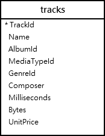
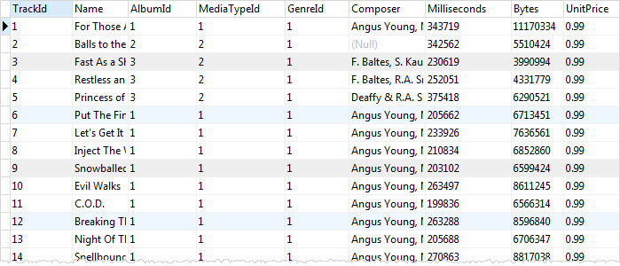
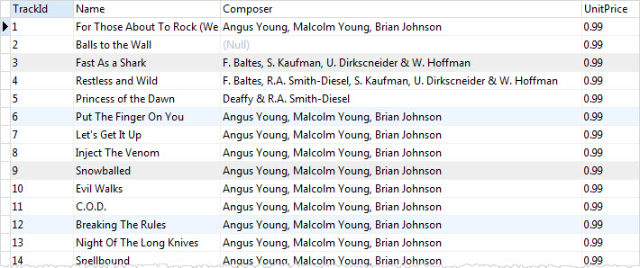

# SQLite 教程

## 简介

下面介绍可以在 SQLite 中使用的基本 SQL 语句。首先从示例数据库中查询数据。如果您已经熟悉 SQL，您会发现 SQL 标准与 SQLite 中使用的 SQL 方言之间存在一些差异。

## 1. 简单查询

- Select（查询）—— 使用 SELECT 语句从单张表中查询数据。

### SELECT

`SELECT` 语句是 SQL 中最常用的语句之一。SQLite 的 `SELECT` 语句提供了 SQL 标准中 `SELECT` 语句的所有功能。

#### SELECT 语句的简单用法

以下示例展示了如何使用 SELECT 语句来执行简单的计算：

```sql
sqlite> SELECT 1 + 1;
╭─────╮
│ 1+1 │
╞═════╡
│   2 │
╰─────╯
```

SELECT 语句支持使用多个表达式，示例如下：

```sql
sqlite> SELECT
   ...> 10/5,
   ...> 2 * 4;
╭──────┬───────╮
│ 10/5 │ 2 * 4 │
╞══════╪═══════╡
│    2 │     8 │
╰──────┴───────╯
```

#### 使用 SELECT 语句从表中查询数据

我们通常使用 `SELECT` 语句从一个或多个表中查询数据。

以下是 `SELECT` 语句的语法：

```sql
SELECT DISTINCT column_list
FROM table_list
  JOIN table ON join_condition
WHERE row_filter
ORDER BY column
LIMIT count OFFSET offset
GROUP BY column
HAVING group_filter;
```

`SELECT` 语句是 SQLite 中最复杂的语句。为了便于理解各个部分，我们将把 `SELECT` 语句拆分为多个易于理解的教程：

- 使用 `ORDER BY` 子句对结果集进行排序。
- 使用 `DISTINCT` 子句查询表中的唯一行。
- 使用 `WHERE` 子句过滤结果集中的行。
- 使用 `LIMIT OFFSET` 子句限制返回的行数。
- 使用 `INNER JOIN` 或 `LEFT JOIN` 通过连接从多个表中查询数据。
- 使用 `GROUP BY` 子句将行分组，并对每个组应用聚合函数。
- 使用 `HAVING` 子句过滤分组。

在本教程中，我们将重点介绍 `SELECT` 语句最简单的形式，它允许您从单个表中查询数据：

```sql
SELECT column_list
FROM table;
```

尽管 `SELECT` 子句在语法上出现在 `FROM` 子句之前，但 SQLite 会先计算 `FROM` 子句，然后再计算 `SELECT` 子句。因此：

1. 首先，在 `FROM` 子句中指定要获取数据的表。请注意，`FROM` 子句中可以包含多个表，我们将在后续教程中讨论这一点。
2. 其次，在 `SELECT` 子句中指定一个列名，或者指定多个以逗号分隔的列名。
3. 最后，使用分号（`;`）来结束该语句。

#### SQLite SELECT 语句示例

让我们来看看示例数据库中的 `tracks`（曲目）表。



`tracks` 表包含列和行，其外观类似于电子表格。



要从 `tracks` 表中获取诸如曲目 ID（trackid）、曲目名称（name）、作曲者（composer）和单价（unitprice）等数据，您可以使用以下语句：

```sql
SELECT
	trackid,
	name,
	composer,
	unitprice
FROM
	tracks;
```

您在 `SELECT` 子句中指定需要获取数据的列名列表，并在 `FROM` 子句中指定 `tracks` 表。SQLite 将返回以下结果：



如果要获取所有列的数据，您可以在 `SELECT` 子句中指定 `tracks` 表的所有列，如下所示：

```sql
SELECT
	trackid,
	name,
	albumid,
	mediatypeid,
	genreid,
	composer,
	milliseconds,
	bytes,
	unitprice
FROM
	tracks;
```

对于包含许多列的表，这样写出的查询语句会非常长，输入起来也很耗时。为了避免这种情况，您可以使用星号（`*`），它是表中所有列的简写形式，如下所示：

```sql
SELECT * FROM tracks;
```

这样，查询语句就变得简短且整洁了。

**然而……**

您应该**仅将星号（`\*`）用于测试目的**，而**不要在应用程序开发中使用**。

**原因在于……**

在开发应用程序时，您应当明确控制 SQLite 返回给应用程序的数据。假设一个表有 3 列，并且您使用星号（`*`）来检索这 3 列的数据。

如果有人删除了其中一列，您的应用程序将无法正常工作，因为它仍假定会返回 3 列，而处理这 3 列的逻辑就会崩溃。

如果有人增加了更多的列，您的应用程序虽然可能仍能运行，但它会获取到超出所需的数据，这会在数据库和应用程序之间产生额外的 I/O 开销。

因此，在使用 `SELECT` 语句时，请尽量**避免使用星号（`*`）**。

## 2. 对行进行排序

- Order By（排序）—— 将结果按升序或降序进行排列。

### Order By

下面介绍如何使用 SQLite 的 `ORDER BY` 子句对查询结果集进行排序。

SQLite 以未指定的顺序存储表中的行。这意味着表中的行可能按照插入的顺序排列，也可能不是。

如果您使用 `SELECT` 语句从表中检索行，结果集中行的顺序也是未指定的。

要对结果集中的行进行排序，您可以在 `SELECT` 语句中添加 `ORDER BY` 子句，如下所示：

```sql
SELECT
   select_list
FROM
   table
ORDER BY
    column_1 ASC,
    column_2 DESC;
```

`ORDER BY` 子句位于 `FROM` 子句之后。它允许您根据一个或多个列，按升序或降序对结果集进行排序。

在这种语法中，您需要将用于排序的列名放在 `ORDER BY` 子句之后，并紧跟 `ASC` 或 `DESC` 关键字。

- `ASC` 关键字表示升序（Ascending）。
- `DESC` 关键字表示降序（Descending）。

如果您没有指定 `ASC` 或 `DESC` 关键字，SQLite 将默认使用 `ASC` 选项。换句话说，它默认按升序对结果集进行排序。

如果您想按多个列对结果集进行排序，请使用逗号（`,`）将各个列隔开。

`ORDER BY` 子句会按照从左到右的顺序，使用指定的列或表达式对行进行排序。换句话说，`ORDER BY` 子句首先使用列表中的第一列对行进行排序；然后，再使用第二列对已排序的行进行排序，依此类推。

SQLite 允许您使用未出现在 `SELECT` 子句查询列表中的列来对结果集进行排序。